

<h1>🚀 3DSM-ABP-UNDEFINED — GreenER</h1>

    Este repositório contém o desenvolvimento do projeto interdisciplinar da disciplina de
    <strong>Aprendizagem Baseada em Projetos (ABP)</strong> do 3º semestre do curso de
    <strong>Desenvolvimento de Software Multiplataforma</strong> da FATEC Jacareí.

<h2>📌 Sumário</h2>
<ul>
    <li><a href="#sobre">🌱 Sobre o Projeto</a></li>
    <li><a href="#tecnologias">🛠️ Tecnologias Utilizadas</a></li>
    <li><a href="#arquitetura">🏗️ Arquitetura e Modelo de Dados (ER)</a></li>
    <li><a href="#comorodar">🚀 Como Rodar o Projeto e Configurar APIs Externas</a></li>
    <li><a href="#api-endpoints">🔌 Endpoints e Swagger</a></li>
    <li><a href="#ci-testes">✅ CI e Testes</a></li>
    <li><a href="#telas-evidencias">🖼️ Telas Principais e Evidências</a></li>
    <li><a href="#requisitos">📑 Requisitos</a></li>
    <li><a href="#userstories">📝 User Stories</a></li>
    <li><a href="#planejamento-de-sprints">🚀 Planejamento de Sprints</a></li>
    <li><a href="#documentacao">🖺 Documentação</a></li>
    <li><a href="#integrantes">🧑‍💻 Integrantes</a></li>
</ul>

<h2>📎 Links</h2>
<ul>
    <li>
        <strong>Demonstração Online (GitHub Pages):</strong>
        <a href="https://abpundefined.github.io/3DSM-ABP-UNDEFINED/" target="_blank">Acessar Demonstração Interativa</a>
        (<a href="https://abpundefined.github.io/3DSM-ABP-UNDEFINED/qr-code" target="_blank">QR Code para impressão</a>)
    </li>
    <li>
        <strong>GitHub Projects (Kanban):</strong>
        <a href="https://github.com/users/abpundefined/projects/2" target="_blank">Acessar Kanban</a>
    </li>
    <li>
        <strong>Figma:</strong>
        <a href="https://www.figma.com/design/CzTTbJAFqZrm2eUIBTSCNl/Undefined-FatecABP-GreenER?node-id=0-1" target="_blank">Acessar Figma</a>
    </li>
    <li>
        <strong>GreenER Metrics Aggregator API:</strong>
        <a href="https://metrics.unilaunch.org/docs" target="_blank">Acessar Documentação</a>
    </li>
    <li>
        <strong>GreenER Carbon Intensity API:</strong>
        <a href="https://carbon.unilaunch.org/docs" target="_blank">Acessar Documentação</a>
    </li>
</ul>

<h2 id="sobre">🌱 Sobre o Projeto</h2>

    O <strong>GreenER</strong> é uma plataforma web voltada para monitorar continuamente aplicações de software,
    estimar o consumo energético de recursos computacionais e calcular a emissão aproximada de dióxido de carbono
    equivalente (CO₂e). A plataforma visa apoiar decisões de sustentabilidade baseadas em práticas de Green Computing e ESG.

<h2 id="tecnologias">🛠️ Tecnologias Utilizadas</h2>

O desenvolvimento será realizado com as seguintes tecnologias, visando escalabilidade, manutenibilidade e confiabilidade:

<h3>🔧 Stack Principal</h3>
<ul>
    <li> React</li>
    <li> TypeScript</li>
    <li> NestJS</li>
    <li> PostgreSQL</li>
    <li>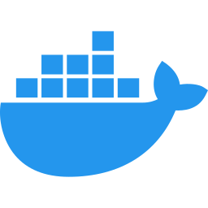 Docker & Docker Compose</li>
</ul>

<h2 id="arquitetura">🏗️ Arquitetura e Modelo de Dados (ER)</h2>

O sistema segue uma arquitetura modular dividida em SPA React/TypeScript, API REST NestJS/TypeScript com Prisma ORM e banco relacional PostgreSQL, consumindo o Agregador de Métricas e a API de Intensidade de Carbono. Detalhes completos em <a href="./docs/arquitetura.md">docs/arquitetura.md</a>.

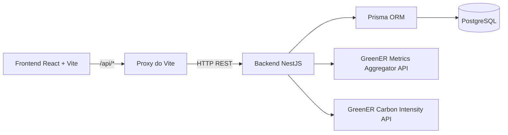

<h3>🗃️ Diagrama Entidade-Relacionamento (Prisma)</h3>

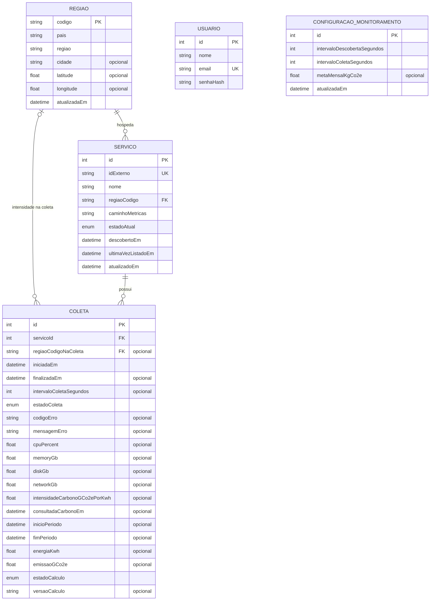

<h2 id="comorodar">🚀 Como Rodar o Projeto e Configurar APIs Externas</h2>

<h3>1. Configuração de Variáveis e APIs Externas (<code>.env</code>)</h3>

Na raiz do repositório, crie seu arquivo de ambiente a partir do modelo:

<pre><code>Copy-Item .env.example .env
</code></pre>

Preencha também <code>DB_PORT</code>, <code>DB_USER</code>, <code>DB_PASS</code> e <code>DB_NAME</code>, que vêm vazios no modelo e são usados pelo Compose para criar o banco (exemplo em <a href="./docs/execucao.md">docs/execucao.md</a>).

Defina as URLs das duas APIs externas e segredos de inicialização antes de subir os containers (o backend valida no boot que <code>JWT_SECRET</code> tem ao menos 32 caracteres e <code>ADMIN_PASSWORD</code> ao menos 12 caracteres, sem manter valores padrão):

<table>
    <tr><th>Variável</th><th>Padrão / Exemplo</th><th>Descrição</th></tr>
    <tr><td><code>METRICS_API_URL</code></td><td><code>https://metrics.unilaunch.org</code></td><td>Base da API externa de descoberta (<code>/services</code>) e telemetria (<code>/metrics/:id</code>).</td></tr>
    <tr><td><code>CARBON_API_URL</code></td><td><code>https://carbon.unilaunch.org</code></td><td>Base da API de intensidade de carbono por região (<code>/regions/:code/carbon-intensity</code>).</td></tr>
    <tr><td><code>METRICS_POLL_INTERVAL_MS</code></td><td><code>30000</code></td><td>Intervalo padrão entre ciclos automáticos de coleta (em ms), sobrescrito em runtime via <code>PUT /configuracao</code>.</td></tr>
    <tr><td><code>JWT_SECRET</code> / <code>JWT_EXPIRES_IN</code></td><td>Hex 64 chars / <code>3600</code></td><td>Chave de assinatura dos tokens JWT e tempo de expiração em segundos.</td></tr>
    <tr><td><code>ADMIN_NOME</code> / <code>ADMIN_EMAIL</code> / <code>ADMIN_PASSWORD</code></td><td><code>Administrador</code> / <code>admin@greener.local</code></td><td>Dados do administrador inicial criado pelo <code>AdminSeedService</code> no boot.</td></tr>
    <tr><td><code>DATABASE_URL</code> / <code>DB_*</code></td><td>PostgreSQL 17</td><td>Conexão relacional usada pelo Prisma (no Compose usa rede interna <code>postgres:5432</code>).</td></tr>
    <tr><td><code>CORS_ORIGIN</code></td><td><code>http://localhost:5173</code></td><td>Origens permitidas para requisições diretas ao backend.</td></tr>
</table>

<h4>Timeouts e política de fallback das APIs externas</h4>
<ul>
    <li><strong>Timeout explícito de 8 segundos (<code>8000 ms</code>):</strong> aplicado nas chamadas de descoberta (<code>/services</code>), métricas (<code>/metrics/:id</code>) e intensidade de carbono (<code>/regions/:code/carbon-intensity</code>) via <code>comTimeout</code> / <code>AbortController</code>.</li>
    <li><strong>Falha na descoberta (<code>METRICS_API_URL/services</code>):</strong> o backend registra o erro, atualiza <code>agregador.estado = FALHA</code> em <code>GET /saude</code> e preserva os serviços já persistidos no PostgreSQL sem interromper a aplicação.</li>
    <li><strong>Falha ou ausência de métricas (<code>METRICS_API_URL/metrics/:id</code>):</strong> HTTP 5xx, erro de rede ou timeout marcam o serviço como <code>INDISPONIVEL</code>, gravam a coleta com <code>estadoColeta = FALHA</code> e continuam o ciclo para os demais serviços. HTTP 404 ou payload sem medições válidas classificam o serviço como <code>SEM_METRICAS</code>.</li>
    <li><strong>Falha na API de carbono (<code>CARBON_API_URL</code>):</strong> as métricas brutas e a energia (<code>energiaKwh</code>) são preservadas com <code>estadoColeta = SUCESSO</code> e <code>estadoCalculo = FALHA</code>, atualizando <code>apiCarbono.estado = FALHA</code> em <code>GET /saude</code>.</li>
    <li><strong>Fallback de configuração e interface:</strong> se a leitura de <code>ConfiguracaoMonitoramento</code> falhar, o agendador recorre a <code>METRICS_POLL_INTERVAL_MS</code> (padrão <code>30000 ms</code>). No frontend, <code>GET /coletas/servico/:id/ultima-valida</code> recupera a última coleta válida (<code>CACHE_FALLBACK</code>) e a rota <code>/?demo=1</code> oferece demonstração completa sem depender do backend.</li>
</ul>

<h3>2. Execução Completa com Docker Compose (Recomendado)</h3>
<pre><code>docker compose config --quiet
docker compose up --build

# Para testar a partir de um banco vazio (apaga o volume local do PostgreSQL):
docker compose down -v && docker compose up --build
</code></pre>

O container do backend gera o Prisma Client, aplica as migrações pendentes e inicia a API; o frontend e o PostgreSQL sobem integrados na mesma rede.

<ul>
  <li>Frontend: <a href="http://localhost:5173">http://localhost:5173</a> (ou <a href="http://localhost:5173/?demo=1">modo demonstração <code>?demo=1</code></a>).</li>
  <li>Backend direto: <a href="http://localhost:3000/servicos">http://localhost:3000/servicos</a> · Proxy Vite: <a href="http://localhost:5173/api/servicos">http://localhost:5173/api/servicos</a>.</li>
  <li>Swagger / OpenAPI: <a href="http://localhost:3000/docs">http://localhost:3000/docs</a> (JSON em <a href="http://localhost:3000/docs-json">/docs-json</a>).</li>
</ul>

<h3>3. Execução Local (Sem Container de App)</h3>

Exige <strong>Node 24.x</strong>, <strong>npm 11.x</strong> e PostgreSQL ativo. Veja detalhes completos no <a href="./docs/execucao.md">guia de execução</a>, em <a href="./backend/README.md">backend/README.md</a> e em <a href="./frontend/README.md">frontend/README.md</a>:

<pre><code># Terminal 1 — Backend
cd backend
npm.cmd ci
npx.cmd prisma generate --config prisma7.config.ts
npx.cmd prisma migrate deploy --config prisma7.config.ts
npm.cmd run start:dev

# Terminal 2 — Frontend
cd frontend
npm.cmd ci
npm.cmd run dev
</code></pre>

<h2 id="api-endpoints">🔌 Endpoints e Swagger</h2>

A documentação interativa OpenAPI está disponível em <code>GET /docs</code> e o contrato completo com exemplos em <a href="./docs/api.md">docs/api.md</a>. Resumo das rotas:

<table>
    <tr><th>Método</th><th>Rota (Backend)</th><th>Autenticação</th><th>Finalidade</th></tr>
    <tr><td><code>POST</code></td><td><code>/auth/login</code></td><td>Pública</td><td>Autentica administrador e retorna <code>accessToken</code> JWT (limite de 5 tentativas/min).</td></tr>
    <tr><td><code>GET</code> / <code>PUT</code></td><td><code>/configuracao</code></td><td><code>GET</code> público / <code>PUT</code> JWT</td><td>Consulta ou altera intervalos de descoberta/coleta e <code>metaMensalKgCo2e</code> em runtime.</td></tr>
    <tr><td><code>GET</code></td><td><code>/servicos</code></td><td>Pública</td><td>Lista serviços descobertos com estado operacional, <code>localizacao</code> e <code>componentes</code> de potência.</td></tr>
    <tr><td><code>GET</code></td><td><code>/servicos/:id/historico</code></td><td>Pública</td><td>Série temporal de energia, emissão, CPU, memória, <code>componentes</code> e estados por intervalo.</td></tr>
    <tr><td><code>GET</code></td><td><code>/servicos/:id/simulacao-regiao</code></td><td>Pública</td><td>Simula emissões e economia estimada caso o serviço rodasse em outra região.</td></tr>
    <tr><td><code>POST</code></td><td><code>/servicos/sync</code></td><td>JWT Bearer</td><td>Dispara descoberta externa e sincronização imediata no banco.</td></tr>
    <tr><td><code>GET</code> / <code>POST</code></td><td><code>/coletas</code>, <code>/coletas/:id</code> e <code>/coletas/servico/:id/ultima-valida</code></td><td><code>GET</code> público / <code>POST</code> JWT</td><td>Registra coletas e consulta histórico paginado (<code>pagina</code>/<code>tamanho</code>), detalhe por ID ou última coleta válida.</td></tr>
    <tr><td><code>GET</code></td><td><code>/indicadores</code>, <code>/indicadores/serie</code> e <code>/indicadores/meta</code></td><td>Pública</td><td>Totais consolidados (com variação em <code>mes-anterior</code>), séries temporais por período e meta mensal com projeção.</td></tr>
    <tr><td><code>GET</code></td><td><code>/ranking</code></td><td>Pública</td><td>Ranking de serviços por energia ou emissão no período e lista sem dados.</td></tr>
    <tr><td><code>GET</code></td><td><code>/comparacao</code></td><td>Pública</td><td>Comparação alinhada de 2 a 5 serviços no mesmo intervalo.</td></tr>
    <tr><td><code>GET</code></td><td><code>/mapa</code></td><td>Pública</td><td>Serviços geolocalizados, série por intervalo e lista sem coordenadas.</td></tr>
    <tr><td><code>GET</code></td><td><code>/intensidade/horarios</code></td><td>Pública</td><td>Matriz 7×24 de intensidade média por dia/hora e melhor janela de 3h.</td></tr>
    <tr><td><code>GET</code></td><td><code>/oportunidades</code></td><td>Pública</td><td>Lista oportunidades estimadas de redução (migração de região, superdimensionamento e horário), ordenadas pelo ganho no período.</td></tr>
    <tr><td><code>GET</code></td><td><code>/eventos</code></td><td>Pública</td><td>Fluxo em tempo real via Server-Sent Events (SSE) emitindo <code>coleta-registrada</code> e <code>estado-alterado</code>.</td></tr>
    <tr><td><code>GET</code></td><td><code>/saude</code></td><td>JWT Bearer</td><td>Estado das integrações (agregador e API de carbono), taxa de falha e serviços por estado.</td></tr>
</table>

<h2 id="ci-testes">✅ CI e Testes</h2>

O pipeline em <a href="./.github/workflows/ci.yml">.github/workflows/ci.yml</a> executa quatro jobs a cada PR e push para <code>develop</code>/<code>main</code>: <strong>backend</strong> (unitários Jest com cobertura mínima de 80% em services/repositories, artefato <code>backend-coverage</code>, typecheck, lint e build), <strong>frontend</strong> (testes Node + Vitest com cobertura, artefato <code>frontend-coverage</code>, lint, Prettier, typecheck e build), <strong>backend-e2e</strong> (Supertest contra PostgreSQL 17 real) e <strong>docker-build</strong> (build das imagens Docker). Além disso, o workflow <a href="./.github/workflows/deploy-pages.yml">.github/workflows/deploy-pages.yml</a> gera o build estático do frontend em modo demonstração (<code>VITE_DEMO_MODE=true</code>, com <code>404.html</code> e <code>.nojekyll</code> para rotas SPA e zero chamadas ao backend) e publica automaticamente no GitHub Pages a cada merge na <code>main</code>. Os testes E2E de navegador do frontend (Playwright + Axe em desktop e celular) são executados localmente antes de abrir ou aprovar PRs de interface para evitar o download de navegadores e manter o tempo de feedback do CI reduzido.

<pre><code># Backend (na pasta backend/)
npm.cmd run test:cov   # unitários + cobertura >= 80% (services e repositories)
npm.cmd run test:e2e   # requer PostgreSQL de teste (*_e2e)
npm.cmd run lint

# Frontend (na pasta frontend/)
npm.cmd test               # testes unitários Node e hooks/componentes (CI)
npm.cmd run test:coverage  # cobertura Vitest (CI)
npm.cmd run lint
npm.cmd run format:check
npm.cmd run test:e2e       # Playwright + acessibilidade Axe (execução local em desktop e celular)
</code></pre>

<h2 id="telas-evidencias">🖼️ Telas Principais e Evidências</h2>
<h3>🎬 Demonstração da Plataforma</h3>

    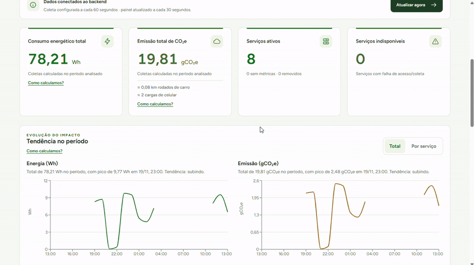

Capturas das telas principais da Sprint 3 em modo demonstração (<code>?demo=1</code>, dados fictícios identificados) nos tamanhos padrão de desktop (<code>1440×900</code>) e celular (<code>375×812</code>), além do acervo de evidências das Sprints 2 e 3:

<table>
    <tr>
        <th>Dashboard — Desktop (tema claro)</th>
        <th>Dashboard — Desktop (tema escuro)</th>
    </tr>
    <tr>
        <td>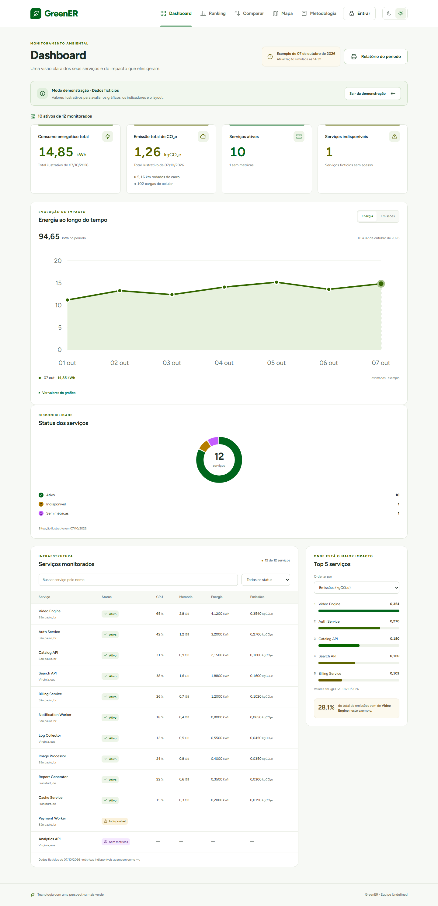 <em>Indicadores consolidados, equivalências de CO₂e, evolução temporal, distribuição por estado e lista de serviços (<code>/?demo=1</code>).</em></td>
        <td>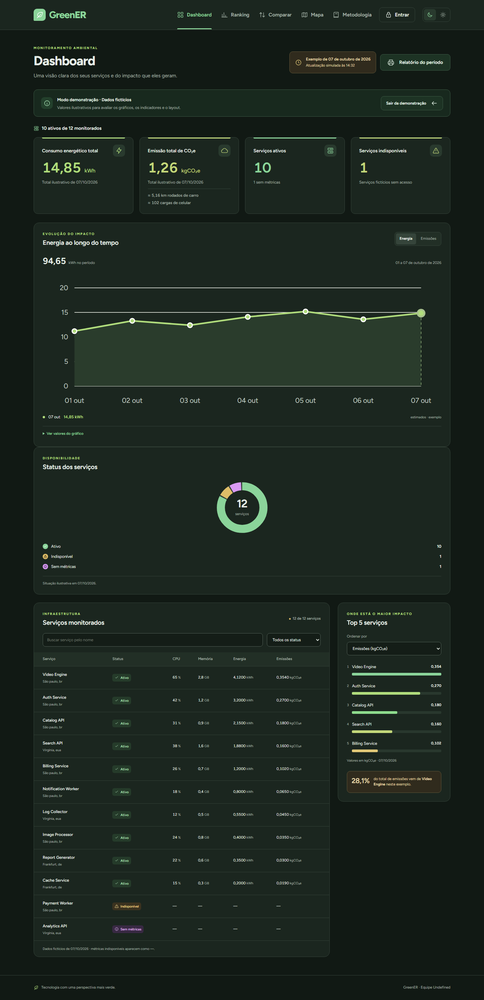 <em>Mesma visão do dashboard com tema escuro persistido e contraste validado (<code>/?demo=1</code>).</em></td>
    </tr>
    <tr>
        <th>Dashboard — Mobile (375×812)</th>
        <th>Ranking de impacto ambiental</th>
    </tr>
    <tr>
        <td>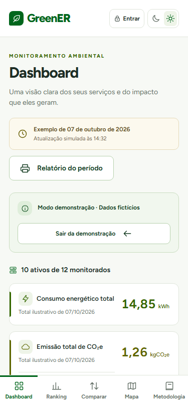 <em>Layout responsivo em 375×812 com barra de navegação inferior acessível (<code>/?demo=1</code>).</em></td>
        <td>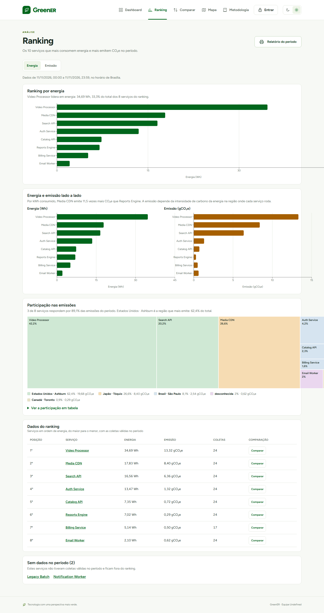 <em>Barras por energia/emissão, comparação lado a lado, treemap de participação por região, tabela e serviços sem dados (<code>/ranking?demo=1</code>).</em></td>
    </tr>
    <tr>
        <th>Comparação entre serviços</th>
        <th>Mapa de emissões e melhor horário</th>
    </tr>
    <tr>
        <td>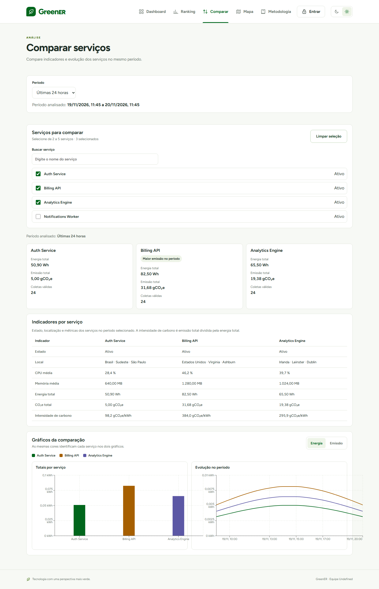 <em>Seleção de 2 a 5 serviços, destaque da maior emissão, tabela indicador × serviço e gráficos sincronizados (<code>/comparar?demo=1</code>).</em></td>
        <td>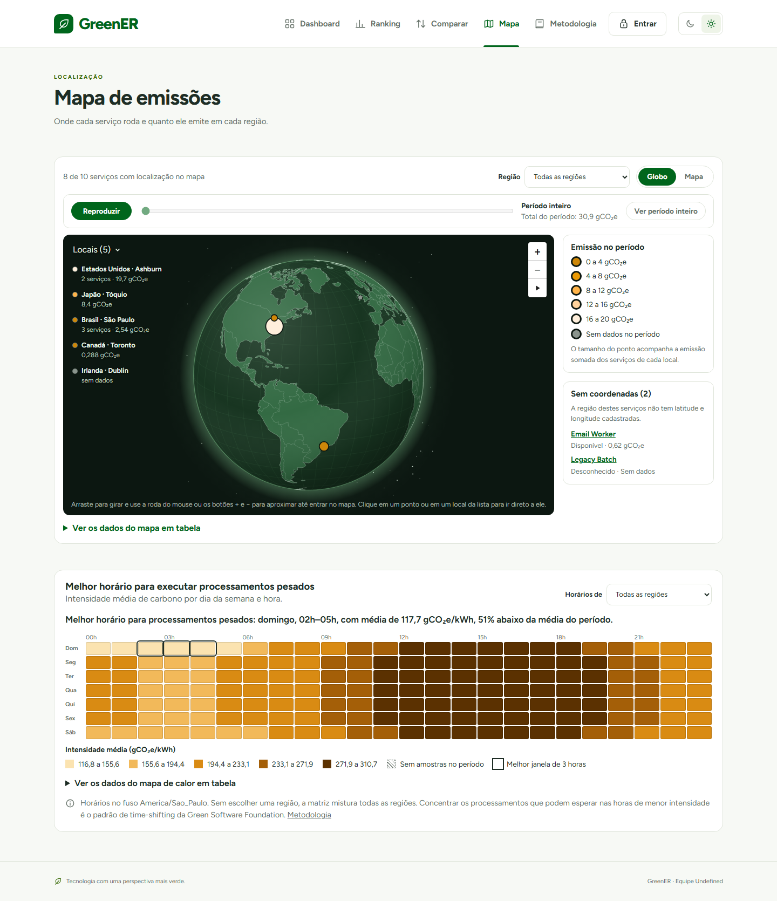 <em>Globo interativo, filtro regional, linha do tempo, lista sem coordenadas e matriz 7×24 do melhor horário (<code>/mapa?demo=1</code>).</em></td>
    </tr>
    <tr>
        <th>Detalhe do serviço e simulador de região</th>
        <th>Administração e saúde das integrações</th>
    </tr>
    <tr>
        <td>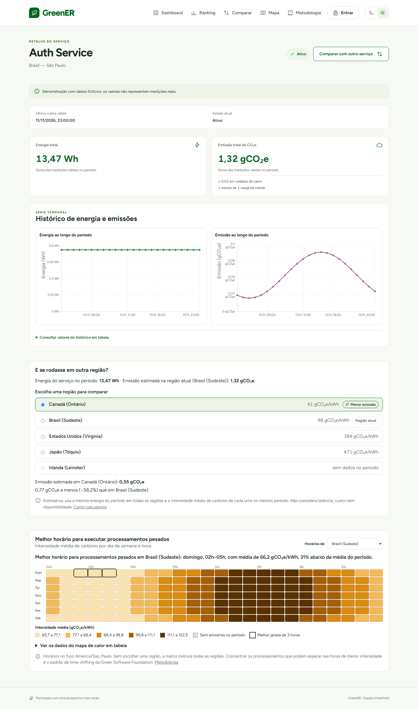 <em>Série histórica de energia e emissão, simulador “E se rodasse em outra região?” e melhor janela horária (<code>/servicos/1?demo=1</code>).</em></td>
        <td>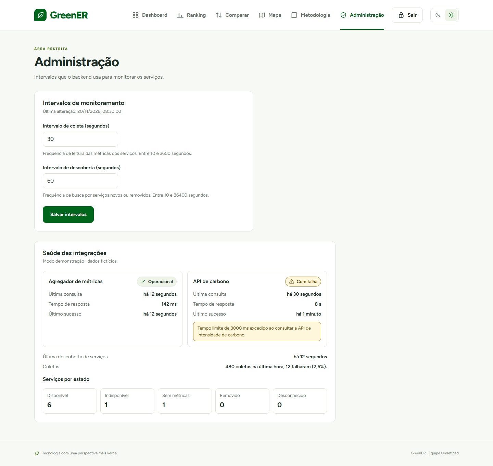 <em>Área restrita com JWT para configurar intervalos de coleta/descoberta e monitorar agregador e API de carbono (<code>/admin</code>, após o login).</em></td>
    </tr>
    <tr>
        <th colspan="2">Metodologia (“Como calculamos”)</th>
    </tr>
    <tr>
        <td colspan="2" align="center">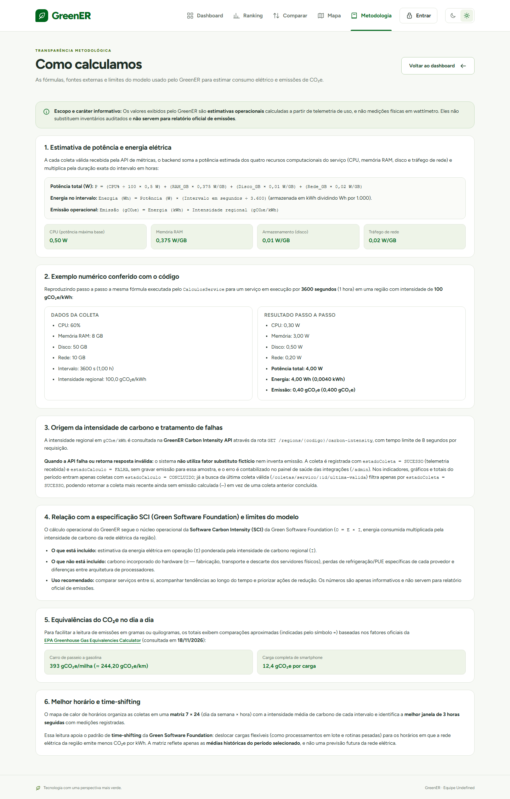 <em>Fórmulas de potência, energia e emissão, exemplo numérico conferido com o <code>CalculosService</code>, tratamento de falhas da Carbon API, relação com SCI, equivalências EPA e <em>time-shifting</em> (<code>/metodologia?demo=1</code>).</em></td>
    </tr>
</table>
<ul>
    <li><strong>Sprint 2 (Dashboard, Login, 404 e Responsividade 1920px/375px):</strong> <a href="./docs/evidencias/frontend-25/">docs/evidencias/frontend-25/</a></li>
    <li><strong>Backend (Coleta com falha HTTP 500 e estado indisponível no PostgreSQL):</strong> <a href="./docs/evidencias/backend/">docs/evidencias/backend/</a></li>
    <li><strong>Sprint 3 (Avaliação Heurística e Melhorias P01–P08 — Antes e Depois):</strong> <a href="./docs/evidencias/issue-101/">issue-101</a>, <a href="./docs/evidencias/issue-101-2026-11-16/">2026-11-16</a>, <a href="./docs/evidencias/issue-101-2026-11-17/">2026-11-17</a> e <a href="./docs/evidencias/issue-101-2026-11-18/">2026-11-18</a></li>
    <li><strong>Relatório de IHC, Protótipos e Testes com Usuários:</strong> <a href="./docs/interface.md">docs/interface.md</a></li>
</ul>

<h2 id="requisitos">📑 Requisitos</h2>

<h3>✅ Requisitos Funcionais</h3>
<table>
    <tr>
        <th>Código</th>
        <th>Descrição</th>
    </tr>
    <tr>
        <td>RF01</td>
        <td>Descoberta de serviços: consultar o Agregador de Métricas para identificar os serviços disponíveis.</td>
    </tr>
    <tr>
        <td>RF02</td>
        <td>Monitoramento dinâmico: reconhecer inclusão, remoção, indisponibilidade e retorno de serviços durante a execução.</td>
    </tr>
    <tr>
        <td>RF03</td>
        <td>Coleta de métricas por serviço: consultar periodicamente o endpoint /metrics/{id_servico} para cada serviço disponível.</td>
    </tr>
    <tr>
        <td>RF04</td>
        <td>Tratamento da variação das métricas: considerar e tratar valores que se alteram dinamicamente a cada requisição.</td>
    </tr>
    <tr>
        <td>RF05</td>
        <td>Detecção de indisponibilidade: identificar e sinalizar falhas quando um serviço não responder ou estiver indisponível.</td>
    </tr>
    <tr>
        <td>RF06</td>
        <td>Detecção de ausência de métricas: identificar quando um serviço está ativo na listagem mas não exporta dados de métricas.</td>
    </tr>
    <tr>
        <td>RF07</td>
        <td>Cálculo individual: calcular consumo energético e emissão de CO₂e para cada serviço monitorado.</td>
    </tr>
    <tr>
        <td>RF08</td>
        <td>Indicadores agregados: calcular métricas consolidadas (consumo total, emissão total, serviços ativos/indisponíveis).</td>
    </tr>
    <tr>
        <td>RF09</td>
        <td>Dashboard operacional: exibir estado de monitoramento, localização, métricas, consumo estimado e emissão de CO₂e por serviço.</td>
    </tr>
    <tr>
        <td>RF10</td>
        <td>Histórico de coletas: armazenar histórico de coletas para análises temporais e evolutivas.</td>
    </tr>
    <tr>
        <td>RF11</td>
        <td>Atualização contínua: atualizar a interface periodicamente sem exigir recarregamento da página.</td>
    </tr>
    <tr>
        <td>RF12</td>
        <td>Localização dos serviços: exibir país, região e cidade (quando disponível) de hospedagem do serviço.</td>
    </tr>
    <tr>
        <td>RF13</td>
        <td>Visualização geográfica: exibir em mapa a posição aproximada dos serviços com coordenadas latitude/longitude.</td>
    </tr>
    <tr>
        <td>RF14</td>
        <td>Ranking de impacto: ordenar serviços por consumo energético estimado ou emissão de CO₂e em determinado período.</td>
    </tr>
    <tr>
        <td>RF15</td>
        <td>Comparação entre serviços: comparar dois ou mais serviços avaliando métricas e indicadores no mesmo intervalo temporal.</td>
    </tr>
    <tr>
        <td>RF16</td>
        <td>Autenticação e controle de acesso: autenticar via JWT o usuário responsável pela alteração de configurações de monitoramento.</td>
    </tr>
</table>

<h3>⚙️ Requisitos Não Funcionais</h3>
<table>
    <tr>
        <th>Código</th>
        <th>Descrição</th>
    </tr>
    <tr>
        <td>RNF01</td>
        <td>Usabilidade: interface simples, clara e responsiva para desktop e dispositivos móveis.</td>
    </tr>
    <tr>
        <td>RNF02</td>
        <td>Acessibilidade da informação: estados (ativo, indisponível, sem métricas) e alertas identificáveis por texto ou ícones, não apenas cores.</td>
    </tr>
    <tr>
        <td>RNF03</td>
        <td>Atualização periódica: exibir intervalos de coleta e apresentar data/hora da última atualização para o usuário.</td>
    </tr>
    <tr>
        <td>RNF04</td>
        <td>Desempenho: tempos de resposta adequados para visualização contínua e sem degradação do dashboard.</td>
    </tr>
    <tr>
        <td>RNF05</td>
        <td>Tolerância a falhas: a indisponibilidade de serviços monitorados ou de APIs externas não deve interromper o sistema.</td>
    </tr>
    <tr>
        <td>RNF06</td>
        <td>Segurança: senhas com hash seguro, credenciais fora do versionamento e proteção de rotas restritas via JWT.</td>
    </tr>
    <tr>
        <td>RNF07</td>
        <td>Manutenibilidade e testes: regras de cálculo isoladas dos controllers, com cobertura de testes unitários.</td>
    </tr>
    <tr>
        <td>RNF08</td>
        <td>Documentação técnica: instruções de deploy/execução, arquitetura, modelo de dados e endpoints documentados.</td>
    </tr>
</table>

<h3>🚧 Restrições de Projeto</h3>
<table>
    <tr>
        <th>Código</th>
        <th>Descrição</th>
    </tr>
    <tr>
        <td>RP01</td>
        <td>Frontend obrigatório em React com TypeScript.</td>
    </tr>
    <tr>
        <td>RP02</td>
        <td>Backend obrigatório em NestJS com TypeScript estruturado em módulos, controllers, services e DTOs.</td>
    </tr>
    <tr>
        <td>RP03</td>
        <td>Banco de dados PostgreSQL integrado via ORM no ecossistema NestJS com persistência de coletas temporais.</td>
    </tr>
    <tr>
        <td>RP04</td>
        <td>Injeção de dependência e regras de cálculo de energia e CO₂e isoladas fora dos controllers.</td>
    </tr>
    <tr>
        <td>RP05</td>
        <td>Execução completa exclusivamente por meio de containers Docker.</td>
    </tr>
    <tr>
        <td>RP06</td>
        <td>Escopo MVP com navegação completa, respostas estruturadas e evidências documentais.</td>
    </tr>
    <tr>
        <td>RP07</td>
        <td>Autenticação da área restrita de configuração validada obrigatoriamente no backend via JWT.</td>
    </tr>
    <tr>
        <td>RP08</td>
        <td>Metodologia ágil com backlog priorizado, critérios de aceitação e reviews de sprint com feedback documentado.</td>
    </tr>
    <tr>
        <td>RP09</td>
        <td>Evidências de IHC: protótipos de tela, planejamento e resultados de avaliação de usabilidade.</td>
    </tr>
</table>

<h2 id="userstories">📝 User Stories</h2>
<table>
    <tr>
        <th>ID</th>
        <th>User Story</th>
        <th>DoR (Definition of Ready)</th>
        <th>DoD (Definition of Done)</th>
    </tr>
    <tr>
        <td>US01</td>
        <td>Como gestor de TI, quero visualizar o consumo consolidado de CO₂e e energia para monitorar metas ESG.</td>
        <td>Cálculos de CO₂e e energia validados | Endpoint agregado modelado</td>
        <td>Indicadores totais exibidos dinamicamente na tela inicial com testes unitários cobrindo o cálculo</td>
    </tr>
    <tr>
        <td>US02</td>
        <td>Como operador, quero identificar serviços indisponíveis ou sem métricas para agir rapidamente sobre incidentes.</td>
        <td>Status mapeados | Regra de tolerância a falhas definida</td>
        <td>Dashboard exibe alertas textuais e por ícones indicando ausência de resposta ou métricas</td>
    </tr>
    <tr>
        <td>US03</td>
        <td>Como analista, quero comparar o impacto ambiental entre serviços para decidir estratégias de otimização de nuvem.</td>
        <td>Histórico de métricas persistido | Filtros de intervalo definidos</td>
        <td>Tela de comparação exibindo métricas consolidadas de múltiplos serviços em gráfico/tabela</td>
    </tr>
    <tr>
        <td>US04</td>
        <td>Como administrador, quero autenticar-me com segurança para alterar intervalos e parâmetros de monitoramento.</td>
        <td>Fluxo de login definido | Middleware JWT planejado</td>
        <td>Login funcional, JWT retornado no padrão Bearer e rotas de configuração restritas</td>
    </tr>
</table>

<h2 id="planejamento-de-sprints">🚀 Planejamento de Sprints</h2>
<ul>
    <li>
        <a href="#documentacao">🗎 Documentação</a>
        <ul>
            <li><a href="./backend/prisma/schema.prisma">🗃️ Modelo do banco (Prisma)</a></li>
            <li><a href="./docs/interface.md">📊 Personas e fluxos previstos</a></li>
            <li><a href="./docs/arquitetura.md">📊 Arquitetura atual</a></li>
            <li><a href="./docs/interface.md">🎨 Protótipos IHC e Usabilidade</a></li>
        </ul>
    </li>
    <li>
        <a href="#sprint1">⏱️ Sprint 1 (20/10/2026)</a>
        <ul>
            <li><a href="#backlogsprint1">📋 Backlog</a></li>
            <li><a href="#burndownsprint1">📉 Burndown</a></li>
        </ul>
    </li>
    <li>
        <a href="#sprint2">⏱️ Sprint 2 (10/11/2026)</a>
        <ul>
            <li><a href="#backlogsprint2">📋 Backlog</a></li>
            <li><a href="#burndownsprint2">📉 Burndown</a></li>
        </ul>
    </li>
    <li>
        <a href="#sprint3">⏱️ Sprint 3 (23/11/2026)</a>
        <ul>
            <li><a href="#backlogsprint3">📋 Backlog</a></li>
            <li><a href="#burndownsprint3">📉 Burndown</a></li>
        </ul>
    </li>
</ul>

<h3 id="sprint1">⏱️ Sprint 1 — Descoberta, Coleta de Métricas e Estrutura Base 🥇</h3>
<h4 id="backlogsprint1">📋 Backlog Sprint 1</h4>

Baseline preservada: <strong>13 itens e 60 SP</strong>. Os 13 itens foram fechados no GitHub em 20/10/2026. As pendências técnicas apontadas na revisão de 19/10 (localização, distinção 404/5xx, timeout, sobreposição de ciclos) foram tratadas na Sprint 2.

<table>
<tr><th>Issue</th><th>Item</th><th>SP</th><th>Situação</th></tr>
<tr><td><a href="https://github.com/abpundefined/3DSM-ABP-UNDEFINED/issues/1">#1</a></td><td>[PBI-01] Descoberta automática de serviços</td><td>5</td><td>Fechada em 20/10</td></tr>
<tr><td><a href="https://github.com/abpundefined/3DSM-ABP-UNDEFINED/issues/2">#2</a></td><td>[PBI-02] Monitoramento dinâmico de serviços</td><td>8</td><td>Fechada em 20/10</td></tr>
<tr><td><a href="https://github.com/abpundefined/3DSM-ABP-UNDEFINED/issues/3">#3</a></td><td>[PBI-03] Coleta periódica de métricas</td><td>5</td><td>Fechada em 20/10</td></tr>
<tr><td><a href="https://github.com/abpundefined/3DSM-ABP-UNDEFINED/issues/4">#4</a></td><td>[PBI-04] Detecção de serviço indisponível</td><td>3</td><td>Fechada em 20/10</td></tr>
<tr><td><a href="https://github.com/abpundefined/3DSM-ABP-UNDEFINED/issues/5">#5</a></td><td>[PBI-05] Detecção de ausência de métricas</td><td>3</td><td>Fechada em 20/10</td></tr>
<tr><td><a href="https://github.com/abpundefined/3DSM-ABP-UNDEFINED/issues/9">#9</a></td><td>[PBI-09] Histórico de coletas</td><td>5</td><td>Fechada em 20/10</td></tr>
<tr><td><a href="https://github.com/abpundefined/3DSM-ABP-UNDEFINED/issues/18">#18</a></td><td>[PBI-18] Tolerância a falhas</td><td>5</td><td>Fechada em 20/10</td></tr>
<tr><td><a href="https://github.com/abpundefined/3DSM-ABP-UNDEFINED/issues/22">#22</a></td><td>[PBI-22] Setup Docker Compose</td><td>5</td><td>Fechada em 20/10</td></tr>
<tr><td><a href="https://github.com/abpundefined/3DSM-ABP-UNDEFINED/issues/23">#23</a></td><td>[PBI-23] Protótipos e avaliação de usabilidade (IHC)</td><td>8</td><td>Fechada em 20/10</td></tr>
<tr><td><a href="https://github.com/abpundefined/3DSM-ABP-UNDEFINED/issues/24">#24</a></td><td>[TASK] Setup da estrutura base do backend NestJS com TypeScript</td><td>3</td><td>Fechada em 20/10</td></tr>
<tr><td><a href="https://github.com/abpundefined/3DSM-ABP-UNDEFINED/issues/25">#25</a></td><td>[TASK] Setup da estrutura base do frontend React com TypeScript e Vite</td><td>3</td><td>Fechada em 20/10</td></tr>
<tr><td><a href="https://github.com/abpundefined/3DSM-ABP-UNDEFINED/issues/26">#26</a></td><td>[TASK] Configuração de variáveis de ambiente e segurança (.env.example)</td><td>2</td><td>Fechada em 20/10</td></tr>
<tr><td><a href="https://github.com/abpundefined/3DSM-ABP-UNDEFINED/issues/27">#27</a></td><td>[TASK] Modelagem relacional e migrações PostgreSQL via ORM</td><td>5</td><td>Fechada em 20/10</td></tr>
</table>

<a href="./docs/sprints/sprint-1.md">Registro da sprint e contribuições</a> · <a href="./docs/sprints/revisao-sprint-1.md">Evidências e pendências por item</a>.

<h4 id="burndownsprint1">📉 Burndown Sprint 1</h4>

  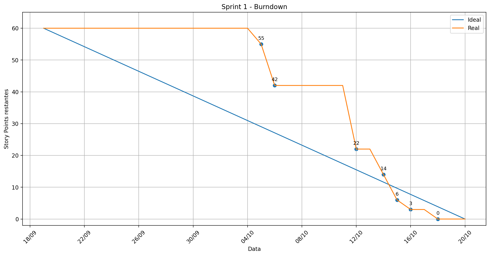

<h3 id="sprint2">⏱️ Sprint 2 — Cálculos Ambientais, Dashboard e Autenticação 🥈</h3>
<h4 id="backlogsprint2">📋 Backlog Sprint 2</h4>

Baseline estabelecida: <strong>10 itens e 63 SP</strong>. Situação ao encerramento do desenvolvimento: 10 itens concluídos (63 SP). Taxa de entrega de <strong>100%</strong> dos Story Points planejados.

<table>
<tr><th>Issue</th><th>Item</th><th>SP</th><th>Situação</th></tr>
<tr><td><a href="https://github.com/abpundefined/3DSM-ABP-UNDEFINED/issues/6">#6</a></td><td>[PBI-06] Cálculo individual de consumo e emissão</td><td>8</td><td>Done</td></tr>
<tr><td><a href="https://github.com/abpundefined/3DSM-ABP-UNDEFINED/issues/7">#7</a></td><td>[PBI-07] Indicadores agregados</td><td>5</td><td>Done</td></tr>
<tr><td><a href="https://github.com/abpundefined/3DSM-ABP-UNDEFINED/issues/8">#8</a></td><td>[PBI-08] Dashboard operacional</td><td>13</td><td>Done</td></tr>
<tr><td><a href="https://github.com/abpundefined/3DSM-ABP-UNDEFINED/issues/10">#10</a></td><td>[PBI-10] Atualização automática do dashboard</td><td>5</td><td>Done</td></tr>
<tr><td><a href="https://github.com/abpundefined/3DSM-ABP-UNDEFINED/issues/11">#11</a></td><td>[PBI-11] Localização dos serviços</td><td>3</td><td>Done</td></tr>
<tr><td><a href="https://github.com/abpundefined/3DSM-ABP-UNDEFINED/issues/15">#15</a></td><td>[PBI-15] Autenticação JWT</td><td>8</td><td>Done</td></tr>
<tr><td><a href="https://github.com/abpundefined/3DSM-ABP-UNDEFINED/issues/16">#16</a></td><td>[PBI-16] Interface responsiva e acessível</td><td>5</td><td>Done</td></tr>
<tr><td><a href="https://github.com/abpundefined/3DSM-ABP-UNDEFINED/issues/17">#17</a></td><td>[PBI-17] Exibição de intervalos e timestamps</td><td>3</td><td>Done</td></tr>
<tr><td><a href="https://github.com/abpundefined/3DSM-ABP-UNDEFINED/issues/19">#19</a></td><td>[PBI-19] Segurança</td><td>5</td><td>Done</td></tr>
<tr><td><a href="https://github.com/abpundefined/3DSM-ABP-UNDEFINED/issues/20">#20</a></td><td>[PBI-20] Testes unitários</td><td>8</td><td>Done</td></tr>
</table>

<a href="./docs/sprints/sprint-2.md">Registro da sprint e contribuições</a> · <a href="./docs/burndown-sprint-2.md">Métricas e evolução do burndown</a>.

<h4 id="burndownsprint2">📉 Burndown Sprint 2</h4>

  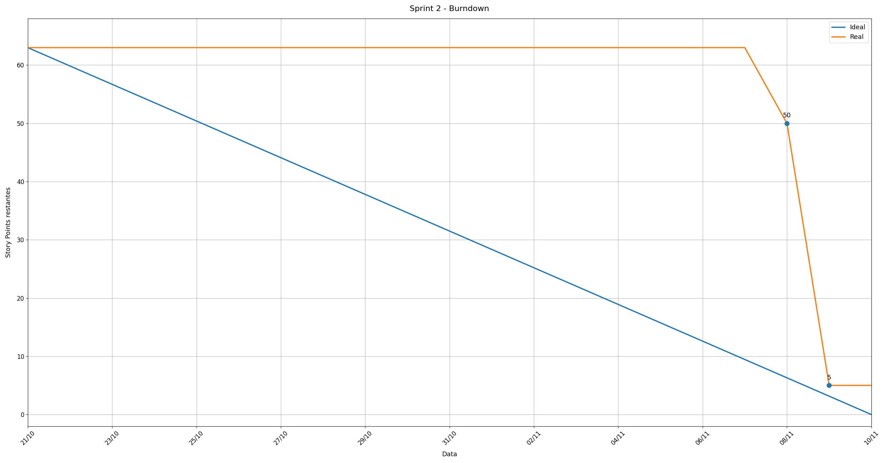

<h3 id="sprint3">⏱️ Sprint 3 — Análises Avançadas, Usabilidade, Consolidação e Feira 🥉</h3>
<h4 id="backlogsprint3">📋 Backlog Sprint 3</h4>

Baseline estabelecida em <strong>11/11/2026</strong>: <strong>51 itens comprometidos totalizando 178 Story Points (SP)</strong>, além de 8 PBIs guarda-chuva decompostas em tarefas e 10 itens no backlog de reserva/opcional (29 SP). Consulte o planejamento detalhado em <a href="./docs/sprints/sprint-3.md">docs/sprints/sprint-3.md</a> e o acompanhamento métrico em <a href="./docs/burndown-sprint-3.md">docs/burndown-sprint-3.md</a>.

<h4 id="burndownsprint3">📉 Burndown Sprint 3</h4>

    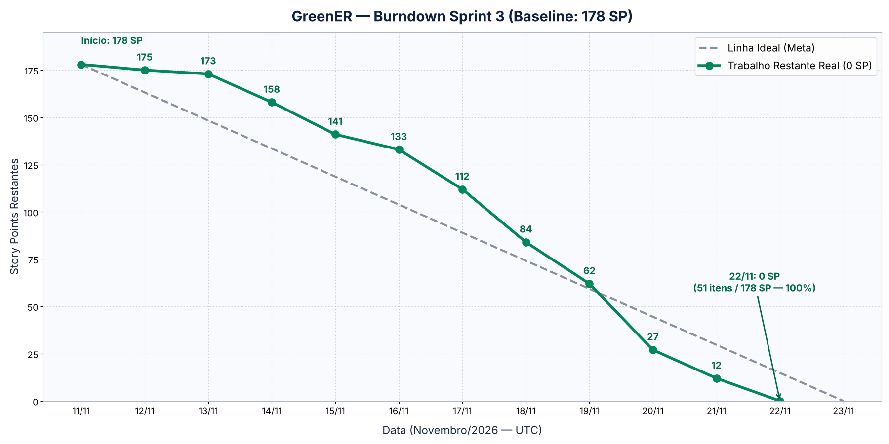

<h2 id="integrantes">🧑‍💻 Integrantes</h2>
<table>
    <tr>
        <th>Foto</th>
        <th>Nome Completo</th>
        <th>Papel</th>
        <th>LinkedIn</th>
        <th>GitHub</th>
    </tr>
    <tr>
        <td></td>
        <td>Rainan de Oliveira Reis</td>
        <td>Product Owner & Dev Fullstack</td>
        <td><a href="https://www.linkedin.com/in/rainan-reis-757384365/">LinkedIn</a></td>
        <td><a href="https://github.com/RainanKaneka">GitHub</a></td>
    </tr>
    <tr>
        <td></td>
        <td>Thales Cambraia Dias</td>
        <td>Scrum Master & Dev Frontend</td>
        <td><a href="https://www.linkedin.com/in/thales-tcd/">LinkedIn</a></td>
        <td><a href="https://github.com/thalestcd">GitHub</a></td>
    </tr>
    <tr>
        <td></td>
        <td>Pedro Augusto Gomes</td>
        <td>Dev Backend & DevOps</td>
        <td><a href="https://www.linkedin.com/in/pedro-augusto-gomes">LinkedIn</a></td>
        <td><a href="https://github.com/PedrinhoDBR">GitHub</a></td>
    </tr>
    <tr>
        <td></td>
        <td>Marcus Vinicius Ribeiro do Nascimento</td>
        <td>Dev Backend</td>
        <td><a href="https://www.linkedin.com/in/marcus-nascimento-50a0ba1b5">LinkedIn</a></td>
        <td><a href="https://github.com/MarcusVRDN">GitHub</a></td>
    </tr>
    <tr>
        <td></td>
        <td>Israel da Silva Lemes</td>
        <td>Dev Backend</td>
        <td><a href="https://www.linkedin.com/in/israel-lemes/">LinkedIn</a></td>
        <td><a href="https://github.com/Israelisl">GitHub</a></td>
    </tr>
    <tr>
        <td></td>
        <td>Nadla Fernandes Ferreira</td>
        <td>Dev Frontend & UI/UX</td>
        <td><a href="https://www.linkedin.com/in/nadla-ferreira-4646433a8/">LinkedIn</a></td>
        <td><a href="https://github.com/NadlaFernandes">GitHub</a></td>
    </tr>
</table>

<h2 id="documentacao">🖺 Documentação</h2>

Toda a documentação técnica e de processos está organizada no diretório <a href="./docs/README.md"><code>docs/</code></a>:

<ul>
    <li>📋 <a href="./docs/plano-de-entregas.md"><strong>Plano de Entregas das Sprints</strong></a> — Distribuição dos 27 critérios da rubrica (100 pontos) e participação dos integrantes.</li>
    <li>✅ <a href="./docs/definicao-de-pronto.md"><strong>Definição de Pronto (DoD)</strong></a> — Critérios de aceite e qualidade para conclusão de tarefas (GA07).</li>
    <li>🚀 <a href="./docs/execucao.md"><strong>Guia de Execução e Verificação</strong></a> — Docker Compose, desenvolvimento nativo, variáveis de ambiente e comandos de teste.</li>
    <li>🏗️ <a href="./docs/arquitetura.md"><strong>Arquitetura de Software e Modelo ER</strong></a> — Estrutura NestJS, React, PostgreSQL, integrações externas e fluxo de dados.</li>
    <li>⚡ <a href="./docs/calculos.md"><strong>Memória de Cálculo Ambiental</strong></a> — Fórmulas matemáticas de kWh, emissão de CO₂e e fatores regionais.</li>
    <li>🔌 <a href="./docs/api.md"><strong>Documentação da API REST</strong></a> — Endpoints, métodos HTTP, DTOs, paginação e autenticação JWT.</li>
    <li>🔒 <a href="./docs/seguranca.md"><strong>Segurança</strong></a> — Controles implementados no backend (JWT, bcrypt, Helmet, CORS, limite de login e validação de ambiente).</li>
    <li>🎨 <a href="./docs/interface.md"><strong>Interface e Usabilidade (IHC)</strong></a> — Personas, fluxos, protótipos Figma, avaliação heurística e testes com usuários.</li>
    <li>🖼️ <a href="./docs/evidencias/"><strong>Evidências Visuais</strong></a> — Capturas de backend, frontend e ciclos de melhorias P01–P08.</li>
    <li>⏱️ <strong>Sprints e Burndowns:</strong>
        <a href="./docs/sprints/sprint-1.md">Sprint 1</a> |
        <a href="./docs/sprints/sprint-2.md">Sprint 2</a> |
        <a href="./docs/sprints/sprint-3.md">Sprint 3</a> |
        <a href="./docs/burndown-sprint-3.md">Burndown Sprint 3</a>
    </li>
</ul>
