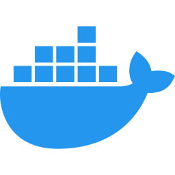
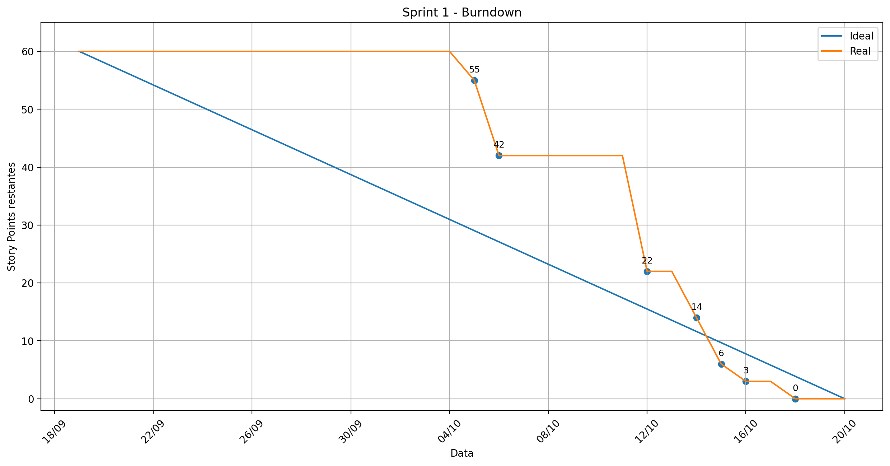

<h1>🚀 3DSM-ABP-UNDEFINED</h1>

    Este repositório contém o desenvolvimento do projeto interdisciplinar da disciplina de
    <strong>Aprendizagem Baseada em Projetos (ABP)</strong> do 3º semestre do curso de
    <strong>Desenvolvimento de Software Multiplataforma</strong> da FATEC Jacareí.

<h2>📌 Sumário</h2>
<ul>
    <li><a href="#sobre">🌱 Sobre o Projeto</a></li>
    <li><a href="#tecnologias">🛠️ Tecnologias Utilizadas</a></li>
    <li><a href="#comorodar">🚀 Como Rodar o Projeto</a></li>
    <li><a href="#requisitos">📑 Requisitos</a></li>
    <li><a href="#userstories">📝 User Stories</a></li>
    <li><a href="#planejamento-de-sprints">🚀 Planejamento de Sprints</a></li>
    <li><a href="#documentacao">🖺 Documentação</a></li>
    <li><a href="#integrantes">🧑‍💻 Integrantes</a></li>
</ul>

<h2>📎 Links</h2>
<ul>
    <li>
        <strong>GitHub Projects (Kanban):</strong>
        <a href="https://github.com/users/abpundefined/projects/2" target="_blank">Acessar Kanban</a>
    </li>
    <li>
        <strong>Figma:</strong>
        <a href="https://www.figma.com/design/CzTTbJAFqZrm2eUIBTSCNl/Undefined-FatecABP-GreenER?node-id=0-1" target="_blank">Acessar Figma</a>
    </li>
    <li>
        <strong>GreenER Metrics Aggregator API:</strong>
        <a href="https://metrics.unilaunch.org/docs" target="_blank">Acessar Documentação</a>
    </li>
    <li>
        <strong>GreenER Carbon Intensity API:</strong>
        <a href="https://carbon.unilaunch.org/docs" target="_blank">Acessar Documentação</a>
    </li>
</ul>

<h2 id="sobre">🌱 Sobre o Projeto</h2>

    O <strong>GreenER</strong> é uma plataforma web voltada para monitorar continuamente aplicações de software,
    estimar o consumo energético de recursos computacionais e calcular a emissão aproximada de dióxido de carbono
    equivalente (CO₂e). A plataforma visa apoiar decisões de sustentabilidade baseadas em práticas de Green Computing e ESG.

<h2 id="tecnologias">🛠️ Tecnologias Utilizadas</h2>

O desenvolvimento será realizado com as seguintes tecnologias, visando escalabilidade, manutenibilidade e confiabilidade:

<h3>🔧 Stack Principal</h3>
<ul>
    <li> React</li>
    <li> TypeScript</li>
    <li> NestJS</li>
    <li> PostgreSQL</li>
    <li> Docker & Docker Compose</li>
</ul>

<h2 id="comorodar">🚀 Como Rodar o Projeto</h2>

O ambiente completo usa Docker Desktop em execução, com containers Linux. Na raiz:

<pre><code>Copy-Item .env.example .env
</code></pre>

Preencha as credenciais e a porta do PostgreSQL no arquivo antes de iniciar. Leia o <a href="./docs/execucao.md">guia de execução</a> para exemplos de variáveis e para escolher entre Docker completo e desenvolvimento nativo.

<pre><code>docker compose config --quiet
docker compose up --build
</code></pre>

O backend containerizado já gera o Prisma Client, aplica as migrações e inicia o servidor. Não inicie outro backend nas mesmas portas após subir o Compose completo.

<ul>
  <li>Frontend: <a href="http://localhost:5173">http://localhost:5173</a>.</li>
  <li>API direta: <a href="http://localhost:3000/servicos">http://localhost:3000/servicos</a>.</li>
  <li>API pelo proxy: <a href="http://localhost:5173/api/servicos">http://localhost:5173/api/servicos</a>.</li>
  <li>Demonstração com dados fictícios: <a href="http://localhost:5173/?demo=1">http://localhost:5173/?demo=1</a>.</li>
</ul>

A lista e as últimas coletas já são consumidas do backend. Energia/CO₂e reais, autenticação e análises avançadas ainda não estão implementados. O teste completo dos três containers permanece pendente de homologação registrada. Consulte a <a href="./docs/sprints/revisao-sprint-1.md">revisão técnica e seus limites</a>.

Execução nativa exige Node 24.x/npm 11.x e ambiente configurado na pasta do backend; instruções em <a href="./backend/README.md">backend/README.md</a> e <a href="./frontend/README.md">frontend/README.md</a>. As rotas implementadas estão na <a href="./docs/api.md">documentação da API</a>.

<h2 id="requisitos">📑 Requisitos</h2>

<h3>✅ Requisitos Funcionais</h3>
<table>
    <tr>
        <th>Código</th>
        <th>Descrição</th>
    </tr>
    <tr>
        <td>RF01</td>
        <td>Descoberta de serviços: consultar o Agregador de Métricas para identificar os serviços disponíveis.</td>
    </tr>
    <tr>
        <td>RF02</td>
        <td>Monitoramento dinâmico: reconhecer inclusão, remoção, indisponibilidade e retorno de serviços durante a execução.</td>
    </tr>
    <tr>
        <td>RF03</td>
        <td>Coleta de métricas por serviço: consultar periodicamente o endpoint /metrics/{id_servico} para cada serviço disponível.</td>
    </tr>
    <tr>
        <td>RF04</td>
        <td>Tratamento da variação das métricas: considerar e tratar valores que se alteram dinamicamente a cada requisição.</td>
    </tr>
    <tr>
        <td>RF05</td>
        <td>Detecção de indisponibilidade: identificar e sinalizar falhas quando um serviço não responder ou estiver indisponível.</td>
    </tr>
    <tr>
        <td>RF06</td>
        <td>Detecção de ausência de métricas: identificar quando um serviço está ativo na listagem mas não exporta dados de métricas.</td>
    </tr>
    <tr>
        <td>RF07</td>
        <td>Cálculo individual: calcular consumo energético e emissão de CO₂e para cada serviço monitorado.</td>
    </tr>
    <tr>
        <td>RF08</td>
        <td>Indicadores agregados: calcular métricas consolidadas (consumo total, emissão total, serviços ativos/indisponíveis).</td>
    </tr>
    <tr>
        <td>RF09</td>
        <td>Dashboard operacional: exibir estado de monitoramento, localização, métricas, consumo estimado e emissão de CO₂e por serviço.</td>
    </tr>
    <tr>
        <td>RF10</td>
        <td>Histórico de coletas: armazenar histórico de coletas para análises temporais e evolutivas.</td>
    </tr>
    <tr>
        <td>RF11</td>
        <td>Atualização contínua: atualizar a interface periodicamente sem exigir recarregamento da página.</td>
    </tr>
    <tr>
        <td>RF12</td>
        <td>Localização dos serviços: exibir país, região e cidade (quando disponível) de hospedagem do serviço.</td>
    </tr>
    <tr>
        <td>RF13</td>
        <td>Visualização geográfica: exibir em mapa a posição aproximada dos serviços com coordenadas latitude/longitude.</td>
    </tr>
    <tr>
        <td>RF14</td>
        <td>Ranking de impacto: ordenar serviços por consumo energético estimado ou emissão de CO₂e em determinado período.</td>
    </tr>
    <tr>
        <td>RF15</td>
        <td>Comparação entre serviços: comparar dois ou mais serviços avaliando métricas e indicadores no mesmo intervalo temporal.</td>
    </tr>
    <tr>
        <td>RF16</td>
        <td>Autenticação e controle de acesso: autenticar via JWT o usuário responsável pela alteração de configurações de monitoramento.</td>
    </tr>
</table>

<h3>⚙️ Requisitos Não Funcionais</h3>
<table>
    <tr>
        <th>Código</th>
        <th>Descrição</th>
    </tr>
    <tr>
        <td>RNF01</td>
        <td>Usabilidade: interface simples, clara e responsiva para desktop e dispositivos móveis.</td>
    </tr>
    <tr>
        <td>RNF02</td>
        <td>Acessibilidade da informação: estados (ativo, indisponível, sem métricas) e alertas identificáveis por texto ou ícones, não apenas cores.</td>
    </tr>
    <tr>
        <td>RNF03</td>
        <td>Atualização periódica: exibir intervalos de coleta e apresentar data/hora da última atualização para o usuário.</td>
    </tr>
    <tr>
        <td>RNF04</td>
        <td>Desempenho: tempos de resposta adequados para visualização contínua e sem degradação do dashboard.</td>
    </tr>
    <tr>
        <td>RNF05</td>
        <td>Tolerância a falhas: a indisponibilidade de serviços monitorados ou de APIs externas não deve interromper o sistema.</td>
    </tr>
    <tr>
        <td>RNF06</td>
        <td>Segurança: senhas com hash seguro, credenciais fora do versionamento e proteção de rotas restritas via JWT.</td>
    </tr>
    <tr>
        <td>RNF07</td>
        <td>Manutenibilidade e testes: regras de cálculo isoladas dos controllers, com cobertura de testes unitários.</td>
    </tr>
    <tr>
        <td>RNF08</td>
        <td>Documentação técnica: instruções de deploy/execução, arquitetura, modelo de dados e endpoints documentados.</td>
    </tr>
</table>

<h3>🚧 Restrições de Projeto</h3>
<table>
    <tr>
        <th>Código</th>
        <th>Descrição</th>
    </tr>
    <tr>
        <td>RP01</td>
        <td>Frontend obrigatório em React com TypeScript.</td>
    </tr>
    <tr>
        <td>RP02</td>
        <td>Backend obrigatório em NestJS com TypeScript estruturado em módulos, controllers, services e DTOs.</td>
    </tr>
    <tr>
        <td>RP03</td>
        <td>Banco de dados PostgreSQL integrado via ORM no ecossistema NestJS com persistência de coletas temporais.</td>
    </tr>
    <tr>
        <td>RP04</td>
        <td>Injeção de dependência e regras de cálculo de energia e CO₂e isoladas fora dos controllers.</td>
    </tr>
    <tr>
        <td>RP05</td>
        <td>Execução completa exclusivamente por meio de containers Docker.</td>
    </tr>
    <tr>
        <td>RP06</td>
        <td>Escopo MVP com navegação completa, respostas estruturadas e evidências documentais.</td>
    </tr>
    <tr>
        <td>RP07</td>
        <td>Autenticação da área restrita de configuração validada obrigatoriamente no backend via JWT.</td>
    </tr>
    <tr>
        <td>RP08</td>
        <td>Metodologia ágil com backlog priorizado, critérios de aceitação e reviews de sprint com feedback documentado.</td>
    </tr>
    <tr>
        <td>RP09</td>
        <td>Evidências de IHC: protótipos de tela, planejamento e resultados de avaliação de usabilidade.</td>
    </tr>
</table>

<h2 id="userstories">📝 User Stories</h2>
<table>
    <tr>
        <th>ID</th>
        <th>User Story</th>
        <th>DoR (Definition of Ready)</th>
        <th>DoD (Definition of Done)</th>
    </tr>
    <tr>
        <td>US01</td>
        <td>Como gestor de TI, quero visualizar o consumo consolidado de CO₂e e energia para monitorar metas ESG.</td>
        <td>Cálculos de CO₂e e energia validados | Endpoint agregado modelado</td>
        <td>Indicadores totais exibidos dinamicamente na tela inicial com testes unitários cobrindo o cálculo</td>
    </tr>
    <tr>
        <td>US02</td>
        <td>Como operador, quero identificar serviços indisponíveis ou sem métricas para agir rapidamente sobre incidentes.</td>
        <td>Status mapeados | Regra de tolerância a falhas definida</td>
        <td>Dashboard exibe alertas textuais e por ícones indicando ausência de resposta ou métricas</td>
    </tr>
    <tr>
        <td>US03</td>
        <td>Como analista, quero comparar o impacto ambiental entre serviços para decidir estratégias de otimização de nuvem.</td>
        <td>Histórico de métricas persistido | Filtros de intervalo definidos</td>
        <td>Tela de comparação exibindo métricas consolidadas de múltiplos serviços em gráfico/tabela</td>
    </tr>
    <tr>
        <td>US04</td>
        <td>Como administrador, quero autenticar-me com segurança para alterar intervalos e parâmetros de monitoramento.</td>
        <td>Fluxo de login definido | Middleware JWT planejado</td>
        <td>Login funcional, JWT retornado no padrão Bearer e rotas de configuração restritas</td>
    </tr>
</table>

<h2 id="planejamento-de-sprints">🚀 Planejamento de Sprints</h2>
<ul>
    <li>
        <a href="#documentacao">🗎 Documentação</a>
        <ul>
            <li><a href="./backend/prisma/schema.prisma">🗃️ Modelo do banco (Prisma)</a></li>
            <li><a href="./docs/interface.md">📊 Personas e fluxos previstos</a></li>
            <li><a href="./docs/arquitetura.md">📊 Arquitetura atual</a></li>
            <li><a href="./docs/interface.md">🎨 Protótipos IHC e Usabilidade</a></li>
        </ul>
    </li>
    <li>
        <a href="#sprint1">⏱️ Sprint 1 (20/10/2026)</a>
        <ul>
            <li><a href="#backlogsprint1">📋 Backlog</a></li>
            <li><a href="#burndownsprint1">📉 Burndown</a></li>
        </ul>
    </li>
    <li>
        <a href="#sprint2">⏱️ Sprint 2 (10/11/2026)</a>
        <ul>
            <li><a href="#backlogsprint2">📋 Backlog</a></li>
            <li><a href="#burndownsprint2">📉 Burndown</a></li>
        </ul>
    </li>
    <li>
        <a href="#sprint3">⏱️ Sprint 3 (23/11/2026)</a>
        <ul>
            <li><a href="#backlogsprint3">📋 Backlog</a></li>
            <li><a href="#burndownsprint3">📉 Burndown</a></li>
        </ul>
    </li>
</ul>

<h3 id="sprint1">⏱️ Sprint 1 — Descoberta, Coleta de Métricas e Estrutura Base 🥇</h3>
<h4 id="backlogsprint1">📋 Backlog Sprint 1</h4>

Baseline preservada: <strong>13 itens e 60 SP</strong>. Situação técnica recomendada após a revisão de 19/10/2026: 8 itens em revisão, 5 com correções pendentes e nenhum Done com aceite comprovado. As colunas do Projects ainda precisam de sincronização por alguém com permissão.

<table>
<tr><th>Issue</th><th>Item</th><th>SP</th><th>Situação técnica recomendada</th></tr>
<tr><td><a href="https://github.com/abpundefined/3DSM-ABP-UNDEFINED/issues/1">#1</a></td><td>[PBI-01] Descoberta automática de serviços</td><td>5</td><td>In progress</td></tr>
<tr><td><a href="https://github.com/abpundefined/3DSM-ABP-UNDEFINED/issues/2">#2</a></td><td>[PBI-02] Monitoramento dinâmico de serviços</td><td>8</td><td>In review</td></tr>
<tr><td><a href="https://github.com/abpundefined/3DSM-ABP-UNDEFINED/issues/3">#3</a></td><td>[PBI-03] Coleta periódica de métricas</td><td>5</td><td>In progress</td></tr>
<tr><td><a href="https://github.com/abpundefined/3DSM-ABP-UNDEFINED/issues/4">#4</a></td><td>[PBI-04] Detecção de serviço indisponível</td><td>3</td><td>In review</td></tr>
<tr><td><a href="https://github.com/abpundefined/3DSM-ABP-UNDEFINED/issues/5">#5</a></td><td>[PBI-05] Detecção de ausência de métricas</td><td>3</td><td>In progress</td></tr>
<tr><td><a href="https://github.com/abpundefined/3DSM-ABP-UNDEFINED/issues/9">#9</a></td><td>[PBI-09] Histórico de coletas</td><td>5</td><td>In review</td></tr>
<tr><td><a href="https://github.com/abpundefined/3DSM-ABP-UNDEFINED/issues/18">#18</a></td><td>[PBI-18] Tolerância a falhas</td><td>5</td><td>In progress</td></tr>
<tr><td><a href="https://github.com/abpundefined/3DSM-ABP-UNDEFINED/issues/22">#22</a></td><td>[PBI-22] Setup Docker Compose</td><td>5</td><td>In review</td></tr>
<tr><td><a href="https://github.com/abpundefined/3DSM-ABP-UNDEFINED/issues/23">#23</a></td><td>[PBI-23] Protótipos e avaliação de usabilidade (IHC)</td><td>8</td><td>In progress</td></tr>
<tr><td><a href="https://github.com/abpundefined/3DSM-ABP-UNDEFINED/issues/24">#24</a></td><td>[TASK] Setup da estrutura base do backend NestJS com TypeScript</td><td>3</td><td>In review</td></tr>
<tr><td><a href="https://github.com/abpundefined/3DSM-ABP-UNDEFINED/issues/25">#25</a></td><td>[TASK] Setup da estrutura base do frontend React com TypeScript e Vite</td><td>3</td><td>In review</td></tr>
<tr><td><a href="https://github.com/abpundefined/3DSM-ABP-UNDEFINED/issues/26">#26</a></td><td>[TASK] Configuração de variáveis de ambiente e segurança (.env.example)</td><td>2</td><td>In review</td></tr>
<tr><td><a href="https://github.com/abpundefined/3DSM-ABP-UNDEFINED/issues/27">#27</a></td><td>[TASK] Modelagem relacional e migrações PostgreSQL via ORM</td><td>5</td><td>In review</td></tr>
</table>

<a href="./docs/sprints/sprint-1.md">Registro da sprint e contribuições</a> · <a href="./docs/sprints/revisao-sprint-1.md">Evidências e pendências por item</a>.

<h4 id="burndownsprint1">📉 Burndown Sprint 1</h4>

  

<h3 id="sprint2">⏱️ Sprint 2 — Cálculos Ambientais, Dashboard e Autenticação 🥈</h3>
<h4 id="backlogsprint2">📋 Backlog Sprint 2</h4>

Planejamento futuro: consulte <a href="./docs/sprints/sprint-2.md">Sprint 2</a> e <a href="./docs/sprints/sprint-3.md">Sprint 3</a> para os candidatos com IDs e pontos reconciliados. A seleção depende da capacidade de cada ciclo.

<h4 id="burndownsprint2">📉 Burndown Sprint 2</h4>

<em>A definir.</em>

<h3 id="sprint3">⏱️ Sprint 3 — Ranking, Comparações, IHC e Finalização 🥉</h3>
<h4 id="backlogsprint3">📋 Backlog Sprint 3</h4>

Planejamento futuro: consulte <a href="./docs/sprints/sprint-2.md">Sprint 2</a> e <a href="./docs/sprints/sprint-3.md">Sprint 3</a> para os candidatos com IDs e pontos reconciliados. A seleção depende da capacidade de cada ciclo.

<h4 id="burndownsprint3">📉 Burndown Sprint 3</h4>

<em>A definir.</em>

<h2 id="integrantes">🧑‍💻 Integrantes</h2>
<table>
    <tr>
        <th>Foto</th>
        <th>Nome Completo</th>
        <th>Papel</th>
        <th>LinkedIn</th>
        <th>GitHub</th>
    </tr>
    <tr>
        <td></td>
        <td>Rainan de Oliveira Reis</td>
        <td>Product Owner & Dev Fullstack</td>
        <td><a href="https://www.linkedin.com/in/rainan-reis-757384365/">LinkedIn</a></td>
        <td><a href="https://github.com/RainanKaneka">GitHub</a></td>
    </tr>
    <tr>
        <td></td>
        <td>Thales Cambraia Dias</td>
        <td>Scrum Master & Dev Frontend</td>
        <td><a href="https://www.linkedin.com/in/thales-tcd/">LinkedIn</a></td>
        <td><a href="https://github.com/thalestcd">GitHub</a></td>
    </tr>
    <tr>
        <td></td>
        <td>Pedro Augusto Gomes</td>
        <td>Dev Backend & DevOps</td>
        <td><a href="https://www.linkedin.com/in/pedro-augusto-gomes">LinkedIn</a></td>
        <td><a href="https://github.com/PedrinhoDBR">GitHub</a></td>
    </tr>
    <tr>
        <td></td>
        <td>Marcus Vinicius Ribeiro do Nascimento</td>
        <td>Dev Backend</td>
        <td><a href="https://www.linkedin.com/in/marcus-nascimento-50a0ba1b5">LinkedIn</a></td>
        <td><a href="https://github.com/MarcusVRDN">GitHub</a></td>
    </tr>
    <tr>
        <td></td>
        <td>Israel da Silva Lemes</td>
        <td>Dev Backend</td>
        <td><a href="https://www.linkedin.com/in/israel-lemes/">LinkedIn</a></td>
        <td><a href="https://github.com/Israelisl">GitHub</a></td>
    </tr>
    <tr>
        <td></td>
        <td>Nadla Fernandes Ferreira</td>
        <td>Dev Frontend & UI/UX</td>
        <td><a href="https://www.linkedin.com/in/nadla-ferreira-4646433a8/">LinkedIn</a></td>
        <td><a href="https://github.com/NadlaFernandes">GitHub</a></td>
    </tr>
</table>

<h2 id="documentacao">🖺 Documentação</h2>

Toda a documentação técnica e de processos está organizada no diretório <a href="./docs/README.md"><code>docs/</code></a>:

<ul>
    <li>📋 <a href="./docs/plano-de-entregas.md"><strong>Plano de Entregas das Sprints</strong></a> — Distribuição dos 28 critérios da rubrica e participação dos integrantes.</li>
    <li>✅ <a href="./docs/definicao-de-pronto.md"><strong>Definição de Pronto (DoD)</strong></a> — Critérios de aceite e qualidade para conclusão de tarefas (GA07).</li>
    <li>🏗️ <a href="./docs/arquitetura.md"><strong>Arquitetura de Software</strong></a> — Estrutura NestJS, React, PostgreSQL, Docker e fluxo de dados.</li>
    <li>⚡ <a href="./docs/calculos.md"><strong>Memória de Cálculo Ambiental</strong></a> — Fórmulas matemáticas de kWh, emissão de CO₂e e fatores regionais.</li>
    <li>🔌 <a href="./docs/api.md"><strong>Documentação da API REST</strong></a> — Endpoints, métodos HTTP, DTOs e autenticação JWT.</li>
    <li>🎨 <a href="./docs/interface.md"><strong>Interface e Usabilidade (IHC)</strong></a> — Personas, fluxos, protótipos Figma e testes de usabilidade.</li>
    <li>⏱️ <strong>Sprints:</strong>
        <a href="./docs/sprints/sprint-1.md">Sprint 1</a> | 
        <a href="./docs/sprints/sprint-2.md">Sprint 2</a> | 
        <a href="./docs/sprints/sprint-3.md">Sprint 3</a>
    </li>
</ul>
