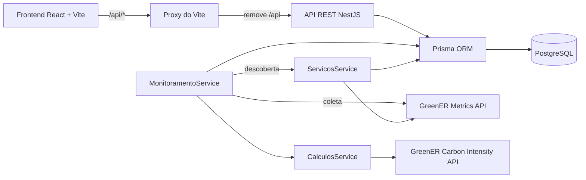

# Arquitetura do Sistema — GreenER

A aplicação é composta por uma SPA em React + TypeScript, um backend modular em NestJS + TypeScript, um banco de dados PostgreSQL via Prisma ORM e integrações HTTP com APIs externas de métricas e intensidade de carbono.

## Módulos e Componentes Implementados

| Camada / Módulo | Responsabilidade |
| --- | --- |
| `frontend/src/pages` | Rotas públicas (`/`, `/?demo=1`, `/ranking`, `/comparar`, `/mapa`, `/servicos/:id`, `/metodologia`, `/login`) e rota protegida `/admin` via React Router. |
| `frontend/src/components` | Layout responsivo, seletor global de período (`PeriodProvider`), cards e painel lateral de serviço, gráficos Recharts, mapa/globo interativo (`d3-geo` + Leaflet + MapLibre), painel de administração e saúde das integrações. |
| `frontend/src/services/api.ts` | Cliente HTTP relativo em `/api` com tratamento tipado (`ApiError`) e cancelamento por `AbortSignal`. |
| `backend/src/modules/servicos` | Descoberta e sincronização periódica com a API de métricas via `ServicosRepository`. |
| `backend/src/modules/monitoramento` | Orquestração periódica de descoberta e coleta respeitando intervalos dinâmicos (`/configuracao`) e timeouts explícitos. |
| `backend/src/modules/calculos` | Cálculo de energia (`kWh`) por recurso (CPU, RAM, disco e rede) e emissões (`gCO₂e`) com consulta à API de intensidade de carbono. |
| `backend/src/modules/coletas` | Registro, histórico com filtros e consulta à última coleta válida (`ColetasRepository`). |
| `backend/src/modules/indicadores` | Consolidação por período (`PeriodoDto`), série temporal (`/indicadores/serie`), ranking (`/ranking`) e matriz 7×24 de intensidade horária (`/intensidade/horarios`). |
| `backend/src/modules/mapa` | Agregação geográfica e série de emissões por intervalo para serviços com e sem coordenadas (`/mapa`). |
| `backend/src/modules/comparacao` | Comparação alinhada de totais e séries temporais de 2 a 5 serviços (`/comparacao`). |
| `backend/src/modules/simulacao` | Simulação de emissões caso um serviço rodasse em outra região monitorada (`/servicos/:id/simulacao-regiao`). |
| `backend/src/modules/saude` | Monitoramento em memória do estado e tempo de resposta do agregador, da API de carbono e da taxa de falha das coletas (`/saude`). |
| `backend/src/modules/auth` e `configuracao` | Autenticação JWT (`POST /auth/login`), seed do administrador inicial (`AdminSeedService`) e parametrização em runtime (`/configuracao`). |

## Fluxo de Dados

1. Ao iniciar, o backend valida variáveis obrigatórias (`validar-ambiente.ts`), verifica o schema PostgreSQL e cria o administrador inicial quando ainda não existe.
2. O `MonitoramentoService` executa ciclos periódicos (lendo `ConfiguracaoMonitoramento` sem reiniciar o servidor) para sincronizar `/services` e coletar `/metrics/{idExterno}`.
3. Para coletas válidas com duração positiva, o `CalculosService` estima a energia elétrica (`kWh`), consulta a intensidade de carbono regional (`gCO₂e/kWh`) e persiste a coleta com `estadoCalculo = CONCLUIDO`.
4. O frontend consulta os endpoints via proxy `/api`, mantendo estado de período compartilhado na URL e no contexto (`PeriodProvider`), com fallback visual para o modo `?demo=1` sem backend.

No Docker Compose, a rede interna resolve `postgres:5432` para o banco e `http://backend:3000` para o proxy do frontend, publicando a interface web em `http://localhost:5173` e a API/Swagger em `http://localhost:3000`.

Consulte também [documentação da API](api.md), [memória de cálculo](calculos.md), [guia de execução](execucao.md) e [plano de entregas](plano-de-entregas.md).
