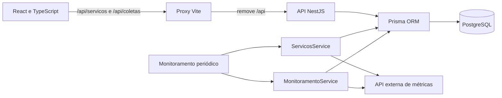

# Arquitetura atual — GreenER

Referência: `0adb1e0`, conferida em 19/10/2026. A aplicação é um frontend SPA, um backend NestJS modular e um PostgreSQL. Não há múltiplos microsserviços de negócio implementados.

## Componentes implementados

| Componente | Responsabilidade e limite atual |
| --- | --- |
| `frontend/src/pages` | Dashboard público, login indisponível e página 404, com React Router. |
| `frontend/src/components` | Layout, feedback, gráficos demonstrativos e painel conectado `LiveDashboard`. |
| `frontend/src/services/api.ts` | Cliente JSON por caminhos relativos, erros HTTP e cancelamento por signal fornecido. Não valida o JSON em runtime. |
| `frontend/src/hooks/usePageTitle.ts` | Título da página. A lógica de consultas periódicas ainda está no componente LiveDashboard. |
| `backend/src/modules/servicos` | Descobre, normaliza e sincroniza serviços; lista registros persistidos. Acessa Prisma diretamente. |
| `backend/src/modules/monitoramento` | Inicia ciclo ao subir o módulo, sincroniza descoberta e coleta sequencialmente os serviços não removidos. Persiste diretamente no Prisma. |
| `backend/src/modules/coletas` | API de registro/histórico/última coleta válida, DTOs e repository próprio. O coletor automático não passa por esse service. |
| `backend/src/database` | PrismaService e verificação das tabelas necessárias. |
| `backend/prisma` | Esquema e migrações versionadas. Regiao, Servico, Coleta e modelos reservados de usuário/configuração. |

## Fluxo de dados

1. O backend verifica conexão/schema e inicia monitoramento, por padrão a cada 30 segundos.
2. A descoberta recebe `/services`, valida a lista e sincroniza os registros. Novos/retornados aguardam coleta como `DESCONHECIDO`; ausentes de uma lista válida tornam-se `REMOVIDO`.
3. O coletor consulta `/metrics/{idExterno}`, grava resultado e atualiza estado. O histórico anterior é preservado.
4. O frontend consulta `/servicos` e a última coleta `SUCESSO` de cada serviço, atualizando a cada 30 segundos. Essa coleta pode ser antiga.
5. O modo `?demo=1` usa fixtures locais e não alimenta o banco ou os indicadores reais.

No Compose, os nomes de rede são `postgres`, `backend` e `frontend`. O navegador usa a porta publicada 5173; Vite encaminha para `http://backend:3000`. O backend usa PostgreSQL interno em `postgres:5432`.

## Decisões e melhorias necessárias

- A base modular e a injeção permitem substituir persistência/agendador em testes isolados.
- A separação em repositories é parcial: existe em coletas, mas descoberta e monitoramento concentram persistência e integração.
- A regra de ausência de métricas está duplicada e diverge entre registro manual e automático; deve ter uma implementação compartilhada.
- A leitura de localização não corresponde ao objeto `location` oficial. É necessário preservar a região original antes da integração de carbono.
- Coleta não tem timeout explícito nem trava de ciclo; o intervalo gravado não usa o intervalo real recebido.
- A carga do dashboard depende do sucesso de todas as consultas individuais. Extrair a coordenação para service/hook e isolar as falhas facilita teste e manutenção.

Não criar contexts/providers ou padrões de projeto sem uma necessidade de estado compartilhado/regra que os justifique. As mudanças recomendadas organizam responsabilidades já existentes.

## Planejado para as próximas entregas

Integração de carbono, cálculos ambientais, agregados, autenticação JWT/configuração protegida, ranking, comparação e mapa. O desenho completo de produto e as personas incluem esses fluxos futuros; eles ainda não são rotas disponíveis.

Consulte [plano de entregas](plano-de-entregas.md), [API implementada](api.md), [execução](execucao.md) e [revisão da Sprint 1](sprints/revisao-sprint-1.md).
