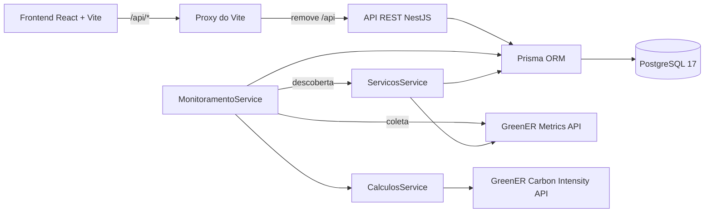
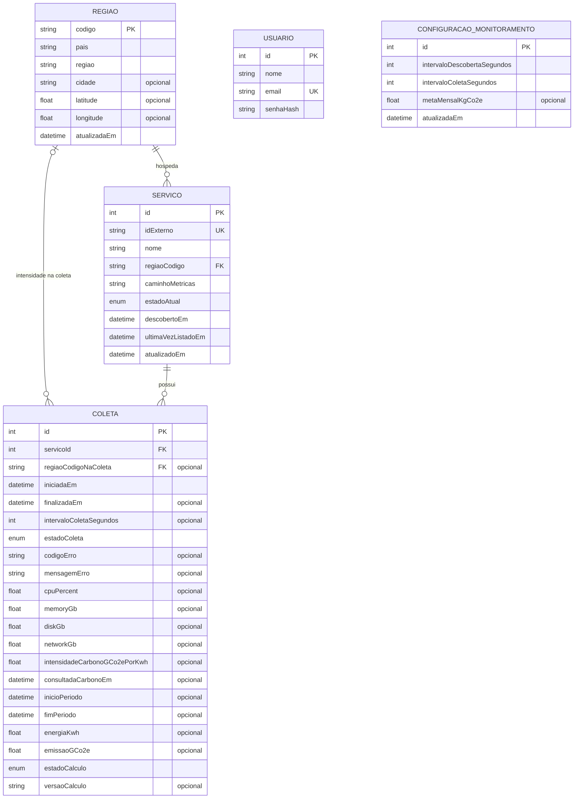

# Arquitetura do Sistema — GreenER

A aplicação é composta por uma SPA em React + TypeScript, um backend modular em NestJS + TypeScript, um banco de dados PostgreSQL 17 via Prisma ORM e integrações HTTP com APIs externas de métricas e intensidade de carbono.

## Diagrama de Arquitetura

## Modelo de Dados (ER — Prisma)

O diagrama abaixo reflete exatamente os modelos e relacionamentos definidos em [`backend/prisma/schema.prisma`](../backend/prisma/schema.prisma).

Enums persistidos no schema:

- **`EstadoMonitoramento`:** `DISPONIVEL`, `INDISPONIVEL`, `SEM_METRICAS`, `REMOVIDO`, `DESCONHECIDO` (padrão).
- **`EstadoColeta`:** `SUCESSO`, `SEM_METRICAS`, `FALHA`.
- **`EstadoCalculo`:** `PENDENTE` (padrão), `CONCLUIDO`, `FALHA`.

## Módulos e Componentes Implementados

| Camada / Módulo | Responsabilidade |
| --- | --- |
| `frontend/src/pages` | Rotas públicas (`/`, `/?demo=1`, `/ranking`, `/comparar`, `/mapa`, `/oportunidades`, `/servicos/:id`, `/metodologia`, `/relatorio`, `/qr-code`, `/login`) e rota protegida `/admin` via React Router (com `basename` e fallback SPA `404.html` + `.nojekyll` para GitHub Pages). |
| `frontend/src/components` | Layout responsivo com Modo TV (`?tv=1`, globo 3D WebGL e QR code ISO/IEC 18004), tour guiado, seletor global de período (`PeriodProvider`), cards com anel de CPU (`role="meter"`), contador ao vivo de CO₂e, painel de meta mensal com planeta reativo, corrida de barras, gráficos Recharts, mapa/globo interativo (`d3-geo` + Leaflet + MapLibre) com modo Simular, painel de oportunidades, administração e saúde das integrações. |
| `frontend/src/services/api.ts` | Cliente HTTP relativo em `/api` com tratamento tipado (`ApiError`), cancelamento por `AbortSignal` e bloqueio preventivo de chamadas ao backend quando `VITE_DEMO_MODE=true`. |
| `backend/src/common/regras` | Funções puras de domínio sem acoplamento a banco/HTTP: classificação de estado, resumo de coletas, simulação regional e regras de oportunidades de redução. |
| `backend/src/modules/servicos` | Descoberta e sincronização periódica com a API de métricas via `ServicosRepository`, retornando localização e composição de potência (`componentes`). |
| `backend/src/modules/monitoramento` | Orquestração periódica de descoberta e coleta respeitando intervalos dinâmicos (`/configuracao`) e timeouts explícitos de 8 segundos. |
| `backend/src/modules/calculos` | Cálculo de potência por recurso (CPU, RAM, disco e rede), energia (`kWh`) e emissões (`gCO₂e`) com consulta à API de intensidade de carbono (`CarbonApiService`). |
| `backend/src/modules/coletas` | Registro, histórico paginado com filtros (`pagina`, `tamanho`) e consulta à última coleta válida (`ColetasRepository`). |
| `backend/src/modules/indicadores` | Consolidação por período (`PeriodoDto`), meta mensal e projeção (`/indicadores/meta`), série temporal (`/indicadores/serie`), histórico por serviço (`/servicos/:id/historico`), ranking (`/ranking`) e matriz 7×24 de intensidade horária (`/intensidade/horarios`). |
| `backend/src/modules/mapa` | Agregação geográfica e série de emissões por intervalo para serviços com e sem coordenadas (`/mapa`). |
| `backend/src/modules/comparacao` | Comparação alinhada de totais e séries temporais de 2 a 5 serviços (`/comparacao`). |
| `backend/src/modules/simulacao` | Simulação de emissões caso um serviço rodasse em outra região monitorada (`/servicos/:id/simulacao-regiao`). |
| `backend/src/modules/oportunidades` | Avaliação das regras puras de redução de emissão (migração de região, possível superdimensionamento e mudança de horário) ordenadas pelo ganho estimado (`/oportunidades`). |
| `backend/src/modules/eventos` | Fluxo Server-Sent Events (`GET /eventos`) que publica em tempo real eventos `coleta-registrada` e `estado-alterado` para o frontend (`EventSource` com reconexão automática e fallback para polling de 30 s). |
| `backend/src/modules/saude` | Monitoramento em memória do estado e tempo de resposta do agregador, da API de carbono e da taxa de falha das coletas (`/saude`). |
| `backend/src/modules/auth` e `configuracao` | Autenticação JWT (`POST /auth/login` com limite de 5 tentativas/min), seed do administrador inicial (`AdminSeedService`) e parametrização de intervalos e `metaMensalKgCo2e` em runtime (`/configuracao`). |

## Fluxo de Dados

1. Ao iniciar, o backend valida variáveis obrigatórias (`validar-ambiente.ts`), verifica o schema PostgreSQL e cria o administrador inicial quando ainda não existe.
2. O `MonitoramentoService` executa ciclos periódicos (lendo `ConfiguracaoMonitoramento` sem reiniciar o servidor) para sincronizar `/services` e coletar `/metrics/{idExterno}`.
3. Para coletas válidas com duração positiva, o `CalculosService` estima a energia elétrica (`kWh`), consulta a intensidade de carbono regional (`gCO₂e/kWh`) e persiste a coleta com `estadoCalculo = CONCLUIDO`.
4. O frontend consulta os endpoints via proxy `/api`, mantendo estado de período compartilhado na URL e no contexto (`PeriodProvider`), com fallback visual para o modo `?demo=1` sem backend.

No Docker Compose, a rede interna resolve `postgres:5432` para o banco e `http://backend:3000` para o proxy do frontend, publicando a interface web em `http://localhost:5173` e a API/Swagger em `http://localhost:3000`.

## Integração com APIs Externas, Timeouts e Fallback

| Variável | Exemplo / Padrão | Endpoint externo consumido | Timeout | Comportamento de fallback / falha |
| --- | --- | --- | --- | --- |
| `METRICS_API_URL` | `https://metrics.unilaunch.org` | `GET /services` e `GET /metrics/:id` | `8000 ms` (`DISCOVERY_FETCH_TIMEOUT_MS` e `METRICS_FETCH_TIMEOUT_MS`) | Falha/timeout na descoberta registra `agregador = FALHA` em `/saude` e preserva serviços já salvos. Na coleta individual, 5xx/rede/timeout marcam `INDISPONIVEL` + `estadoColeta = FALHA` e o ciclo segue para os demais serviços; HTTP 404 ou ausência de métricas marcam `SEM_METRICAS`. |
| `CARBON_API_URL` | `https://carbon.unilaunch.org` | `GET /regions/:code/carbon-intensity` | `8000 ms` (`CARBON_FETCH_TIMEOUT_MS` via `comTimeout`) | Falha, resposta inválida ou timeout preservam as medições brutas e `energiaKwh`, gravam `estadoColeta = SUCESSO` e `estadoCalculo = FALHA`, e registram `apiCarbono = FALHA` em `/saude`. |
| `METRICS_POLL_INTERVAL_MS` | `30000` | — (agendador interno) | — | Usado como fallback quando a leitura de `ConfiguracaoMonitoramento` falha; caso o valor seja inválido, recorre a `30000 ms`. |

Na camada de consulta e interface, `GET /coletas/servico/:servicoId/ultima-valida` devolve a última coleta `SUCESSO` preservada (`CACHE_FALLBACK`), e a rota `/?demo=1` permite navegar por todas as telas com dados fictícios identificados quando o backend estiver fora do ar.

## Execução e Testes (Resumo)

- **Docker Compose (recomendado):** `docker compose up --build` (ou `docker compose down -v && docker compose up --build` para iniciar do zero com banco limpo).
- **Execução local:** PostgreSQL ativo + `npm.cmd ci`, `npx.cmd prisma generate --config prisma7.config.ts`, `npx.cmd prisma migrate deploy --config prisma7.config.ts` e `npm.cmd run start:dev` em `backend/`; `npm.cmd ci` e `npm.cmd run dev` em `frontend/`.
- **Testes do backend (`backend/`):** `npm.cmd test`, `npm.cmd run test:cov` (cobertura mínima de 80% em `*.service.ts` e `*.repository.ts`), `npm.cmd run test:e2e` (Supertest contra PostgreSQL `*_e2e`) e `npm.cmd run lint`.
- **Testes do frontend (`frontend/`):** `npm.cmd test` (Node + Vitest), `npm.cmd run test:coverage`, `npm.cmd run lint`, `npm.cmd run format:check` e `npm.cmd run test:e2e` (Playwright + Axe).

Consulte o passo a passo completo em [guia de execução](execucao.md), além de [documentação da API](api.md), [memória de cálculo](calculos.md), [segurança](seguranca.md) e [plano de entregas](plano-de-entregas.md).
