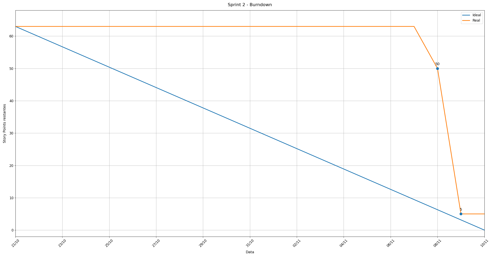

# Burndown e Métricas — Sprint 2

## Visão Geral

A Sprint 2 estabeleceu uma baseline de **10 itens e 63 Story Points (SP)**, compreendendo os cálculos ambientais, indicadores agregados, dashboard operacional com cards e localização, autenticação JWT, proteção de segurança e cobertura de testes unitários.

Ao encerramento do ciclo de desenvolvimento, **9 itens foram concluídos (58 SP)** e 1 item permaneceu em andamento (**#16**, 5 SP), atingindo uma taxa de entrega de **92%**.

| Arquivo | Finalidade |
| --- | --- |
| [periodo.json](metricas/sprint-2/periodo.json) | Período da sprint, datas de corte e pontos planejados/entregues. |
| [escopo.csv](metricas/sprint-2/escopo.csv) | Baseline dos 10 itens da sprint, responsáveis, status e fechamento. |
| [GreenER_Burndown_Sprint2.png](GreenER_Burndown_Sprint2.png) | Gráfico de evolução temporal dos Story Points restantes. |

---

## 📉 Gráfico de Burndown

---

## Dados Históricos e Regra de Baixa

A baixa de pontos no burndown seguiu estritamente o critério de **aceite e fechamento das issues no GitHub**:
- Enquanto uma issue estiver com PR em aberto ou em revisão, todos os seus Story Points permanecem no saldo devedor;
- Apenas com a homologação e fechamento verificado da issue no GitHub os pontos são integralmente baixados.

### Linha do Tempo (Datas UTC):
- **21/10/2026 (Início):** 63 SP (10 itens no backlog da sprint).
- **21/10 a 07/11/2026:** Desenvolvimento das regras de cálculo, fórmulas na API de carbono, tela de login e estruturação dos cards de dashboard (saldo mantido em 63 SP).
- **08/11/2026:** Fechamento de 13 SP:
  - [#6](https://github.com/abpundefined/3DSM-ABP-UNDEFINED/issues/6) — [PBI-06] Cálculo individual de consumo e emissão (8 SP)
  - [#19](https://github.com/abpundefined/3DSM-ABP-UNDEFINED/issues/19) — [PBI-19] Segurança (5 SP)
  - *Saldo:* **50 SP**.
- **09/11/2026:** Validação e fechamento de 45 SP após integração dos PRs na `develop`:
  - [#7](https://github.com/abpundefined/3DSM-ABP-UNDEFINED/issues/7) — [PBI-07] Indicadores agregados (5 SP)
  - [#8](https://github.com/abpundefined/3DSM-ABP-UNDEFINED/issues/8) — [PBI-08] Dashboard operacional (13 SP)
  - [#10](https://github.com/abpundefined/3DSM-ABP-UNDEFINED/issues/10) — [PBI-10] Atualização automática do dashboard (5 SP)
  - [#11](https://github.com/abpundefined/3DSM-ABP-UNDEFINED/issues/11) — [PBI-11] Localização dos serviços (3 SP)
  - [#15](https://github.com/abpundefined/3DSM-ABP-UNDEFINED/issues/15) — [PBI-15] Autenticação JWT (8 SP)
  - [#17](https://github.com/abpundefined/3DSM-ABP-UNDEFINED/issues/17) — [PBI-17] Exibição de intervalos e timestamps (3 SP)
  - [#20](https://github.com/abpundefined/3DSM-ABP-UNDEFINED/issues/20) — [PBI-20] Testes unitários (8 SP)
  - *Saldo:* **5 SP**.
- **10/11/2026 (Review):** Encerramento com 5 SP em aberto referente à issue [#16](https://github.com/abpundefined/3DSM-ABP-UNDEFINED/issues/16) (Interface responsiva e acessível), transferida para conclusão na Sprint 3.

