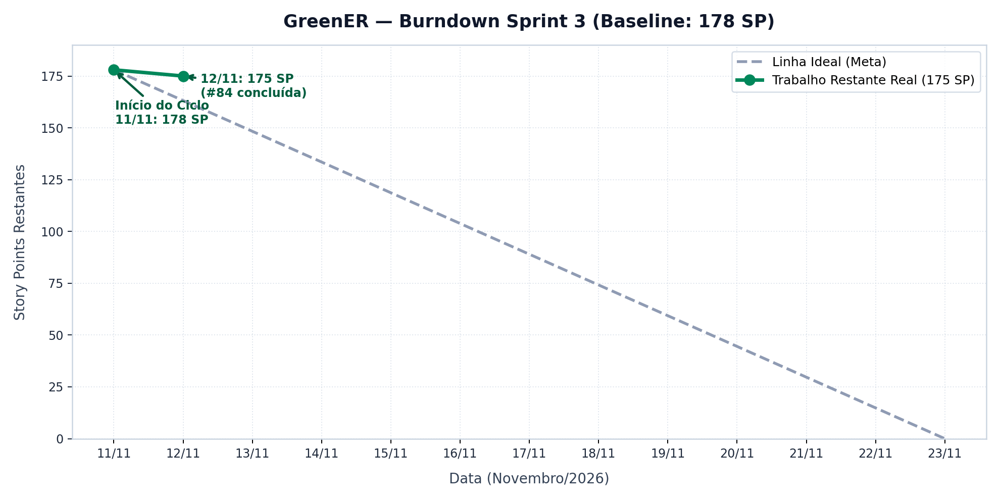

# Burndown e Métricas — Sprint 3

## Visão Geral

A Sprint 3 estabeleceu uma baseline de **51 itens comprometidos totalizando 178 Story Points (SP)**, compreendendo as análises avançadas (ranking, comparação temporal, mapa animado e histórico), usabilidade completa (resolução dos achados P01 a P08 e testes com usuários reais), testes E2E com PostgreSQL no CI, cobertura de 80% nos serviços e repositories, página de administração dos intervalos, diferenciais visuais/analíticos e pacote completo para a feira de tecnologia (24 e 25/11).

| Arquivo | Finalidade |
| --- | --- |
| [periodo.json](metricas/sprint-3/periodo.json) | Período da sprint, datas de corte e pontos planejados/entregues. |
| [escopo.csv](metricas/sprint-3/escopo.csv) | Baseline dos 51 itens comprometidos da sprint, responsáveis, status e fechamento. |
| [GreenER_Burndown_Sprint3.png](GreenER_Burndown_Sprint3.png) | Gráfico de evolução temporal dos Story Points restantes. |

---

## 📉 Gráfico de Burndown

---

## Dados Históricos e Regra de Baixa

A baixa de pontos no burndown segue estritamente o critério de **aceite e fechamento das issues no GitHub**:
- Enquanto uma issue estiver com PR em aberto ou em revisão, todos os seus Story Points permanecem no saldo devedor;
- Apenas com a homologação e fechamento verificado da issue no GitHub os pontos são integralmente baixados;
- **PBIs Guarda-Chuva (#12, #13, #14, #83, #97, #121, #128, #137):** não somam pontos diretamente ao burndown, pois seus pontos estão distribuídos e são baixados em suas respectivas tarefas filhas;
- **Backlog de Reserva e Opcionais (10 itens, 29 SP):** possuem a label `could` e permanecem fora da baseline inicial de 178 SP, sendo incorporados apenas caso integrantes finalizem seus compromissos com antecedência.

### Linha do Tempo (Datas UTC):
- **11/11/2026 (Início do Ciclo):** 178 SP restantes (51 itens comprometidos abertos).
- **12/11/2026:** 175 SP restantes (1 item concluído: [#84](https://github.com/abpundefined/3DSM-ABP-UNDEFINED/issues/84) — 3 SP, via PR [#160](https://github.com/abpundefined/3DSM-ABP-UNDEFINED/pull/160)).
