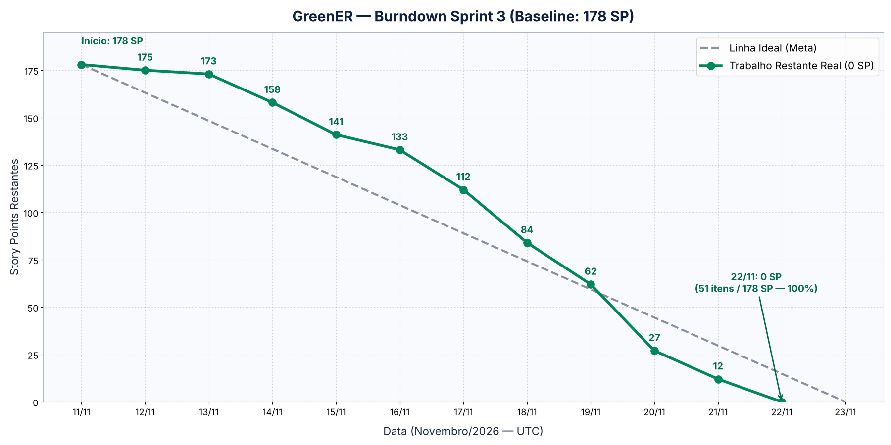

# Burndown e Métricas — Sprint 3

## Visão Geral

A Sprint 3 estabeleceu uma baseline de **51 itens comprometidos totalizando 178 Story Points (SP)**, compreendendo as análises avançadas (ranking, comparação temporal, mapa animado e histórico), usabilidade completa (resolução dos achados P01 a P08 e testes com usuários reais), testes E2E com PostgreSQL no CI, cobertura de 80% nos serviços e repositories, página de administração dos intervalos, diferenciais visuais/analíticos e pacote completo para a feira de tecnologia (24 e 25/11).

| Arquivo | Finalidade |
| --- | --- |
| [periodo.json](metricas/sprint-3/periodo.json) | Período da sprint, datas de corte e pontos planejados/entregues. |
| [escopo.csv](metricas/sprint-3/escopo.csv) | Baseline dos 51 itens comprometidos da sprint, responsáveis, status e fechamento. |
| [GreenER_Burndown_Sprint3.png](GreenER_Burndown_Sprint3.png) | Gráfico de evolução temporal dos Story Points restantes. |

---

## 📉 Gráfico de Burndown

---

## Dados Históricos e Regra de Baixa

A baixa de pontos no burndown segue estritamente o critério de **aceite e fechamento das issues no GitHub**:
- Enquanto uma issue estiver com PR em aberto ou em revisão, todos os seus Story Points permanecem no saldo devedor;
- Apenas com a homologação e fechamento verificado da issue no GitHub os pontos são integralmente baixados;
- **PBIs Guarda-Chuva (#12, #13, #14, #83, #97, #121, #128, #137):** não somam pontos diretamente ao burndown, pois seus pontos estão distribuídos e são baixados em suas respectivas tarefas filhas;
- **Backlog de Reserva e Opcionais (10 itens, 29 SP):** possuem a label `could` e permanecem fora da baseline inicial de 178 SP, sendo incorporados apenas caso integrantes finalizem seus compromissos com antecedência.

### Linha do Tempo (Datas UTC):
- **11/11/2026 (Início do Ciclo):** 178 SP restantes (51 itens comprometidos abertos).
- **12/11/2026:** 175 SP restantes (1 item concluído: [#84](https://github.com/abpundefined/3DSM-ABP-UNDEFINED/issues/84) — 3 SP, via PR [#160](https://github.com/abpundefined/3DSM-ABP-UNDEFINED/pull/160)).
- **13/11/2026:** 173 SP restantes (+1 item concluído: [#85](https://github.com/abpundefined/3DSM-ABP-UNDEFINED/issues/85) — 2 SP, via PR [#162](https://github.com/abpundefined/3DSM-ABP-UNDEFINED/pull/162)).
- **14/11/2026:** 158 SP restantes (+3 itens concluídos: [#95](https://github.com/abpundefined/3DSM-ABP-UNDEFINED/issues/95) — 5 SP via PR [#163](https://github.com/abpundefined/3DSM-ABP-UNDEFINED/pull/163); [#79](https://github.com/abpundefined/3DSM-ABP-UNDEFINED/issues/79) — 5 SP via PR [#164](https://github.com/abpundefined/3DSM-ABP-UNDEFINED/pull/164); [#86](https://github.com/abpundefined/3DSM-ABP-UNDEFINED/issues/86) — 5 SP via PR [#165](https://github.com/abpundefined/3DSM-ABP-UNDEFINED/pull/165)).
- **15/11/2026:** 141 SP restantes (+3 itens concluídos: [#96](https://github.com/abpundefined/3DSM-ABP-UNDEFINED/issues/96) — 9 SP via PR [#170](https://github.com/abpundefined/3DSM-ABP-UNDEFINED/pull/170); [#88](https://github.com/abpundefined/3DSM-ABP-UNDEFINED/issues/88) — 3 SP via PR [#169](https://github.com/abpundefined/3DSM-ABP-UNDEFINED/pull/169); [#78](https://github.com/abpundefined/3DSM-ABP-UNDEFINED/issues/78) — 5 SP via PR [#171](https://github.com/abpundefined/3DSM-ABP-UNDEFINED/pull/171)). Acumulado: 8 itens concluídos (37 SP entregues).
- **16/11/2026:** 133 SP restantes (+2 itens concluídos: [#93](https://github.com/abpundefined/3DSM-ABP-UNDEFINED/issues/93) — 5 SP via PR [#174](https://github.com/abpundefined/3DSM-ABP-UNDEFINED/pull/174); [#98](https://github.com/abpundefined/3DSM-ABP-UNDEFINED/issues/98) — 3 SP via PR [#179](https://github.com/abpundefined/3DSM-ABP-UNDEFINED/pull/179)).
- **17/11/2026:** 112 SP restantes (+6 itens concluídos: [#110](https://github.com/abpundefined/3DSM-ABP-UNDEFINED/issues/110) — 2 SP via PR [#185](https://github.com/abpundefined/3DSM-ABP-UNDEFINED/pull/185); [#122](https://github.com/abpundefined/3DSM-ABP-UNDEFINED/issues/122) — 2 SP via PR [#187](https://github.com/abpundefined/3DSM-ABP-UNDEFINED/pull/187); [#135](https://github.com/abpundefined/3DSM-ABP-UNDEFINED/issues/135) — 3 SP via PR [#188](https://github.com/abpundefined/3DSM-ABP-UNDEFINED/pull/188); [#115](https://github.com/abpundefined/3DSM-ABP-UNDEFINED/issues/115) — 3 SP via PR [#182](https://github.com/abpundefined/3DSM-ABP-UNDEFINED/pull/182); [#104](https://github.com/abpundefined/3DSM-ABP-UNDEFINED/issues/104) — 5 SP via PR [#183](https://github.com/abpundefined/3DSM-ABP-UNDEFINED/pull/183); [#91](https://github.com/abpundefined/3DSM-ABP-UNDEFINED/issues/91) — 6 SP via PR [#186](https://github.com/abpundefined/3DSM-ABP-UNDEFINED/pull/186)).
- **18/11/2026:** 92 SP restantes (+3 itens concluídos: [#106](https://github.com/abpundefined/3DSM-ABP-UNDEFINED/issues/106) — 5 SP via PR [#190](https://github.com/abpundefined/3DSM-ABP-UNDEFINED/pull/190); [#99](https://github.com/abpundefined/3DSM-ABP-UNDEFINED/issues/99) — 7 SP via PRs [#173](https://github.com/abpundefined/3DSM-ABP-UNDEFINED/pull/173), [#177](https://github.com/abpundefined/3DSM-ABP-UNDEFINED/pull/177) e [#194](https://github.com/abpundefined/3DSM-ABP-UNDEFINED/pull/194); [#81](https://github.com/abpundefined/3DSM-ABP-UNDEFINED/issues/81) — 8 SP via PRs [#166](https://github.com/abpundefined/3DSM-ABP-UNDEFINED/pull/166), [#167](https://github.com/abpundefined/3DSM-ABP-UNDEFINED/pull/167), [#175](https://github.com/abpundefined/3DSM-ABP-UNDEFINED/pull/175) e [#180](https://github.com/abpundefined/3DSM-ABP-UNDEFINED/pull/180)). Acumulado: 19 itens concluídos (86 SP entregues).
