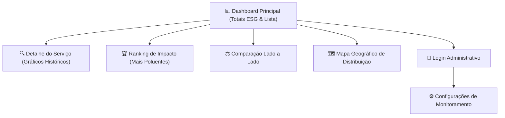

# 🎨 Interface e Usabilidade (IHC) — GreenER

> **Critérios da Rubrica:** IHC01, IHC02, IHC03, IHC04, IHC05, IHC06  
> **Repositório:** [abpundefined/3DSM-ABP-UNDEFINED](https://github.com/abpundefined/3DSM-ABP-UNDEFINED)  
> **Equipe:** Undefined  
> **Link do Protótipo no Figma:** [Acessar Projeto no Figma](https://www.figma.com/design/CzTTbJAFqZrm2eUIBTSCNl/Undefined-FatecABP-GreenER?node-id=0-1) *(referência atual do README; versão/aprovação a confirmar)*

---

## 👥 1. Identificação de Usuários e Tarefas (IHC01)

Para orientar o design da interface e a hierarquia visual das informações, foram definidas duas **Personas** principais representativas dos usuários da plataforma:

### 👤 Persona 1: Beatriz Menezes — Gestora de TI e Sustentabilidade (ESG)
* **Perfil:** 38 anos, diretora de tecnologia responsável pelo cumprimento de metas ESG e descarbonização de TI.
* **Necessidades:**
  - Acompanhar se a organização está dentro do orçamento de emissões de carbono corporativo.
  - Relatórios consolidados de emissão mensal e trimestral em formato claro e exportável.
  - Identificar quais aplicações em nuvem mais oneram a pegada de carbono da empresa.
* **Tarefas Prioritárias na Plataforma:**
  1. Visualizar o total agregado de emissões de $CO_2e$ e consumo em kWh no painel principal.
  2. Consultar o **Ranking de Impacto** para descobrir os 3 serviços mais poluentes do mês.
  3. Comparar dois serviços equivalentes para justificar migração para data centers mais sustentáveis.

---

### 👤 Persona 2: Lucas Ferreira — Engenheiro de Operações e DevOps
* **Perfil:** 27 anos, engenheiro de confiabilidade (SRE) responsável pela disponibilidade e eficiência de microsserviços.
* **Necessidades:**
  - Monitoramento contínuo em tempo real do status das aplicações.
  - Rápida identificação de anomalias (serviços caídos ou que pararam de enviar telemetria).
  - Configuração de intervalos de coleta e limites de tolerância a falhas.
* **Tarefas Prioritárias na Plataforma:**
  1. Acompanhar a lista de serviços ativos, indisponíveis e sem métricas no dashboard operacional.
  2. Inspecionar o gráfico histórico de CPU, memória e energia de um serviço com incidente recente.
  3. Acessar a área autenticada para reconfigurar a periodicidade das coletas.

---

## 📱 2. Protótipos e Fluxos de Navegação (IHC02)

O diagrama abaixo representa o fluxo de produto planejado. Na versão atual existem dashboard, demonstração, login indisponível e 404; detalhe, ranking, comparação, mapa e configuração ainda não são rotas implementadas. A quantidade de cliques e a navegação do protótipo precisam de verificação, não são resultados de teste registrados:

### 🖼️ Telas Planejadas e Prototipadas no Figma:
1. **Dashboard Geral:** Exibição dos cards de totais (Energia em kWh e Carbono em kgCO₂e), barra de busca de serviços e tabela com status em tempo real.
2. **Visualização em Mapa:** Mapa-múndi interativo com pontos georreferenciados coloridos e com ícones informativos.
3. **Módulo de Comparação:** Seleção múltipla de serviços com gráficos sobrepostos de intensidade de carbono.
4. **Painel de Configuração:** Formulário limpo e restrito via autenticação JWT para ajuste de rotinas.

---

## 🏷️ 3. Indicadores e estados atuais (IHC03)

O painel conectado exibe CPU em %, memória/disco/rede em GB, estados com texto e ícone e valores ambientais indisponíveis até os cálculos. A data de atualização da consulta e a data da coleta válida mais recente são informações diferentes.

Pendências: informar timestamp/fallback por serviço, distinguir quantidade desconhecida de zero confirmado e definir o total que inclui/exclui removidos. A data global atual é o máximo entre as coletas e não garante que todas sejam recentes. IHC03 continua previsto para evolução na Sprint 2.

## ⚡ 4. Responsividade e feedback (IHC04)

Há carregamento, vazio, erro, navegação por teclado e componentes com texto/ícone. Na auditoria isolada de 19/10, passaram 22 testes de navegador e oito combinações adicionais do dashboard conectado (360/390/768/1440 px, claro/escuro), sem overflow da página ou violações automáticas nas regras Axe/WCAG selecionadas. A tabela usa rolagem própria. Isso não comprova ausência de todos os problemas de acessibilidade nem substitui avaliação com usuários.

A falha de um serviço ainda pode bloquear toda a primeira carga; após sucesso, uma atualização com erro mantém os dados anteriores e informa isso. Resultados e limites: [revisão técnica](sprints/revisao-sprint-1.md).

---

## 🧪 5. Avaliação de Usabilidade (IHC05)

### 5.1. Avaliação heurística dos protótipos — registro inicial

**Atividade:** [PBI-23 — Protótipos e avaliação de usabilidade](https://github.com/abpundefined/3DSM-ABP-UNDEFINED/issues/23).  
**Responsável:** Thales Cambraia Dias.  
**Situação:** avaliação heurística realizada; documentação em consolidação.  
**Data da avaliação:** a registrar pelo responsável.  
**Referência histórica informada no registro inicial:** [GreenER no Figma](https://www.figma.com/design/rnEO8oYXAzDEnUbBt2NWwu/GreenER-Figma). O README passou a apontar para outro arquivo em 16/10; confirmar com o responsável qual arquivo/versão foi efetivamente avaliado, preservando esse histórico. Não foi presumido que a avaliação antiga ocorreu no arquivo novo.

#### Objetivo e método

Verificar a clareza e a organização das telas usando princípios de usabilidade, como feedback, consistência e controle do usuário.

**Telas avaliadas:** dashboard sem dados e com dados demonstrativos, gráficos, lista de serviços e acesso administrativo.

#### Evidências visíveis nos protótipos

As observações das capturas abaixo devem ser confirmadas com as anotações da avaliação realizada pelo responsável.

| Heurística de Nielsen | Evidência visível |
| --- | --- |
| H1 — Visibilidade do estado do sistema | Mensagem “Aguardando primeira coleta”, identificação dos dados fictícios e indicação de atualização simulada. |
| H2 — Correspondência com o mundo real | Rótulos de energia e emissões, unidades kWh e kgCO₂e e explicações dos indicadores no estado vazio. |
| H3 — Controle e liberdade do usuário | Opções “Voltar ao dashboard” e “Voltar ao estado vazio”; funcionamento a conferir no protótipo navegável. |
| H4 — Consistência e padrões | Identidade visual verde, cabeçalho e apresentação dos cards seguem um padrão entre as telas. |
| H8 — Design estético e minimalista | Totais ambientais aparecem em destaque, com gráficos e lista de serviços agrupados em blocos. |

#### Ajustes sugeridos para confirmação

- **Acesso administrativo (H1/H5):** a tela informa que não permite entrar, mas exibe o botão “Entrar”. Avaliar desabilitar a ação ou identificá-la como demonstração.
- **Leitura:** conferir a legibilidade dos textos menores e o contraste. As capturas não comprovam uma relação de contraste específica.

São sugestões a confirmar; a aplicação dos ajustes ainda não está documentada.

#### Pendências para concluir o registro

- Informar a data real e os resultados da avaliação.
- Anexar evidências dos achados confirmados e dos ajustes, preferencialmente antes/depois.
- Justificar quando um ajuste não for necessário.

O teste com usuários da Sprint 3 continua planejado. Este registro não apresenta resultados de participantes ou questionário SUS.

**Referência:** [10 heurísticas de usabilidade de Jakob Nielsen — Nielsen Norman Group](https://www.nngroup.com/articles/ten-usability-heuristics/).

### 5.2. Plano de teste com usuários — previsto para Sprint 3

O teste de usabilidade está planejado para o início da Sprint 3 com **5 usuários reais** (estudantes e profissionais de TI).

#### 📋 Roteiro de teste proposto

1. **Tarefa 1:** localizar o serviço que consumiu a maior quantidade de energia nas últimas 24 horas.
2. **Tarefa 2:** selecionar dois serviços e comparar suas emissões de CO₂e.
3. **Tarefa 3:** identificar se existe algum serviço fora do ar e qual sua região de hospedagem.

#### Métricas previstas

- Taxa de sucesso na conclusão das tarefas sem assistência.
- Tempo de execução por tarefa.
- Questionário SUS (System Usability Scale) ao final do teste.

---

## 🚀 6. Melhorias Decorrentes da Avaliação (IHC06)

As sugestões da avaliação heurística estão registradas na seção 5.1. Após sua confirmação, os ajustes serão acompanhados na atividade #23.

Para cada melhoria, deverão ser registrados:

- Problema identificado e heurística relacionada.
- Ajuste proposto.
- Situação do ajuste: pendente, implementado ou validado.
- Evidências da interface antes e depois da alteração.

Até o momento, a aplicação das sugestões da avaliação heurística não está documentada.

Após os testes com usuários previstos para a Sprint 3, os problemas identificados também serão registrados em issues do GitHub e acompanhados até sua correção e validação.

## Registro necessário para concluir a #23

Responsável atual no GitHub: Thales. PO: Rainan. Preencher com os fatos da avaliação já mencionada, sem usar sugestões de auditoria como achados confirmados pelo avaliador:

| Informação | Situação |
| --- | --- |
| Data e participantes/avaliadores | Não registrados. |
| Arquivo, página/fluxo e versão do protótipo avaliado | Confirmar, pois há uma referência histórica e uma atual. |
| Aprovação do protótipo pelo PO | Registrar versão/data e evidência. |
| Problema observado, heurística e evidência | Confirmar achados e anexar captura/anotação. |
| Ajuste, antes/depois ou justificativa de pendência | Não consolidado. |
| Critérios da #23 e aceite | Permanecem em andamento até concluir resultados/ajustes e revisão. |

O plano de avaliação com usuários da Sprint 3 permanece futuro. A rubrica exige ao menos uma avaliação com usuários representativos na fase prevista; cinco participantes é uma opção registrada no plano do time, não uma atividade já executada.
