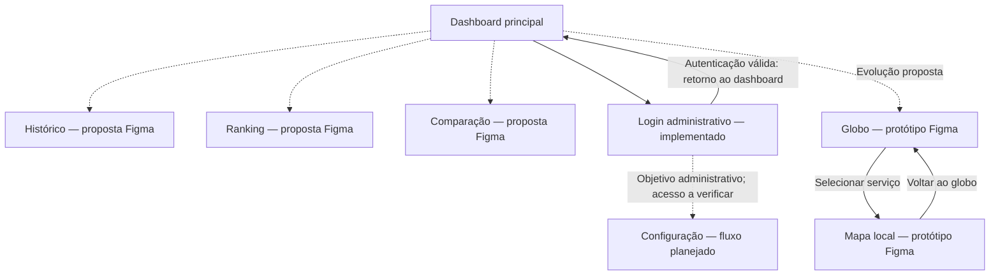

# 🎨 Interface e Usabilidade (IHC) — GreenER

> **Critérios da Rubrica:** IHC01, IHC02, IHC03, IHC04, IHC05, IHC06  
> **Repositório:** [abpundefined/3DSM-ABP-UNDEFINED](https://github.com/abpundefined/3DSM-ABP-UNDEFINED)  
> **Equipe:** Undefined  
> **Responsável pela documentação:** Thales Cambraia Dias  
> **Sprint de referência:** Sprint 2 (histórico) e Sprint 3 (Rodada 1 de IHC)  
> **Atualização da documentação:** 13/11/2026 (Rodada 1 e referências às capturas complementares)  
> **Registro anterior:** revisão da Sprint 2 em 08/11/2026  
> **Código consultado na Sprint 2:** `afe3865fa0833ce0a33ffa3d337362738a7e769a` — branch `develop`  
> **Código de referência da Rodada 1:** `76b4658f2e122d683018012bdcc41ead2988451f` — branch `develop`  
> **Evidências complementares:** [PR #167](https://github.com/abpundefined/3DSM-ABP-UNDEFINED/pull/167), aberto para revisão na data desta atualização  
> **Apresentação da Sprint 2:** 10/11/2026  
> **Protótipo oficial no Figma:** [Acessar Projeto no Figma](https://www.figma.com/design/CzTTbJAFqZrm2eUIBTSCNl/Undefined-FatecABP-GreenER?node-id=0-1)  
> **Página das telas selecionadas:** GreenER — Interfaces

---

## 👥 1. Identificação de Usuários e Tarefas (IHC01)

Para orientar o design da interface e a hierarquia visual das informações, foram definidas duas **personas** representativas dos usuários da plataforma.

As personas orientam o projeto e o planejamento dos testes. Não representam, necessariamente, participantes das verificações realizadas.

### 👤 Persona 1: Beatriz Menezes — Gestora de TI e Sustentabilidade (ESG)

* **Perfil:** 38 anos, diretora de tecnologia responsável pelo acompanhamento de metas ESG e descarbonização de TI.
* **Necessidades:**
  - Acompanhar as emissões estimadas dos serviços monitorados.
  - Consultar informações consolidadas de consumo de energia e emissões.
  - Identificar os serviços com maior impacto ambiental estimado.
* **Tarefas Prioritárias na Plataforma:**
  1. Visualizar os totais de emissões de CO₂e e consumo em kWh.
  2. Consultar o ranking de impacto.
  3. Comparar serviços para apoiar decisões sobre eficiência e infraestrutura.

---

### 👤 Persona 2: Lucas Ferreira — Engenheiro de Operações e DevOps

* **Perfil:** 27 anos, engenheiro de confiabilidade responsável pela disponibilidade e eficiência de microsserviços.
* **Necessidades:**
  - Acompanhar os estados operacionais das aplicações.
  - Identificar serviços indisponíveis ou sem telemetria válida.
  - Relacionar métricas, histórico e região de hospedagem.
* **Tarefas Prioritárias na Plataforma:**
  1. Consultar serviços ativos, indisponíveis e sem métricas.
  2. Inspecionar o histórico de um serviço.
  3. Consultar informações detalhadas dos serviços monitorados.
  4. Na evolução geográfica proposta, localizar serviços no globo e no mapa.

---

## 📱 2. Protótipos e Fluxos de Navegação (IHC02)

As telas selecionadas para apresentação estão organizadas na página **GreenER — Interfaces**, no arquivo oficial do Figma.

A página **GreenER — Exploração geográfica** foi mantida como registro dos estudos e das versões adicionais.

### 🧭 Fluxo de navegação proposto

O diagrama combina o fluxo implementado de login com a navegação proposta. Ligações pontilhadas indicam fluxos planejados; o trecho globo–mapa também pertence exclusivamente ao Figma.

Na versão do [roteador consultada para a Sprint 2](../frontend/src/App.tsx), estavam definidos o dashboard em `/`, o redirecionamento de `/dashboard` para `/`, o login em `/login` e o tratamento de páginas não encontradas. Naquele recorte, Histórico, Ranking, Comparação e Configuração não possuíam rotas próprias nesse arquivo; o dashboard já reunia componentes e gráficos.

**Atualização da Sprint 3 (13/11):** a [issue #85](https://github.com/abpundefined/3DSM-ABP-UNDEFINED/issues/85) introduziu as rotas `/ranking`, `/comparar`, `/mapa`, `/servicos/:id`, `/admin` e `/metodologia`, com páginas inicialmente provisórias. As rotas foram criadas com páginas provisórias. A Rodada 1 da seção 5.2 examina a navegação comum do cabeçalho e a barra inferior móvel; os conteúdos finais ficam para a Rodada 2.

### 🖼️ Telas selecionadas no Figma

1. **Dashboard Geral:** indicadores consolidados, gráficos e lista de serviços.
2. **Histórico do Serviço:** acompanhamento das métricas do serviço selecionado.
3. **Ranking de Impacto:** identificação dos serviços com maiores estimativas no período.
4. **Comparação de Serviços:** indicadores apresentados lado a lado.
5. **Exploração Geográfica — Globo:** representação da distribuição dos serviços, marcadores, filtros e painel de detalhes.
6. **Exploração Geográfica — Mapa Local:** representação da região do serviço selecionado, marcador e retorno ao globo.

O arquivo também reúne componentes reutilizáveis, como cabeçalhos, botões, indicadores e cards comparativos.

### 🔐 Login administrativo no frontend

O dashboard é público e possui acesso à tela de login administrativo. O [PR #60](https://github.com/abpundefined/3DSM-ABP-UNDEFINED/pull/60) foi integrado à `develop` em 08/11/2026.

O [código atual do login](../frontend/src/pages/Login.tsx) contém formulário de e-mail e senha, envio à API de autenticação, estado “Entrando...”, bloqueio do envio durante a requisição, mensagens de erro, controle de visibilidade da senha e retorno ao dashboard após autenticação válida.

A avaliação do painel de configuração e das autorizações das demais rotas será realizada separadamente.

### 🌍 Nova versão do protótipo: Globo com Mapa

Na Sprint 2, o protótipo do Figma foi ampliado com telas de exploração geográfica, incorporando uma sugestão do integrante **Israel**.

A experiência proposta contempla:

1. Visualização dos serviços distribuídos no globo.
2. Seleção de um marcador ou de um serviço na lista.
3. Giro e centralização do globo em direção ao destino.
4. Aproximação da região selecionada.
5. Transição para o mapa local.
6. Consulta dos detalhes do serviço.
7. Retorno à visão global.

**Situação registrada na Sprint 2:** o globo e o mapa local estavam exclusivamente no protótipo do Figma. O globo, a animação de transição e a integração com o mapa não estavam implementados no frontend. A rota `/mapa` criada na Sprint 3 ainda é provisória e será avaliada quando a experiência geográfica estiver implementada.

A fluidez das conexões e transições do protótipo deverá ser conferida no modo de apresentação do Figma.

As localizações representadas são aproximadas e os dados demonstrativos devem permanecer identificados.

---

## 🏷️ 3. Indicadores e Estados da Interface (IHC03)

O projeto adota as seguintes unidades e identificações como padrão de apresentação. A implementação de cada campo é acompanhada nas funcionalidades correspondentes:

| Indicador | Unidade ou identificação |
| --- | --- |
| Consumo de energia | kWh |
| Emissões estimadas | kgCO₂e |
| Uso de CPU | % |
| Uso de memória | GB |
| Estado operacional | Texto, ícone e cor |
| Atualização dos dados | Data e horário |
| Localização, quando disponível | Região e coordenadas |

### Estados dos serviços

Os três estados abaixo compõem a representação principal do protótipo. O frontend conectado também trata **Removido** e **Desconhecido**, conforme `LiveDashboard.tsx`.

| Estado | Significado |
| --- | --- |
| Ativo | Serviço disponível conforme as regras de monitoramento. |
| Indisponível | Serviço identificado como indisponível. |
| Sem métricas | Serviço sem telemetria válida para os indicadores apresentados. |

### Critérios de apresentação

- Diferenciar ausência de dados de valores iguais a zero.
- Identificar os valores ambientais como estimativas.
- Sinalizar dados fictícios ou demonstrativos.
- Apresentar os estados por texto e ícone, além da cor.
- Diferenciar o horário da consulta do horário da coleta.
- Informar o período correspondente aos indicadores.
- Relacionar a seleção do serviço às informações apresentadas.
- Na proposta geográfica, manter serviços sem coordenadas acessíveis pela lista, sem atribuir localização inventada.

Os elementos representados no Figma devem ser diferenciados dos dados efetivamente disponibilizados pela aplicação.

Na versão de `LiveDashboard.tsx` consultada em 08/11, existe apresentação da região por `regiaoCodigo`; a estrutura de serviço utilizada pelo componente não inclui país e cidade. A issue #11 exige também país, região, cidade quando disponível e tratamento de cidade ausente. O componente contém totais ambientais, mas utiliza zero como fallback na soma quando não há valor numérico; portanto, a regra de distinguir ausência de dados de zero permanece um critério a verificar, não uma correção declarada neste documento.

---

## ⚡ 4. Responsividade e Feedback (IHC04)

A situação histórica da Sprint 2 é registrada por funcionalidade, sem declaração de conclusão ou aprovação geral do frontend.

Na consulta histórica de 08/11/2026, o PR #60 de login estava integrado à `develop`; o PR #62 permanecia aberto e as issues #8 e #11 seguiam abertas, com critérios ainda não assinalados. O globo e o mapa local permanecem exclusivamente no Figma.

### Aspectos de interface considerados

- Organização e legibilidade das informações.
- Consistência entre os componentes.
- Navegação entre as funcionalidades disponíveis.
- Apresentação dos estados dos serviços.
- Feedback de carregamento, ausência de resultados e erro.
- Comportamento em diferentes tamanhos de tela.
- Uso de texto e ícones para complementar as cores.

Os resultados específicos devem ser relacionados às evidências e aos cenários efetivamente executados, sem atribuir aprovação a verificações não registradas.

### Evidências técnicas anteriores

A [revisão técnica da Sprint 1](sprints/revisao-sprint-1.md), de **19/10/2026**, registra resultados de testes de navegador e verificações automáticas de acessibilidade da versão então analisada.

Esses resultados não devem ser atribuídos automaticamente às alterações posteriores ou às novas telas geográficas. Verificações automáticas também não substituem avaliação com usuários nem comprovam ausência de todos os problemas de acessibilidade.

### Exploração geográfica no Figma

O protótipo propõe feedback durante a aproximação, indicação do destino e retorno à visão global.

A implementação futura deverá considerar:

- Navegação por teclado e identificação do foco.
- Legibilidade de marcadores e legendas.
- Contraste dos elementos.
- Adaptação a diferentes tamanhos de tela.
- Preferências de redução de movimentos.
- Carregamento e falhas do mapa externo.
- Manutenção do contexto do serviço selecionado.

---

## 🧪 5. Avaliação de Usabilidade (IHC05)

### 5.1. Revisão e testes internos — Sprint 2

**Atividade relacionada:** [PBI-23 — Protótipos e avaliação de usabilidade](https://github.com/abpundefined/3DSM-ABP-UNDEFINED/issues/23).  
**Responsável:** Thales Cambraia Dias.  
**Situação:** revisão documental por funcionalidade; não há declaração de conclusão geral do frontend da Sprint 2.  
**Apresentação:** 10/11/2026.

A revisão interna considera clareza das informações, consistência visual, feedback e controle da navegação.

Os registros da Sprint 2 distinguem funcionalidades implementadas das verificações efetivamente documentadas.

As telas de exploração geográfica fazem parte da evolução do protótipo no Figma. Não há implementação dessas funcionalidades no frontend para testar.

### 5.2. Avaliação heurística

A realização da avaliação heurística foi informada pelo responsável na atividade #23. Seu objetivo é verificar a interface com base nas heurísticas de Nielsen, identificando problemas e oportunidades de melhoria.

### Relação entre as heurísticas e a interface

| Heurística de Nielsen | Aspecto considerado |
| --- | --- |
| H1 — Visibilidade do estado do sistema | Estados dos serviços, atualização dos dados e feedback das operações. |
| H2 — Correspondência com o mundo real | Rótulos e unidades de energia, emissões e métricas dos serviços. |
| H3 — Controle e liberdade do usuário | Navegação, retorno e manutenção do contexto de seleção. |
| H4 — Consistência e padrões | Identidade visual, cabeçalhos, botões, indicadores e cards. |
| H8 — Design estético e minimalista | Hierarquia visual e agrupamento de indicadores, gráficos e listas. |

A tabela apresenta o mapeamento inicial das heurísticas; a análise individual dos achados e das gravidades consta na Rodada 1, abaixo.

### Rastreabilidade da avaliação

O registro dos resultados da avaliação deve identificar:

| Informação | Situação documental |
| --- | --- |
| Data e avaliadores | Ainda não especificados neste documento. |
| Versão e telas efetivamente avaliadas | Ainda não identificadas de forma precisa neste documento. |
| Problemas e heurísticas relacionadas | Registrar os achados confirmados pelo avaliador. |
| Gravidade e justificativa | Registrar conforme o método adotado. |
| Ajustes e evidências antes/depois | Relacionar às alterações efetivamente realizadas. |
| Resultado da verificação dos ajustes | Registrar a evidência correspondente. |

Os registros deste trecho representam a situação da Sprint 2. O levantamento detalhado da Sprint 3, com data, versão e gravidades, é apresentado na sequência.

**Referência:** [10 heurísticas de usabilidade de Jakob Nielsen — Nielsen Norman Group](https://www.nngroup.com/articles/ten-usability-heuristics/).

**Observação histórica:** os parágrafos e a tabela de rastreabilidade anteriores descrevem a situação documental registrada até a Sprint 2. O levantamento específico da Sprint 3, realizado em 13/11, começa abaixo.

#### Rodada 1 — 13/11/2026

##### Identificação, escopo e método

- **Atividade:** [#81 — Avaliação heurística e avaliação com usuários](https://github.com/abpundefined/3DSM-ABP-UNDEFINED/issues/81).
- **Encaminhamento das melhorias:** [#101 — Melhorias de usabilidade (P01 a P08)](https://github.com/abpundefined/3DSM-ABP-UNDEFINED/issues/101).
- **Responsável pela documentação:** Thales Cambraia Dias. O levantamento foi preparado com auxílio do Codex a partir da leitura do código e de uma navegação automatizada local relatada na sessão. As classificações propostas foram revisadas no PR #166.
- **Versão de referência:** branch `develop`, commit [`76b4658f2e122d683018012bdcc41ead2988451f`](https://github.com/abpundefined/3DSM-ABP-UNDEFINED/commit/76b4658f2e122d683018012bdcc41ead2988451f). Esse commit delimita a versão analisada.
- **Ambiente informado pelo Codex:** Windows, frontend, API e PostgreSQL locais via Docker; endereço `http://localhost:5173`; navegador automatizado, tema claro. O relato indica inspeção aproximadamente entre 21h33 e 21h36 de 13/11/2026 (horário de Brasília).
- **Telas incluídas no relato:** dashboard conectado (`/`), modo de demonstração (`/?demo=1`), login (`/login`), menu superior em 1440 × 900 px e barra inferior em 375 × 812 px. A visualização móvel foi simulada no navegador, não em um aparelho físico.
- **Fora do escopo da Rodada 1:** conteúdos finais de ranking (`/ranking`), comparação (`/comparar`), mapa (`/mapa`), detalhe (`/servicos/:id`) e administração (`/admin`), inicialmente disponibilizados como páginas provisórias. O item Admin no menu foi observado, mas o conteúdo da página não recebeu avaliação. O seletor de período presente no dashboard foi identificado no código, porém suas interações não foram avaliadas nesta rodada; o encaminhamento está registrado abaixo.

**Método e limites da Rodada 1:** **C** identifica evidências do código-fonte no commit de referência; **V** identifica observações de navegação automatizada relatadas pelo Codex. As capturas originais dessa sessão não foram guardadas. Seis imagens complementares estão na branch do [PR #167](https://github.com/abpundefined/3DSM-ABP-UNDEFINED/pull/167), mas a reprodução pessoal de V01 a V07, com data e commit, ainda precisa ser registrada. E2E, Axe, contraste, leitor de tela, teste completo por teclado e SUS não foram executados nesta rodada documental.

A avaliação considerou frequência, impacto e persistência do problema, de acordo com a [escala de gravidade de Nielsen](https://www.nngroup.com/articles/how-to-rate-the-severity-of-usability-problems/): **0 = não é problema no recorte observado; 1 = cosmético; 2 = menor; 3 = grave; 4 = crítico/catastrófico**. As notas são propostas de análise, não medições estatísticas nem resultados de participantes. Nenhum achado recebeu nota 4.

##### Aplicação das 10 heurísticas de Nielsen

| Heurística | Aspecto observado e limite da análise |
| --- | --- |
| **H1 — Visibilidade do estado do sistema** | Avisos de conexão, atualização, estado das coletas e indicadores: P01, P02 e P06. |
| **H2 — Correspondência entre o sistema e o mundo real** | Apresentação de kWh, kgCO₂e e leitura de valores ambientais: P03. |
| **H3 — Controle e liberdade do usuário** | Entrada e saída da demonstração, retorno ao dashboard e saída da sessão: P05 e P06. |
| **H4 — Consistência e padrões** | Formatação de indicadores, mensagens, controles e validação do login: P03 e P08. |
| **H5 — Prevenção de erros** | Campos obrigatórios do login e comportamento de envio; relacionada a P08. |
| **H6 — Reconhecimento em vez de memorização** | Identificação da página ativa, unidades e recursos de localização dos serviços: P03 e P04. |
| **H7 — Flexibilidade e eficiência de uso** | Busca, filtros e ordenação da lista de serviços: P04. |
| **H8 — Design estético e minimalista** | Apresentação da demonstração no celular e clareza das mensagens: P06 e P07. |
| **H9 — Ajudar a reconhecer, diagnosticar e recuperar erros** | Feedback de indisponibilidade do backend, ausência de coleta e erros de indicadores: P01, P02 e P07. |
| **H10 — Ajuda e documentação** | Textos explicativos sobre demonstração e atualização. A suficiência das orientações não foi aferida com usuários; a página `/metodologia` não foi avaliada. |

Os dez princípios foram considerados na inspeção; nem todos deram origem a problemas classificados.

##### Seletor de período — delimitação do escopo

O [seletor de período](https://github.com/abpundefined/3DSM-ABP-UNDEFINED/blob/76b4658f2e122d683018012bdcc41ead2988451f/frontend/src/components/common/PeriodSelector.tsx) já integrava o dashboard na versão de referência. O componente apresenta períodos predefinidos e intervalo personalizado, com validação de datas e indicação do período analisado. **Nesta Rodada 1, foi identificado no código, mas não passou por avaliação de uso ou teste de mudança de período.** A conferência de clareza dos rótulos, validação, retorno visual e navegação por teclado fica registrada para a próxima rodada; nenhuma nota de gravidade foi atribuída a esse componente.

##### Evidências de navegação e interface relatadas pelo Codex

| ID | Procedimento informado | Observação registrada |
| --- | --- | --- |
| **V01** | Abrir o dashboard conectado em desktop e 375 px. | O relato descreve oito cards na lista real, sem busca, filtro e ordenação; unidades dos indicadores ambientais abaixo dos números; cards com quatro casas decimais, inclusive `0,0000`. Os valores brutos ainda precisam de conferência. |
| **V02** | Abrir e sair da demonstração em desktop e 375 px. | Dados fictícios identificados; unidades junto aos indicadores. O aviso ocupou aproximadamente 151 px de altura no cenário móvel observado. O botão de saída dizia “Voltar ao estado vazio”, mas retornava ao dashboard conectado. |
| **V03** | Observar menu móvel, rodapé e menu desktop antes e depois do login. | A barra inferior permaneceu fixa sem cobrir o rodapé no cenário informado; o item Admin surgiu após login. O rótulo Metodologia apresentou abreviação visual na largura testada; falta verificar legibilidade em aparelho físico. |
| **V04** | Tentar login vazio, credenciais inválidas e login com conta local de teste. | O formulário vazio exibiu a validação nativa do navegador; credenciais inválidas mostraram alerta visual; login de teste retornou ao dashboard com “Sair” e Admin. A página Admin não foi avaliada. Não se registram credenciais neste documento. |
| **V05** | Após carregar dados, interromper temporariamente o backend local e atualizar. | Foi relatado erro HTTP 502; o título “Dados conectados ao backend” permaneceu; a lista reteve os serviços anteriores com alerta de última atualização válida; os indicadores ficaram com `—`. |
| **V06** | Reiniciar backend e atualizar o dashboard. | Os alertas desapareceram e os indicadores voltaram a apresentar valores, segundo a sessão. |
| **V07** | Usar busca por “Video” e filtro “Sem métricas” na demonstração. | A busca reduziu a tabela fictícia a 1 de 12 serviços; o filtro apresentou um serviço sem métricas. O card conectado sem coleta deverá ser verificado em cenário próprio. |

##### Capturas complementares — PR #167

As imagens abaixo foram adicionadas à branch `thalestcd-patch-2` no [PR #167 — evidências da Rodada 1](https://github.com/abpundefined/3DSM-ABP-UNDEFINED/pull/167), que permanecia **aberto para revisão** nesta atualização. Os links são relativos ao diretório `docs/` e funcionam na branch do PR; após a integração, ficarão disponíveis também na `develop`.

| Identificação | Captura de tela | Achado e relação com os cenários relatados |
| --- | --- | --- |
| **IMG01** | [Erro de backend — P01/P07](evidencias/frontend-25/P01-P07-erro-backend.png) | Mensagens de indisponibilidade do dashboard; complemento visual do relato V05, associado a P01 e P07. |
| **IMG02** | [Indicadores — P03](evidencias/frontend-25/P03-indicadores.png) | Apresentação de valores e unidades no dashboard; relacionada a V01 e P03. |
| **IMG03** | [Lista de serviços — P04](evidencias/frontend-25/P04-lista-servicos.png) | Lista conectada sem busca, filtro ou ordenação; relacionada a V01 e P04. |
| **IMG04** | [Demonstração mobile — P06](evidencias/frontend-25/P06-demonstracao-mobile.png) | Visualização da demonstração em viewport móvel; relacionada a V02 e P06. |
| **IMG05** | [Validação de login — P08](evidencias/frontend-25/P08-validacao-login.png) | Apresentação do formulário e do feedback de validação; relacionada a V04 e P08. |
| **IMG06** | [Navegação mobile — #85](evidencias/frontend-25/navegacao-mobile.png) | Barra inferior de navegação; relacionada a V03 e à issue #85. |

**Pendências de reprodução:** V06 (recuperação da API) e V07 (busca/filtro na demonstração) ainda não têm captura própria. Também faltam primeiro acesso sem backend, serviço sem coleta (P02) e identificação da data/commit real das seis imagens. As imagens são registros da interface antes das correções da #101.

##### Registro de reprodução pessoal e rastreabilidade das capturas

**Preenchimento pelo responsável, até 21/11/2026:** reproduzir cada cenário na própria máquina, verificar se a captura representa o resultado observado e anotar a **data/hora real**, o **commit efetivamente executado** (`git rev-parse HEAD`) e o arquivo da evidência. O commit `76b4658f` é referência da análise original, mas não deve ser usado automaticamente como versão dos prints posteriores.

| Cenário | Evidência já disponível | Reprodução pessoal | Data/hora e commit da captura |
| --- | --- | --- | --- |
| V01 — Dashboard, indicadores e lista real | IMG02, IMG03 | Pendente de confirmação | A preencher após conferir |
| V02 — Entrada/saída da demonstração | IMG04 (mobile) | Pendente de confirmação | A preencher após conferir |
| V03 — Navegação desktop/mobile e Admin após login | IMG06 (mobile) | Pendente de confirmação | A preencher após conferir |
| V04 — Login vazio, inválido e válido | IMG05 (validação) | Pendente de confirmação | A preencher após conferir |
| V05 — Indisponibilidade do backend após carregamento | IMG01 | Pendente de confirmação | A preencher após conferir |
| V06 — Recuperação após reinício do backend | Nenhuma captura específica | Pendente | A preencher após executar |
| V07 — Busca e filtro na demonstração | Nenhuma captura específica | Pendente | A preencher após executar |

Esta tabela é um **controle de validação**, não um registro de testes já realizados pelo responsável. Ao reproduzir um cenário, substituir a pendência pela situação real e incluir o link à captura correspondente, mantendo o histórico do teste automatizado separado do teste manual.

##### Referências de código (commit analisado)

| ID | Arquivo e observação verificável no código |
| --- | --- |
| **C01** | [LiveDashboard.tsx](https://github.com/abpundefined/3DSM-ABP-UNDEFINED/blob/76b4658f2e122d683018012bdcc41ead2988451f/frontend/src/components/dashboard/LiveDashboard.tsx): aviso fixo de conexão, mensagens de erro, unidades nas descrições dos indicadores, retenção da lista depois de falha, cards sem controles de busca/filtro e nota temporal geral. |
| **C02** | [ServiceCard.tsx](https://github.com/abpundefined/3DSM-ABP-UNDEFINED/blob/76b4658f2e122d683018012bdcc41ead2988451f/frontend/src/components/dashboard/ServiceCard.tsx): valores ausentes renderizados como `—`, formatação ambiental com quatro casas e ausência de motivo/data individual da coleta. |
| **C03** | [Dashboard.tsx](https://github.com/abpundefined/3DSM-ABP-UNDEFINED/blob/76b4658f2e122d683018012bdcc41ead2988451f/frontend/src/pages/Dashboard.tsx): link de demonstração com estilo de destaque e rótulo “Voltar ao estado vazio”; indicadores com unidade junto ao valor no modo fictício. |
| **C04** | [DemoServicesTable.tsx](https://github.com/abpundefined/3DSM-ABP-UNDEFINED/blob/76b4658f2e122d683018012bdcc41ead2988451f/frontend/src/components/dashboard/DemoServicesTable.tsx): busca e filtro por estado na tabela demonstrativa, sem controles equivalentes na lista real nem chips removíveis por filtro ativo. |
| **C05** | [Login.tsx](https://github.com/abpundefined/3DSM-ABP-UNDEFINED/blob/76b4658f2e122d683018012bdcc41ead2988451f/frontend/src/pages/Login.tsx): atributos `required` e `type="email"`, validação nativa dos campos e alerta visual dos erros retornados pela API. |
| **C06** | [AppLayout.tsx](https://github.com/abpundefined/3DSM-ABP-UNDEFINED/blob/76b4658f2e122d683018012bdcc41ead2988451f/frontend/src/components/layout/AppLayout.tsx) e [navigation.ts](https://github.com/abpundefined/3DSM-ABP-UNDEFINED/blob/76b4658f2e122d683018012bdcc41ead2988451f/frontend/src/navigation.ts): navegação compartilhada, item Admin condicional e indicação da página atual por `NavLink`. |
| **C07** | [index.css](https://github.com/abpundefined/3DSM-ABP-UNDEFINED/blob/76b4658f2e122d683018012bdcc41ead2988451f/frontend/src/index.css): regras responsivas, barra de navegação inferior e estilos para indicação de rota ativa. |
| **C08** | [PeriodSelector.tsx](https://github.com/abpundefined/3DSM-ABP-UNDEFINED/blob/76b4658f2e122d683018012bdcc41ead2988451f/frontend/src/components/common/PeriodSelector.tsx): seletor de período existente na versão analisada; funcionalidade identificada no código e explicitamente fora da avaliação prática da Rodada 1. |

##### Achados P01 a P08: avaliação e encaminhamento

**P01 — Informação de conexão incompatível com falha da API**

- **Tela/componente:** dashboard conectado, faixa superior do `LiveDashboard`.
- **Descrição:** a mensagem “Dados conectados ao backend” é fixa no código, mesmo quando as consultas falham. O componente informa o erro em outras partes da página, o que reduz, mas não elimina, a contradição. **Evidências:** C01 e V05.
- **Heurísticas:** H1; também H9.
- **Gravidade proposta:** **3 — grave**, pois o aviso superior pode sugerir conexão válida quando o backend ficou indisponível. A classificação deve ser confirmada pela equipe.
- **Encaminhamento:** [#101 — P01](https://github.com/abpundefined/3DSM-ABP-UNDEFINED/issues/101). Exibir “Backend indisponível — exibindo os últimos dados válidos” somente quando houver dados preservados. No primeiro acesso sem dados, apresentar mensagem adequada ao cenário.
- **Situação:** **confirmado no código; reprodução visual relatada** após carregamento bem-sucedido. Pendente testar o primeiro acesso sem backend e anexar evidência.

**P02 — Falta de motivo e de data para card sem coleta válida**

- **Tela/componente:** cards da lista conectada, `ServiceCard`.
- **Descrição:** o código usa `—` para ausência de métricas, mas não exibe mensagem individual “Sem coleta válida” nem a data da última coleta válida no card. A data global não substitui a referência por serviço. **Evidências:** C01 e C02; V07 usa apenas dados fictícios e não reproduz esse card.
- **Heurísticas:** H1 e H9.
- **Gravidade proposta:** **2 — menor (provisória)**; o estado textual ajuda a leitura, mas não esclarece a causa e a antiguidade dos dados. Frequência e impacto ainda dependem de teste.
- **Encaminhamento:** [#101 — P02](https://github.com/abpundefined/3DSM-ABP-UNDEFINED/issues/101). Diferenciar “nunca houve coleta válida” de “há coleta antiga”, sem inventar data.
- **Situação:** **lacuna identificada no código; validação visual pendente** com serviço sem coleta e com coleta antiga.

**P03 — Unidades separadas dos valores destacados**

- **Tela/componente:** indicadores do dashboard conectado e comparação com a demonstração; cards de serviço.
- **Descrição:** no painel conectado, a unidade aparece na descrição inferior, enquanto na demonstração está junto do número. Os cards têm unidades próximas aos valores, mas a exibição fixa com quatro casas exige verificação para números muito pequenos. **Evidências:** C01, C02, C03, V01 e V02.
- **Heurísticas:** H2, H4 e H6.
- **Gravidade proposta:** **2 — menor**, porque a unidade existe, mas a diferença de apresentação dificulta a leitura direta e gera inconsistência.
- **Encaminhamento:** [#101 — P03](https://github.com/abpundefined/3DSM-ABP-UNDEFINED/issues/101). Exibir unidade junto ao indicador e avaliar Wh/gCO₂e ou casas decimais apropriadas, com conversão correta.
- **Situação:** **confirmado no código; observação visual relatada**. Pendente comparar valores brutos para confirmar eventuais perdas por arredondamento.

**P04 — Lista conectada sem busca, filtro e ordenação**

- **Tela/componente:** lista “Serviços monitorados” do dashboard conectado.
- **Descrição:** o `LiveDashboard` renderiza os cards a partir dos serviços retornados, sem controles para busca por nome, filtro de estados ou ordenação. A tabela fictícia possui busca e filtro simples, mas isso não atende ao uso da lista conectada. **Evidências:** C01, C04 e V01.
- **Heurísticas:** H7 e H6.
- **Gravidade proposta:** **2 — menor (provisória)**; a navegação é possível no conjunto observado, mas localizar serviços tende a exigir leitura manual, especialmente com listas maiores. O impacto real deve ser testado.
- **Encaminhamento:** [#101 — P04](https://github.com/abpundefined/3DSM-ABP-UNDEFINED/issues/101). Incluir busca, filtro (Todos, Ativos, Indisponíveis e Sem métricas), ordenação (emissão, consumo e nome) e chips removíveis dos filtros ativos.
- **Situação:** **ausência confirmada no código** da lista conectada; efeito sobre usuários permanece pendente.

**P05 — Acesso à administração após autenticação**

- **Tela/componente:** menu superior e barra inferior em sessão autenticada.
- **Descrição:** `navigation.ts` inclui o item Admin somente para usuários autenticados. O comportamento de exibição após login foi relatado na sessão V03 e V04. Essa verificação diz respeito ao acesso pelo menu, **não** à funcionalidade ou autorização completa da página administrativa. **Evidências:** C06, V03 e V04.
- **Heurísticas:** H3 e H6.
- **Gravidade proposta:** **0 — problema não identificado neste recorte** (visibilidade do item no menu). Esta nota não é uma avaliação da página Admin.
- **Encaminhamento:** o requisito do menu consta em [#101 — P05](https://github.com/abpundefined/3DSM-ABP-UNDEFINED/issues/101); a funcionalidade da administração depende da [#78](https://github.com/abpundefined/3DSM-ABP-UNDEFINED/issues/78).
- **Situação:** **indício de atendimento apenas do acesso pelo menu; aceite funcional pendente**. Reavaliar autenticação, autorização e formulário na Rodada 2.

**P06 — Hierarquia do botão de demonstração e informação resumida**

- **Tela/componente:** acesso à demonstração, banner móvel e topo do dashboard.
- **Descrição:** o botão “Ver demonstração” utiliza destaque visual; no celular, o banner ocupa espaço considerável; o rótulo de saída “Voltar ao estado vazio” não descreve corretamente um retorno ao dashboard que pode conter serviços. Não há no topo um resumo explícito no formato “X ativos de Y monitorados”. **Evidências:** C01, C03 e V02.
- **Heurísticas:** H8, H1 e H3.
- **Gravidade proposta:** **2 — menor (provisória)**, por afetar a hierarquia de ações e a clareza do contexto sem impedir o acesso ao painel.
- **Encaminhamento:** [#101 — P06](https://github.com/abpundefined/3DSM-ABP-UNDEFINED/issues/101). Usar botão secundário, compactar o aviso no celular, acrescentar o contador e corrigir o rótulo de saída conforme o destino real.
- **Situação:** **características verificadas no código; observação móvel relatada**. Validar ergonomia em aparelho físico.

**P07 — Mensagens de erro dos indicadores extensas ou repetitivas**

- **Tela/componente:** aviso de falha dos indicadores no dashboard conectado.
- **Descrição:** o frontend combina o prefixo “Não foi possível carregar os indicadores.” com a mensagem produzida por `getErrorMessage`, que pode acrescentar outra explicação e ação. O conteúdo fornece orientação útil, mas pode ficar longo ou redundante. **Evidência:** C01; V05 descreve falha geral da API, não mede a compreensão dessa mensagem específica.
- **Heurísticas:** H9, H1 e H8.
- **Gravidade proposta:** **2 — menor (provisória)**, pois a recuperação é sugerida, mas a leitura do aviso pode ser menos direta do que o necessário.
- **Encaminhamento:** [#101 — P07](https://github.com/abpundefined/3DSM-ABP-UNDEFINED/issues/101). Resumir a mensagem de indicadores em uma frase objetiva com a ação recomendada, sem perder a informação essencial do erro.
- **Situação:** **o padrão de composição está confirmado no código; compreensão e reprodução visual específica pendentes**.

**P08 — Validação nativa do login diferente dos alertas do aplicativo**

- **Tela/componente:** formulário de login administrativo.
- **Descrição:** campos obrigatórios e de e-mail usam validação nativa do navegador, enquanto os erros da API são apresentados em um alerta estilizado do GreenER. Isso resulta em feedback com apresentações distintas, embora a prevenção de envio vazio já exista. **Evidências:** C05 e V04.
- **Heurísticas:** H4 e H5; relação com H9.
- **Gravidade proposta:** **2 — menor (provisória)**, pela inconsistência de feedback. O fluxo de login permanece disponível no recorte examinado.
- **Encaminhamento:** [#101 — P08](https://github.com/abpundefined/3DSM-ABP-UNDEFINED/issues/101). Padronizar mensagens de validação por campo no visual do aplicativo, com identificação textual, associação acessível e preservação da prevenção de erros.
- **Situação:** **diferença confirmada no código; observação de validação nativa relatada**. Pendente teste completo por teclado e leitor de tela.

##### Resumo de rastreabilidade e prioridades

| Achado | Heurísticas principais | Gravidade proposta | Evidências | Encaminhamento | Estado da avaliação |
| --- | --- | --- | --- | --- | --- |
| P01 | H1, H9 | **3** | C01, V05, IMG01 | #101 — P01 | Código confirmado; captura complementar anexada; primeiro acesso sem backend pendente |
| P02 | H1, H9 | **2 (provisória)** | C01, C02 | #101 — P02 | Pendente reprodução visual |
| P03 | H2, H4, H6 | **2** | C01–C03, V01–V02, IMG02 | #101 — P03 | Captura complementar anexada; pendente checar precisão |
| P04 | H7, H6 | **2 (provisória)** | C01, C04, V01, IMG03 | #101 — P04 | Captura complementar anexada; impacto com usuários pendente |
| P05 | H3, H6 | **0 (apenas menu)** | C06, V03–V04, IMG06 | #101 — P05; #78 | Navegação documentada; página Admin não avaliada |
| P06 | H8, H1, H3 | **2 (provisória)** | C01, C03, V02, IMG04 | #101 — P06 | Captura móvel anexada; celular físico pendente |
| P07 | H9, H1, H8 | **2 (provisória)** | C01, IMG01 | #101 — P07 | Captura de erro anexada; falha isolada dos indicadores ainda pendente |
| P08 | H4, H5, H9 | **2 (provisória)** | C05, V04, IMG05 | #101 — P08 | Captura complementar anexada; acessibilidade manual pendente |

**Encaminhamento geral:** os oito itens foram mapeados à [issue #101](https://github.com/abpundefined/3DSM-ABP-UNDEFINED/issues/101). A nota 0 de P05 justifica não priorizar uma correção adicional apenas na visibilidade do menu; isso **não** encerra a #78 nem a validação da área administrativa. Notas 2 e 3 permanecem propostas para revisão e priorização com a equipe. Nenhuma correção da #101 foi implementada nesta rodada documental.

##### Pendências e evidências a anexar

- Conferir a captura de erro do backend (IMG01) com a situação V05, testar o primeiro acesso sem dados previamente carregados e documentar a recuperação após religar a API (V06).
- Verificar cards sem coleta válida e com coleta antiga (P02), comparando conteúdo, estado e data real.
- Conferir valores numéricos brutos e precisão das unidades (P03).
- Testar busca, seleção e identificação de serviços com tarefas reais, especialmente no crescimento da lista (P04).
- Avaliar navegação com teclado, foco visível, leitura por tecnologia assistiva, zoom e celular físico; verificar o rótulo Metodologia na barra móvel.
- Reproduzir e revisar isoladamente a mensagem dos indicadores (P07) e os cenários de validação do login (P08).
- Conferir os seis arquivos vinculados no PR #167 e registrar a data, o commit da interface efetivamente capturada e eventuais cenários adicionais ainda sem imagem. As capturas de **depois** de cada correção serão adicionadas quando as melhorias da #101 forem implementadas e verificadas.
- Confirmar as notas de gravidade com a equipe e registrar eventuais alterações e seus motivos.

#### Rodada 2 — prevista até 20/11/2026

Repetir a avaliação nas telas de ranking, comparação, mapa, detalhe do serviço e administração **somente após a implementação que permita avaliar os fluxos reais** na `develop`. Registrar data, commit, versão, problemas, gravidade, evidências e vínculo às melhorias. As rotas da #85 eram provisórias na versão de referência. **Estado: pendente, sem resultados atribuídos nesta atualização.**

### 5.3. Testes com usuários — Sprint 3

O planejamento inicial registra até **5 usuários representativos**; a [issue #81](https://github.com/abpundefined/3DSM-ABP-UNDEFINED/issues/81) prevê efetivamente **3 a 5 participantes**, entre estudantes e profissionais de TI. Essa etapa é distinta das verificações internas e não possui resultados apresentados neste documento.

#### 📋 Roteiro proposto

1. Localizar o serviço com maior consumo de energia no período disponível.
2. Selecionar dois serviços e comparar suas emissões estimadas.
3. Identificar um serviço indisponível e consultar suas informações.
4. Avaliar a navegação geográfica no protótipo do Figma ou na aplicação, conforme sua disponibilidade na etapa do teste.
5. Retornar ao dashboard e localizar a indicação de atualização dos dados e a diferença entre dados reais e modo de demonstração.

O roteiro completo é **proposta a validar antes da aplicação**. As tarefas 2 e 4 dependem de telas novas ou de protótipo navegável; se não estiverem disponíveis na data, o aplicador deve adequar a tarefa e registrar o ambiente utilizado, sem declarar o comportamento do protótipo como resultado do sistema implementado.

#### Métricas previstas

- Taxa de sucesso por tarefa.
- Tempo de execução.
- Necessidade de assistência.
- Dificuldades e erros observados.
- Comentários dos participantes.
- Questionário SUS ao final do teste.

Não são apresentados neste documento resultados de participantes ou pontuações SUS. O total de participantes é apenas planejamento, não atividade já executada. Os resultados devem ser registrados sem nomes, e-mails ou dados pessoais, na seção de testes após aplicação em 16 e 17/11, com sucesso, tempo, dificuldades e questionário SUS.

---

## 🚀 6. Melhorias e Evoluções — Sprint 2 e acompanhamento da Sprint 3 (IHC06)

As alterações devem ser identificadas conforme sua origem: correção observada no desenvolvimento ou nos testes, achado da avaliação heurística, sugestão da equipe ou evolução planejada do produto.

As evoluções de protótipo e as correções derivadas dos achados são registradas separadamente.

### Evoluções do protótipo e da documentação

| Evolução | Origem ou finalidade | Situação |
| --- | --- | --- |
| Inclusão do globo e do mapa local no Figma. | Evolução da exploração geográfica, incorporando sugestão do Israel. | Prototipada; sem implementação no frontend. |
| Definição da experiência de giro e aproximação. | Explorar a transição entre visão global e local. | Proposta de interação no Figma; sem implementação no frontend. |
| Organização das telas selecionadas em GreenER — Interfaces. | Reunir o material de apresentação. | Concluída. |
| Manutenção da página de estudos geográficos. | Preservar versões adicionais e estudos. | Mantida no Figma. |
| Padronização do endereço oficial do Figma. | Corrigir referências divergentes apontadas na documentação. | Concluída neste documento. |
| Distinção entre protótipo e frontend. | Diferenciar telas propostas de funcionalidades implementadas. | Explicitada neste documento. |

### 🔐 Melhoria do login administrativo — H1/H5

| Campo | Registro |
| --- | --- |
| Problema registrado anteriormente | A tela informava indisponibilidade do acesso administrativo, mas exibia o botão “Entrar”, gerando uma expectativa incompatível com a ação disponível. |
| Heurísticas relacionadas | H1 — Visibilidade do estado do sistema; H5 — Prevenção de erros. |
| Antes | Login apresentado como indisponível, com ação “Entrar”; observação registrada na documentação anterior. |
| Depois | Formulário com envio à API de autenticação, “Entrando...”, botão desabilitado durante envio, alertas de erro e retorno ao dashboard após resposta válida. |
| Evidência documental do antes | [Registro anterior de interface.md](https://github.com/abpundefined/3DSM-ABP-UNDEFINED/blob/21ecc872dd460c2dd5c5810ab2f812c701c4d5d8/docs/interface.md), seção “Ajustes sugeridos para confirmação”. |
| Evidência de código do antes | [Login.tsx em 0adb1e0](https://github.com/abpundefined/3DSM-ABP-UNDEFINED/blob/0adb1e040c078f9c69cedbcc7038cdb7e0bd4175/frontend/src/pages/Login.tsx): aviso de indisponibilidade e submit que apenas exibia mensagem, sem chamada à API. |
| Evidência da alteração | [PR #60 — Feature/tela login](https://github.com/abpundefined/3DSM-ABP-UNDEFINED/pull/60), integrado em 08/11/2026. |
| Evidência do depois | [Login.tsx na versão consultada](https://github.com/abpundefined/3DSM-ABP-UNDEFINED/blob/21ecc872dd460c2dd5c5810ab2f812c701c4d5d8/frontend/src/pages/Login.tsx). |
| Situação | Alteração implementada no código; validação funcional dos cenários não demonstrada por esta inspeção. |
| Verificação a registrar | Autenticação válida, credenciais inválidas, falha de conexão, estado de carregamento e navegação por teclado. |

O vínculo com H1/H5 retoma a observação registrada anteriormente. A comparação usa documentação e código; a validação visual e funcional permanece no acompanhamento das evidências.

### Registro dos ajustes decorrentes da avaliação

Para cada ajuste relacionado a um achado de usabilidade, registrar:

- Problema identificado e heurística relacionada.
- Tela e versão afetadas.
- Alteração realizada ou justificativa de pendência.
- Responsável.
- Evidência antes e depois.
- Resultado da verificação.
- Situação: pendente, implementado ou validado.

O acompanhamento deve utilizar as atividades do projeto e evidências verificáveis. Os ajustes de usabilidade do globo e do mapa serão avaliados na implementação correspondente.

### Acompanhamento da Sprint 3 — P01 a P08

A Rodada 1 de 13/11 registrou a avaliação e o encaminhamento dos achados na seção 5.2. O vínculo com a [#101](https://github.com/abpundefined/3DSM-ABP-UNDEFINED/issues/101) registra o encaminhamento para implementação. Esta entrega atualiza apenas a documentação de IHC.

| Itens | Encaminhamento planejado | Situação documental em 13/11 |
| --- | --- | --- |
| P01 e P07 | Consistência do aviso de conexão e clareza dos erros | Registrados; implementação e evidências de correção pendentes |
| P02 e P03 | Motivo/data de coleta e legibilidade de unidades | Registrados; validação de cenários e correções pendentes |
| P04 | Busca, filtro e ordenação na lista conectada | Lacuna no código identificada; implementação pendente |
| P05 | Item Admin visível após login, relacionado à #78 | Menu identificado; funcionalidade da página não homologada |
| P06 e P08 | Demonstração e validação consistente no login | Registrados; validação manual e correções pendentes |

As [capturas complementares do PR #167](https://github.com/abpundefined/3DSM-ABP-UNDEFINED/pull/167) documentam situações da interface na etapa de avaliação, **antes das melhorias**. As imagens comparativas **depois** de cada correção deverão ser adicionadas quando a #101 for implementada e testada, com links às entregas. Correções concluídas e resultados de novos testes serão registrados nas entregas correspondentes.

---

## ✅ 7. Situação da Entrega — Sprint 2 (registro histórico)

| Item | Situação |
| --- | --- |
| Login administrativo — PR #60 | Integrado à `develop` em 08/11/2026; comportamento identificado no código. |
| Indicadores agregados — PR #62 | PR aberto na consulta de 08/11/2026; não apresentar como integrado ou aceito. |
| Dashboard operacional — #8 | Issue aberta, com critérios de aceitação ainda não assinalados. |
| Localização dos serviços — #11 | Issue aberta, com critérios de aceitação ainda não assinalados; entrega não comprovada pelos registros consultados. |
| Testes funcionais da Sprint 2 | Não declarar aprovação geral; vincular resultados aos cenários e às evidências efetivamente registrados. |
| Telas selecionadas no Figma | Organizadas em GreenER — Interfaces. |
| Globo e mapa local no Figma | Prototipados. |
| Globo, animação e mapa local no frontend | Ainda não implementados. |
| Testes funcionais do globo e mapa na aplicação | Não realizados, pois não há implementação no frontend. |
| Endereço oficial do Figma | Padronizado neste documento. |
| Estado da atividade #23 no GitHub | Fechada como concluída em 20/10/2026, mas o corpo consultado ainda mantém “Resultados documentados” e “Alterações na interface baseadas nos resultados” desmarcados. |
| Registro detalhado da avaliação heurística | Ainda há lacunas documentais na seção 5.2; o fechamento da issue não as comprova resolvidas. |
| Apresentação da Sprint 2 | Agendada para 10/11/2026. |
| Aceite formal da entrega | Apresentação realizada em 10/11 (ver sprints/sprint-2.md); notas formais ainda não divulgadas.|
| Testes com usuários representativos | Previstos para a Sprint 3. |

Esta seção preserva o registro da consulta de 08/11/2026; os resultados da Rodada 1 da Sprint 3 constam na seção 5.2.

O globo com mapa constitui uma evolução do protótipo do Figma. Sua implementação na aplicação deverá ser acompanhada em atividade própria.

A atividade #23 já está fechada no GitHub. É necessário reconciliar esse estado com os critérios ainda desmarcados e com as evidências documentais, sem presumir uma nova avaliação ou aceite. O aceite formal segue o processo da equipe.

---

## 🔗 Referências e Links Importantes

- **Protótipo oficial:** endereço único informado no início deste documento.
- **Página das telas selecionadas:** GreenER — Interfaces.
- [Repositório GreenER](https://github.com/abpundefined/3DSM-ABP-UNDEFINED).
- [PBI-23 — Protótipos e avaliação de usabilidade](https://github.com/abpundefined/3DSM-ABP-UNDEFINED/issues/23).
- [Documentação da Sprint 2](sprints/sprint-2.md).
- [PR #60 — Login administrativo](https://github.com/abpundefined/3DSM-ABP-UNDEFINED/pull/60).
- [PR #62 — Indicadores agregados](https://github.com/abpundefined/3DSM-ABP-UNDEFINED/pull/62).
- [PBI-08 — Dashboard operacional](https://github.com/abpundefined/3DSM-ABP-UNDEFINED/issues/8).
- [PBI-11 — Localização dos serviços](https://github.com/abpundefined/3DSM-ABP-UNDEFINED/issues/11).
- [Revisão técnica da Sprint 1](sprints/revisao-sprint-1.md).
- [10 heurísticas de usabilidade de Jakob Nielsen](https://www.nngroup.com/articles/ten-usability-heuristics/).
- [Escala de gravidade de problemas de usabilidade — Nielsen Norman Group](https://www.nngroup.com/articles/how-to-rate-the-severity-of-usability-problems/).
- [#81 — Avaliação heurística e avaliação com usuários](https://github.com/abpundefined/3DSM-ABP-UNDEFINED/issues/81).
- [PR #166 — Registro aprovado da Rodada 1](https://github.com/abpundefined/3DSM-ABP-UNDEFINED/pull/166).
- [PR #167 — Capturas complementares da Rodada 1](https://github.com/abpundefined/3DSM-ABP-UNDEFINED/pull/167).
- [#85 — Navegação e rotas](https://github.com/abpundefined/3DSM-ABP-UNDEFINED/issues/85).
- [#101 — Melhorias de usabilidade P01 a P08](https://github.com/abpundefined/3DSM-ABP-UNDEFINED/issues/101).
- [#78 — Página de administração](https://github.com/abpundefined/3DSM-ABP-UNDEFINED/issues/78).
- [Commit de referência da Rodada 1](https://github.com/abpundefined/3DSM-ABP-UNDEFINED/commit/76b4658f2e122d683018012bdcc41ead2988451f).
