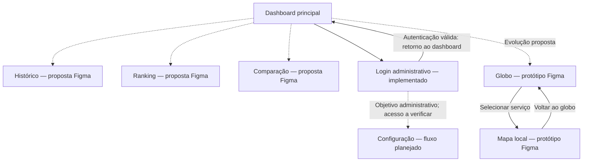

# 🎨 Interface e Usabilidade (IHC) — GreenER

> **Critérios da Rubrica:** IHC01, IHC02, IHC03, IHC04, IHC05, IHC06  
> **Repositório:** [abpundefined/3DSM-ABP-UNDEFINED](https://github.com/abpundefined/3DSM-ABP-UNDEFINED)  
> **Equipe:** Undefined  
> **Responsável pela documentação:** Thales Cambraia Dias  
> **Sprint de referência:** Sprint 2  
> **Atualização:** 08/11/2026  
> **Código consultado:** `afe3865fa0833ce0a33ffa3d337362738a7e769a` — branch `develop`  
> **Apresentação da Sprint 2:** 10/11/2026  
> **Protótipo oficial no Figma:** [Acessar Projeto no Figma](https://www.figma.com/design/CzTTbJAFqZrm2eUIBTSCNl/Undefined-FatecABP-GreenER?node-id=0-1)  
> **Página das telas selecionadas:** GreenER — Interfaces

---

## 👥 1. Identificação de Usuários e Tarefas (IHC01)

Para orientar o design da interface e a hierarquia visual das informações, foram definidas duas **personas** representativas dos usuários da plataforma.

As personas orientam o projeto e o planejamento dos testes. Não representam, necessariamente, participantes das verificações realizadas.

### 👤 Persona 1: Beatriz Menezes — Gestora de TI e Sustentabilidade (ESG)

* **Perfil:** 38 anos, diretora de tecnologia responsável pelo acompanhamento de metas ESG e descarbonização de TI.
* **Necessidades:**
  - Acompanhar as emissões estimadas dos serviços monitorados.
  - Consultar informações consolidadas de consumo de energia e emissões.
  - Identificar os serviços com maior impacto ambiental estimado.
* **Tarefas Prioritárias na Plataforma:**
  1. Visualizar os totais de emissões de CO₂e e consumo em kWh.
  2. Consultar o ranking de impacto.
  3. Comparar serviços para apoiar decisões sobre eficiência e infraestrutura.

---

### 👤 Persona 2: Lucas Ferreira — Engenheiro de Operações e DevOps

* **Perfil:** 27 anos, engenheiro de confiabilidade responsável pela disponibilidade e eficiência de microsserviços.
* **Necessidades:**
  - Acompanhar os estados operacionais das aplicações.
  - Identificar serviços indisponíveis ou sem telemetria válida.
  - Relacionar métricas, histórico e região de hospedagem.
* **Tarefas Prioritárias na Plataforma:**
  1. Consultar serviços ativos, indisponíveis e sem métricas.
  2. Inspecionar o histórico de um serviço.
  3. Consultar informações detalhadas dos serviços monitorados.
  4. Na evolução geográfica proposta, localizar serviços no globo e no mapa.

---

## 📱 2. Protótipos e Fluxos de Navegação (IHC02)

As telas selecionadas para apresentação estão organizadas na página **GreenER — Interfaces**, no arquivo oficial do Figma.

A página **GreenER — Exploração geográfica** foi mantida como registro dos estudos e das versões adicionais.

### 🧭 Fluxo de navegação proposto

O diagrama combina o fluxo implementado de login com a navegação proposta. Ligações pontilhadas indicam fluxos planejados; o trecho globo–mapa também pertence exclusivamente ao Figma.

No [roteador consultado](../frontend/src/App.tsx), estão definidos o dashboard em `/`, o redirecionamento de `/dashboard` para `/`, o login em `/login` e o tratamento de páginas não encontradas. Histórico, Ranking, Comparação e Configuração não possuem rotas próprias nesse arquivo. Isso não exclui a existência de componentes ou gráficos dentro do dashboard.

### 🖼️ Telas selecionadas no Figma

1. **Dashboard Geral:** indicadores consolidados, gráficos e lista de serviços.
2. **Histórico do Serviço:** acompanhamento das métricas do serviço selecionado.
3. **Ranking de Impacto:** identificação dos serviços com maiores estimativas no período.
4. **Comparação de Serviços:** indicadores apresentados lado a lado.
5. **Exploração Geográfica — Globo:** representação da distribuição dos serviços, marcadores, filtros e painel de detalhes.
6. **Exploração Geográfica — Mapa Local:** representação da região do serviço selecionado, marcador e retorno ao globo.

O arquivo também reúne componentes reutilizáveis, como cabeçalhos, botões, indicadores e cards comparativos.

### 🔐 Login administrativo no frontend

O dashboard é público e possui acesso à tela de login administrativo. O [PR #60](https://github.com/abpundefined/3DSM-ABP-UNDEFINED/pull/60) foi integrado à `develop` em 08/11/2026.

O [código atual do login](../frontend/src/pages/Login.tsx) contém formulário de e-mail e senha, envio à API de autenticação, estado “Entrando...”, bloqueio do envio durante a requisição, mensagens de erro, controle de visibilidade da senha e retorno ao dashboard após autenticação válida.

A implementação do login não comprova a existência do painel de configuração ou a conclusão do controle de autorização das demais rotas. Esses pontos exigem verificação própria.

### 🌍 Nova versão do protótipo: Globo com Mapa

Na Sprint 2, o protótipo do Figma foi ampliado com telas de exploração geográfica, incorporando uma sugestão do integrante **Israel**.

A experiência proposta contempla:

1. Visualização dos serviços distribuídos no globo.
2. Seleção de um marcador ou de um serviço na lista.
3. Giro e centralização do globo em direção ao destino.
4. Aproximação da região selecionada.
5. Transição para o mapa local.
6. Consulta dos detalhes do serviço.
7. Retorno à visão global.

**Situação atual:** o globo e o mapa local estão exclusivamente no protótipo do Figma. O globo, a animação de transição e a integração com o mapa ainda não foram implementados no frontend.

As telas representam a experiência proposta. As conexões e transições devem ser conferidas no modo de apresentação do Figma; a presença de estados visuais não comprova uma animação funcional.

As localizações representadas são aproximadas e os dados demonstrativos devem permanecer identificados.

---

## 🏷️ 3. Indicadores e Estados da Interface (IHC03)

O projeto adota as seguintes unidades e identificações para a interface. A tabela descreve o padrão de apresentação, sem comprovar que todos os indicadores e campos estejam implementados:

| Indicador | Unidade ou identificação |
| --- | --- |
| Consumo de energia | kWh |
| Emissões estimadas | kgCO₂e |
| Uso de CPU | % |
| Uso de memória | GB |
| Estado operacional | Texto, ícone e cor |
| Atualização dos dados | Data e horário |
| Localização, quando disponível | Região e coordenadas |

### Estados dos serviços

Os três estados abaixo compõem a representação principal do protótipo. O frontend conectado também trata **Removido** e **Desconhecido**, conforme `LiveDashboard.tsx`.

| Estado | Significado |
| --- | --- |
| Ativo | Serviço disponível conforme as regras de monitoramento. |
| Indisponível | Serviço identificado como indisponível. |
| Sem métricas | Serviço sem telemetria válida para os indicadores apresentados. |

### Critérios de apresentação

- Diferenciar ausência de dados de valores iguais a zero.
- Identificar os valores ambientais como estimativas.
- Sinalizar dados fictícios ou demonstrativos.
- Apresentar os estados por texto e ícone, além da cor.
- Diferenciar o horário da consulta do horário da coleta.
- Informar o período correspondente aos indicadores.
- Relacionar a seleção do serviço às informações apresentadas.
- Na proposta geográfica, manter serviços sem coordenadas acessíveis pela lista, sem atribuir localização inventada.

Os elementos representados no Figma devem ser diferenciados dos dados efetivamente disponibilizados pela aplicação.

Na versão de `LiveDashboard.tsx` consultada, existe apresentação da região por `regiaoCodigo`; a estrutura de serviço utilizada pelo componente não inclui país e cidade. Isso não comprova atendimento completo à #11, que exige país, região, cidade quando disponível e tratamento de ausência de cidade. O componente contém totais ambientais, mas utiliza zero como fallback na soma quando não há valor numérico; portanto, a regra de distinguir ausência de dados de zero permanece um critério a verificar, não uma correção declarada neste documento.

---

## ⚡ 4. Responsividade e Feedback (IHC04)

A situação da Sprint 2 é registrada por funcionalidade, sem declaração de conclusão ou aprovação geral do frontend.

Na consulta de 08/11/2026, o PR #60 de login está integrado à `develop`; o PR #62 permanece aberto e as issues #8 e #11 seguem abertas, com critérios ainda não assinalados. Esses registros não comprovam conclusão ou aceite das funcionalidades pendentes. O globo e o mapa local permanecem exclusivamente no Figma.

### Aspectos de interface considerados

- Organização e legibilidade das informações.
- Consistência entre os componentes.
- Navegação entre as funcionalidades disponíveis.
- Apresentação dos estados dos serviços.
- Feedback de carregamento, ausência de resultados e erro.
- Comportamento em diferentes tamanhos de tela.
- Uso de texto e ícones para complementar as cores.

Os resultados específicos devem ser relacionados às evidências e aos cenários efetivamente executados, sem atribuir aprovação a verificações não registradas.

### Evidências técnicas anteriores

A [revisão técnica da Sprint 1](sprints/revisao-sprint-1.md), de **19/10/2026**, registra resultados de testes de navegador e verificações automáticas de acessibilidade da versão então analisada.

Esses resultados não devem ser atribuídos automaticamente às alterações posteriores ou às novas telas geográficas. Verificações automáticas também não substituem avaliação com usuários nem comprovam ausência de todos os problemas de acessibilidade.

### Exploração geográfica no Figma

O protótipo propõe feedback durante a aproximação, indicação do destino e retorno à visão global.

A implementação futura deverá considerar:

- Navegação por teclado e identificação do foco.
- Legibilidade de marcadores e legendas.
- Contraste dos elementos.
- Adaptação a diferentes tamanhos de tela.
- Preferências de redução de movimentos.
- Carregamento e falhas do mapa externo.
- Manutenção do contexto do serviço selecionado.

---

## 🧪 5. Avaliação de Usabilidade (IHC05)

### 5.1. Revisão e testes internos — Sprint 2

**Atividade relacionada:** [PBI-23 — Protótipos e avaliação de usabilidade](https://github.com/abpundefined/3DSM-ABP-UNDEFINED/issues/23).  
**Responsável:** Thales Cambraia Dias.  
**Situação:** revisão documental por funcionalidade; não há declaração de conclusão geral do frontend da Sprint 2.  
**Apresentação:** 10/11/2026.

A revisão interna considera clareza das informações, consistência visual, feedback e controle da navegação.

A existência de código e de um PR integrado é evidência de implementação, não de execução bem-sucedida de todos os cenários de teste. Não são atribuídos resultados de testes da Sprint 2 sem relatório ou evidência correspondente.

As telas de exploração geográfica fazem parte da evolução do protótipo no Figma. Não há implementação dessas funcionalidades no frontend para testar.

### 5.2. Avaliação heurística

A realização da avaliação heurística foi informada pelo responsável na atividade #23. Seu objetivo é verificar a interface com base nas heurísticas de Nielsen, identificando problemas e oportunidades de melhoria.

### Relação entre as heurísticas e a interface

| Heurística de Nielsen | Aspecto considerado |
| --- | --- |
| H1 — Visibilidade do estado do sistema | Estados dos serviços, atualização dos dados e feedback das operações. |
| H2 — Correspondência com o mundo real | Rótulos e unidades de energia, emissões e métricas dos serviços. |
| H3 — Controle e liberdade do usuário | Navegação, retorno e manutenção do contexto de seleção. |
| H4 — Consistência e padrões | Identidade visual, cabeçalhos, botões, indicadores e cards. |
| H8 — Design estético e minimalista | Hierarquia visual e agrupamento de indicadores, gráficos e listas. |

A tabela relaciona princípios aos aspectos da interface. Não substitui o registro individual dos problemas encontrados e não constitui uma classificação de gravidade dos achados.

### Rastreabilidade da avaliação

O registro dos resultados da avaliação deve identificar:

| Informação | Situação documental |
| --- | --- |
| Data e avaliadores | Ainda não especificados neste documento. |
| Versão e telas efetivamente avaliadas | Ainda não identificadas de forma precisa neste documento. |
| Problemas e heurísticas relacionadas | Registrar os achados confirmados pelo avaliador. |
| Gravidade e justificativa | Registrar conforme o método adotado. |
| Ajustes e evidências antes/depois | Relacionar às alterações efetivamente realizadas. |
| Resultado da verificação dos ajustes | Registrar a evidência correspondente. |

A situação de implementação das funcionalidades é distinta da completude documental da avaliação heurística. Não se presume que a avaliação anterior tenha incluído as novas telas de globo e mapa.

Não são atribuídos datas, participantes, gravidades ou resultados sem registro correspondente.

**Referência:** [10 heurísticas de usabilidade de Jakob Nielsen — Nielsen Norman Group](https://www.nngroup.com/articles/ten-usability-heuristics/).

### 5.3. Testes com usuários — Sprint 3

O planejamento prevê testes com **5 usuários representativos**, entre estudantes e profissionais de TI. Essa etapa é distinta das verificações internas e não possui resultados apresentados neste documento.

#### 📋 Roteiro proposto

1. Localizar o serviço com maior consumo de energia no período disponível.
2. Selecionar dois serviços e comparar suas emissões estimadas.
3. Identificar um serviço indisponível e consultar suas informações.
4. Avaliar a navegação geográfica no protótipo do Figma ou na aplicação, conforme sua disponibilidade na etapa do teste.

#### Métricas previstas

- Taxa de sucesso por tarefa.
- Tempo de execução.
- Necessidade de assistência.
- Dificuldades e erros observados.
- Comentários dos participantes.
- Questionário SUS ao final do teste.

Não são apresentados neste documento resultados de participantes ou pontuações SUS. Cinco participantes correspondem ao planejamento da equipe, não a uma atividade já executada.

---

## 🚀 6. Melhorias e Evoluções da Sprint 2 (IHC06)

As alterações devem ser identificadas conforme sua origem: correção observada no desenvolvimento ou nos testes, achado da avaliação heurística, sugestão da equipe ou evolução planejada do produto.

Uma nova tela não deve ser apresentada automaticamente como correção decorrente da avaliação heurística.

### Evoluções do protótipo e da documentação

| Evolução | Origem ou finalidade | Situação |
| --- | --- | --- |
| Inclusão do globo e do mapa local no Figma. | Evolução da exploração geográfica, incorporando sugestão do Israel. | Prototipada; sem implementação no frontend. |
| Definição da experiência de giro e aproximação. | Explorar a transição entre visão global e local. | Proposta de interação no Figma; sem implementação no frontend. |
| Organização das telas selecionadas em GreenER — Interfaces. | Reunir o material de apresentação. | Concluída. |
| Manutenção da página de estudos geográficos. | Preservar versões adicionais e estudos. | Mantida no Figma. |
| Padronização do endereço oficial do Figma. | Corrigir referências divergentes apontadas na documentação. | Concluída neste documento. |
| Distinção entre protótipo e frontend. | Diferenciar telas propostas de funcionalidades implementadas. | Explicitada neste documento. |

### 🔐 Melhoria do login administrativo — H1/H5

| Campo | Registro |
| --- | --- |
| Problema registrado anteriormente | A tela informava indisponibilidade do acesso administrativo, mas exibia o botão “Entrar”, gerando uma expectativa incompatível com a ação disponível. |
| Heurísticas relacionadas | H1 — Visibilidade do estado do sistema; H5 — Prevenção de erros. |
| Antes | Login apresentado como indisponível, com ação “Entrar”; observação registrada na documentação anterior. |
| Depois | Formulário com envio à API de autenticação, “Entrando...”, botão desabilitado durante envio, alertas de erro e retorno ao dashboard após resposta válida. |
| Evidência documental do antes | [Registro anterior de interface.md](https://github.com/abpundefined/3DSM-ABP-UNDEFINED/blob/21ecc872dd460c2dd5c5810ab2f812c701c4d5d8/docs/interface.md), seção “Ajustes sugeridos para confirmação”. |
| Evidência de código do antes | [Login.tsx em 0adb1e0](https://github.com/abpundefined/3DSM-ABP-UNDEFINED/blob/0adb1e040c078f9c69cedbcc7038cdb7e0bd4175/frontend/src/pages/Login.tsx): aviso de indisponibilidade e submit que apenas exibia mensagem, sem chamada à API. |
| Evidência da alteração | [PR #60 — Feature/tela login](https://github.com/abpundefined/3DSM-ABP-UNDEFINED/pull/60), integrado em 08/11/2026. |
| Evidência do depois | [Login.tsx na versão consultada](https://github.com/abpundefined/3DSM-ABP-UNDEFINED/blob/21ecc872dd460c2dd5c5810ab2f812c701c4d5d8/frontend/src/pages/Login.tsx). |
| Situação | Alteração implementada no código; validação funcional dos cenários não demonstrada por esta inspeção. |
| Verificação a registrar | Autenticação válida, credenciais inválidas, falha de conexão, estado de carregamento e navegação por teclado. |

O vínculo com H1/H5 retoma a observação já registrada na documentação. A comparação antes/depois é documental e de código; não substitui capturas ou execução dos cenários. Não foi atribuída uma data à avaliação heurística original.

### Registro dos ajustes decorrentes da avaliação

Para cada ajuste relacionado a um achado de usabilidade, registrar:

- Problema identificado e heurística relacionada.
- Tela e versão afetadas.
- Alteração realizada ou justificativa de pendência.
- Responsável.
- Evidência antes e depois.
- Resultado da verificação.
- Situação: pendente, implementado ou validado.

O acompanhamento deve utilizar as atividades do projeto e evidências verificáveis. A prototipação do globo e do mapa não comprova, isoladamente, a resolução dos achados da avaliação anterior.

---

## ✅ 7. Situação da Entrega — Sprint 2

| Item | Situação |
| --- | --- |
| Login administrativo — PR #60 | Integrado à `develop` em 08/11/2026; comportamento identificado no código. |
| Indicadores agregados — PR #62 | PR aberto na consulta de 08/11/2026; não apresentar como integrado ou aceito. |
| Dashboard operacional — #8 | Issue aberta, com critérios de aceitação ainda não assinalados. |
| Localização dos serviços — #11 | Issue aberta, com critérios de aceitação ainda não assinalados; entrega não comprovada pelos registros consultados. |
| Testes funcionais da Sprint 2 | Não declarar aprovação geral; vincular resultados aos cenários e às evidências efetivamente registrados. |
| Telas selecionadas no Figma | Organizadas em GreenER — Interfaces. |
| Globo e mapa local no Figma | Prototipados. |
| Globo, animação e mapa local no frontend | Ainda não implementados. |
| Testes funcionais do globo e mapa na aplicação | Não realizados, pois não há implementação no frontend. |
| Endereço oficial do Figma | Padronizado neste documento. |
| Estado da atividade #23 no GitHub | Fechada como concluída em 20/10/2026, mas o corpo consultado ainda mantém “Resultados documentados” e “Alterações na interface baseadas nos resultados” desmarcados. |
| Registro detalhado da avaliação heurística | Ainda há lacunas documentais na seção 5.2; o fechamento da issue não as comprova resolvidas. |
| Apresentação da Sprint 2 | Agendada para 10/11/2026. |
| Aceite formal da entrega | A registrar conforme o processo da equipe. |
| Testes com usuários representativos | Previstos para a Sprint 3. |

Os estados desta seção refletem a consulta de 08/11/2026 e devem ser atualizados quando houver integração, evidência de teste e aceite correspondentes. Uma issue aberta não prova ausência total de implementação, assim como código existente não comprova atendimento integral dos critérios.

O globo com mapa constitui uma evolução do protótipo do Figma. Sua implementação na aplicação deverá ser acompanhada em atividade própria.

A atividade #23 já está fechada no GitHub. É necessário reconciliar esse estado com os critérios ainda desmarcados e com as evidências documentais, sem presumir uma nova avaliação ou aceite. A apresentação agendada não equivale, por si só, ao aceite formal da entrega.

---

## 🔗 Referências e Links Importantes

- **Protótipo oficial:** endereço único informado no início deste documento.
- **Página das telas selecionadas:** GreenER — Interfaces.
- [Repositório GreenER](https://github.com/abpundefined/3DSM-ABP-UNDEFINED).
- [PBI-23 — Protótipos e avaliação de usabilidade](https://github.com/abpundefined/3DSM-ABP-UNDEFINED/issues/23).
- [Documentação da Sprint 2](sprints/sprint-2.md).
- [PR #60 — Login administrativo](https://github.com/abpundefined/3DSM-ABP-UNDEFINED/pull/60).
- [PR #62 — Indicadores agregados](https://github.com/abpundefined/3DSM-ABP-UNDEFINED/pull/62).
- [PBI-08 — Dashboard operacional](https://github.com/abpundefined/3DSM-ABP-UNDEFINED/issues/8).
- [PBI-11 — Localização dos serviços](https://github.com/abpundefined/3DSM-ABP-UNDEFINED/issues/11).
- [Revisão técnica da Sprint 1](sprints/revisao-sprint-1.md).
- [10 heurísticas de usabilidade de Jakob Nielsen](https://www.nngroup.com/articles/ten-usability-heuristics/).
