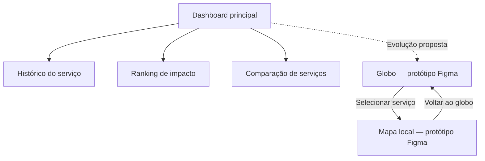

# 🎨 Interface e Usabilidade (IHC) — GreenER

> **Critérios da Rubrica:** IHC01, IHC02, IHC03, IHC04, IHC05, IHC06  
> **Repositório:** [abpundefined/3DSM-ABP-UNDEFINED](https://github.com/abpundefined/3DSM-ABP-UNDEFINED)  
> **Equipe:** Undefined  
> **Responsável pela documentação:** Thales Cambraia Dias  
> **Sprint de referência:** Sprint 2  
> **Atualização:** 08/11/2026
> **Protótipo oficial no Figma:** [Acessar Projeto no Figma](https://www.figma.com/design/CzTTbJAFqZrm2eUIBTSCNl/Undefined-FatecABP-GreenER?node-id=0-1)  

---

## 👥 1. Identificação de Usuários e Tarefas (IHC01)

Para orientar o design da interface e a hierarquia visual das informações, foram definidas duas **personas** representativas dos usuários da plataforma.

As personas orientam o projeto e o planejamento dos testes. Não representam, necessariamente, participantes das verificações realizadas.

### 👤 Persona 1: Beatriz Menezes — Gestora de TI e Sustentabilidade (ESG)

* **Perfil:** 38 anos, diretora de tecnologia responsável pelo acompanhamento de metas ESG e descarbonização de TI.
* **Necessidades:**
  - Acompanhar as emissões estimadas dos serviços monitorados.
  - Consultar informações consolidadas de consumo de energia e emissões.
  - Identificar os serviços com maior impacto ambiental estimado.
* **Tarefas Prioritárias na Plataforma:**
  1. Visualizar os totais de emissões de CO₂e e consumo em kWh.
  2. Consultar o ranking de impacto.
  3. Comparar serviços para apoiar decisões sobre eficiência e infraestrutura.

---

### 👤 Persona 2: Lucas Ferreira — Engenheiro de Operações e DevOps

* **Perfil:** 27 anos, engenheiro de confiabilidade responsável pela disponibilidade e eficiência de microsserviços.
* **Necessidades:**
  - Acompanhar os estados operacionais das aplicações.
  - Identificar serviços indisponíveis ou sem telemetria válida.
  - Relacionar métricas, histórico e região de hospedagem.
* **Tarefas Prioritárias na Plataforma:**
  1. Consultar serviços ativos, indisponíveis e sem métricas.
  2. Inspecionar o histórico de um serviço.
  3. Consultar informações detalhadas sobre os serviços monitorados.
  4. Na evolução geográfica proposta, localizar serviços no globo e no mapa.

---

## 📱 2. Protótipos e Fluxos de Navegação (IHC02)

As telas selecionadas para apresentação estão organizadas na página **GreenER — Interfaces**, no arquivo oficial do Figma.

A página **GreenER — Exploração geográfica** foi mantida como registro dos estudos e das versões adicionais.

### 🧭 Fluxo de navegação proposto

O diagrama apresenta o fluxo de navegação do produto e sua evolução proposta. A presença de uma tela no Figma não comprova a implementação da rota ou funcionalidade correspondente no frontend.

### 🖼️ Telas selecionadas no Figma

1. **Dashboard Geral:** indicadores consolidados, gráficos e lista de serviços.
2. **Histórico do Serviço:** acompanhamento das métricas do serviço selecionado.
3. **Ranking de Impacto:** identificação dos serviços com maiores estimativas no período.
4. **Comparação de Serviços:** indicadores apresentados lado a lado.
5. **Exploração Geográfica — Globo:** representação da distribuição dos serviços, marcadores, filtros e painel de detalhes.
6. **Exploração Geográfica — Mapa Local:** representação da região do serviço selecionado, marcador e retorno ao globo.

O arquivo também reúne componentes reutilizáveis, como cabeçalhos, botões, indicadores e cards comparativos.

### 🌍 Nova versão do protótipo: Globo com Mapa

Na Sprint 2, o protótipo do Figma foi ampliado com telas de exploração geográfica, incorporando uma sugestão do integrante **Israel**.

A proposta contempla a seguinte experiência:

1. Visualização dos serviços distribuídos no globo.
2. Seleção de um marcador ou de um serviço na lista.
3. Giro e centralização do globo em direção ao destino.
4. Aproximação da região selecionada.
5. Transição para o mapa local.
6. Consulta dos detalhes do serviço.
7. Retorno à visão global.

**Situação atual:** as telas de globo e mapa foram adicionadas ao Figma. O globo, a animação e o mapa local ainda não estão implementados no frontend.

A existência e o comportamento das transições do Figma devem ser verificados no modo de apresentação. As telas, isoladamente, não comprovam uma animação funcional.

### 🧩 Escopo da prototipação geográfica

O globo e o mapa local fazem parte exclusivamente do protótipo no Figma.

Essas telas representam uma proposta de evolução da interface. O globo, a animação de transição e a integração com o mapa ainda não foram implementados no frontend do projeto.

---

## 🏷️ 3. Indicadores e Estados da Interface (IHC03)

A interface organiza os indicadores com suas respectivas unidades e identificações:

| Indicador | Unidade ou identificação |
| --- | --- |
| Consumo de energia | kWh |
| Emissões estimadas | kgCO₂e |
| Uso de CPU | % |
| Uso de memória | GB |
| Estado operacional | Texto, ícone e cor |
| Atualização dos dados | Data e horário |
| Localização, quando disponível | Região e coordenadas |

### Estados dos serviços

| Estado | Significado |
| --- | --- |
| Ativo | Serviço disponível conforme as regras de monitoramento. |
| Indisponível | Serviço identificado como indisponível. |
| Sem métricas | Serviço sem telemetria válida para os indicadores apresentados. |

### Critérios de apresentação

- Diferenciar ausência de dados de valores iguais a zero.
- Identificar os valores ambientais como estimativas.
- Sinalizar dados fictícios ou demonstrativos.
- Apresentar os estados por texto e ícone, além da cor.
- Diferenciar o horário da consulta do horário da coleta.
- Informar o período correspondente aos indicadores.
- Relacionar a seleção do serviço às informações apresentadas.
- Na proposta geográfica, manter os serviços sem coordenadas acessíveis pela lista e identificar as localizações como aproximadas.

Os elementos representados no Figma devem ser diferenciados dos dados efetivamente disponibilizados pela aplicação.

---

## ⚡ 4. Responsividade e Feedback (IHC04)

As funcionalidades implementadas no frontend para a Sprint 2 foram concluídas e testadas internamente, conforme confirmação do responsável.

Essa conclusão não inclui a implementação do globo e do mapa local, que permanecem no escopo de prototipação do Figma.

### Aspectos considerados nas verificações

- Organização e legibilidade das informações.
- Consistência entre os componentes.
- Navegação entre as funcionalidades disponíveis.
- Apresentação dos estados dos serviços.
- Feedback de carregamento, ausência de resultados e erro.
- Comportamento da interface em diferentes tamanhos de tela.
- Uso de texto e ícones para complementar as cores.

### Evidências técnicas anteriores

A revisão técnica de **19/10/2026** registra resultados de testes de navegador e verificações automáticas de acessibilidade da versão então analisada.

Essas evidências podem ser consultadas na [revisão técnica da Sprint 1](sprints/revisao-sprint-1.md). Seus resultados não devem ser atribuídos automaticamente às alterações posteriores ou às novas telas geográficas.

### Exploração geográfica no Figma

O protótipo propõe feedback durante a aproximação do globo, indicação do destino e opção de retorno à visão global.

A implementação futura deverá considerar:

- Navegação por teclado e identificação do foco.
- Legibilidade dos marcadores e das legendas.
- Contraste dos elementos.
- Adaptação a diferentes tamanhos de tela.
- Preferências de redução de movimentos.
- Carregamento e falhas do mapa externo.
- Manutenção do contexto do serviço selecionado.

---

## 🧪 5. Avaliação de Usabilidade (IHC05)

### 5.1. Revisão e testes internos — Sprint 2

**Atividade relacionada:** [PBI-23 — Protótipos e avaliação de usabilidade](https://github.com/abpundefined/3DSM-ABP-UNDEFINED/issues/23).  
**Responsável:** Thales Cambraia Dias.  
**Situação:** funcionalidades implementadas da Sprint 2 concluídas e testadas internamente, conforme confirmação do responsável.  
**Apresentação:** 10/11/2026.

A revisão interna considera clareza das informações, consistência visual, feedback e controle da navegação.

As telas de exploração geográfica fazem parte da evolução do protótipo no Figma. Não foram realizados testes funcionais dessas funcionalidades no frontend, pois elas ainda não estão implementadas na aplicação.

### 5.2. Avaliação heurística

A realização da avaliação heurística foi informada pelo responsável na atividade #23.

Seu objetivo é verificar a interface com base nas heurísticas de Nielsen, identificando problemas e oportunidades de melhoria.

### Relação entre as heurísticas e a interface

| Heurística de Nielsen | Aspecto considerado |
| --- | --- |
| H1 — Visibilidade do estado do sistema | Estados dos serviços, atualização dos dados e feedback das operações. |
| H2 — Correspondência com o mundo real | Rótulos e unidades de energia, emissões e métricas dos serviços. |
| H3 — Controle e liberdade do usuário | Navegação, retorno e manutenção do contexto de seleção. |
| H4 — Consistência e padrões | Identidade visual, cabeçalhos, botões, indicadores e cards. |
| H8 — Design estético e minimalista | Hierarquia visual e agrupamento de indicadores, gráficos e listas. |

A tabela relaciona os princípios aos aspectos da interface. Não substitui o registro individual dos problemas encontrados.

### Rastreabilidade da avaliação

Para documentar a avaliação e suas evidências, o registro deve identificar:

- Data da avaliação.
- Avaliador ou avaliadores.
- Versão e telas efetivamente avaliadas.
- Problemas observados.
- Heurística relacionada a cada problema.
- Gravidade e justificativa adotadas.
- Ajustes realizados ou justificativas.
- Evidências antes e depois, quando aplicáveis.
- Resultado da verificação dos ajustes.

A conclusão das funcionalidades e dos testes internos da Sprint 2 não permite atribuir uma data, uma gravidade ou um resultado específico à avaliação heurística sem o registro correspondente.

Também não se presume que a avaliação anterior tenha incluído as novas telas de globo e mapa.

**Referência:** [10 heurísticas de usabilidade de Jakob Nielsen — Nielsen Norman Group](https://www.nngroup.com/articles/ten-usability-heuristics/).

### 5.3. Testes com usuários — Sprint 3

O planejamento prevê testes com **5 usuários representativos**, entre estudantes e profissionais de TI.

Essa etapa é distinta dos testes internos realizados na Sprint 2.

#### 📋 Roteiro proposto

1. Localizar o serviço com maior consumo de energia no período disponível.
2. Selecionar dois serviços e comparar suas emissões estimadas.
3. Identificar um serviço indisponível e consultar suas informações.
4. Avaliar a navegação geográfica no protótipo do Figma ou na aplicação, conforme sua disponibilidade na etapa do teste.

#### Métricas previstas

- Taxa de sucesso por tarefa.
- Tempo de execução.
- Necessidade de assistência.
- Dificuldades e erros observados.
- Comentários dos participantes.
- Questionário SUS ao final do teste.

Não são apresentados neste documento resultados de participantes ou pontuações SUS.

---

## 🚀 6. Melhorias e Evoluções da Sprint 2 (IHC06)

As alterações devem ser identificadas conforme sua origem:

- Correção observada durante o desenvolvimento ou os testes.
- Achado da avaliação heurística.
- Sugestão da equipe.
- Evolução planejada do produto.

Uma nova tela ou funcionalidade não deve ser apresentada automaticamente como correção decorrente da avaliação heurística.

### Evoluções do protótipo e da documentação

| Evolução | Origem ou finalidade | Situação |
| --- | --- | --- |
| Inclusão do globo e do mapa local no Figma. | Evolução da exploração geográfica, incorporando sugestão do Israel. | Prototipada. |
| Organização das telas selecionadas em GreenER — Interfaces. | Reunir o material de apresentação. | Concluída. |
| Manutenção da página de estudos geográficos. | Preservar versões adicionais e estudos. | Mantida no Figma. |
| Padronização do endereço oficial do Figma. | Corrigir referências divergentes apontadas na documentação. | Concluída neste documento. |
| Distinção entre protótipo e frontend. | Evitar apresentar telas do Figma como funcionalidades implementadas. | Explicitada neste documento. |

### Registro dos ajustes decorrentes da avaliação

Para cada ajuste relacionado a um achado de usabilidade, registrar:

- Problema identificado.
- Heurística relacionada.
- Tela e versão afetadas.
- Alteração realizada.
- Responsável.
- Evidência antes e depois.
- Resultado da verificação.
- Situação ou justificativa de pendência.

As correções realizadas no HTML independente, incluindo carregamento do mapa e execução da animação, pertencem à demonstração de referência. Não são classificadas como correções do frontend GreenER.

---

## ✅ 7. Situação da Entrega — Sprint 2

| Item | Situação |
| --- | --- |
| Funcionalidades implementadas no frontend para a Sprint 2 | Concluídas, conforme confirmação do responsável. |
| Testes internos das funcionalidades implementadas | Concluídos, conforme confirmação do responsável. |
| Telas selecionadas no Figma | Organizadas em GreenER — Interfaces. |
| Globo e mapa local no Figma | Prototipados. |
| Globo, animação e mapa local no frontend | Ainda não implementados. |
| Testes funcionais do globo e mapa na aplicação | Não realizados, pois não há implementação no frontend. |
| Endereço oficial do Figma | Padronizado neste documento. |
| Apresentação da Sprint 2 | Agendada para 10/11/2026. |
| Aceite formal da entrega | A registrar conforme o processo da equipe. |
| Testes com usuários representativos | Previstos para a Sprint 3. |

A conclusão da Sprint 2 informada pela equipe refere-se ao escopo implementado e testado nessa etapa.

O globo com mapa constitui uma evolução do protótipo do Figma. Sua implementação na aplicação deverá ser acompanhada em atividade própria.

O encerramento da atividade #23 deve considerar os critérios de aceitação, o registro da avaliação, as evidências dos ajustes e a revisão correspondente.

---

## 🔗 Referências e Links Importantes

- **Protótipo oficial:** endereço informado no início deste documento.
- **Página das telas selecionadas:** GreenER — Interfaces.
- [Repositório GreenER](https://github.com/abpundefined/3DSM-ABP-UNDEFINED).
- [PBI-23 — Protótipos e avaliação de usabilidade](https://github.com/abpundefined/3DSM-ABP-UNDEFINED/issues/23).
- [Documentação da Sprint 2](sprints/sprint-2.md).
- [Revisão técnica da Sprint 1](sprints/revisao-sprint-1.md).
- [10 heurísticas de usabilidade de Jakob Nielsen](https://www.nngroup.com/articles/ten-usability-heuristics/).
