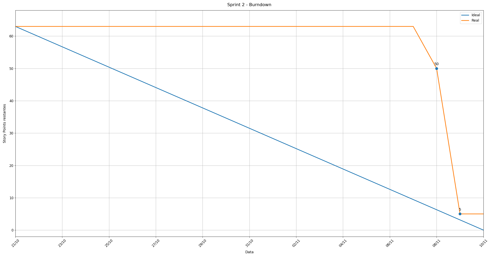

# Sprint 2 — Cálculos ambientais, dashboard e autenticação

**Período:** 21/10/2026 a 10/11/2026. **Tag planejada:** `sprint-2`. **Registro:** Rainan Reis (Product Owner) e Thales Cambraia (Scrum Master).

---

## 🎯 Objetivo e Capacidade

### Objetivo da Sprint
Evoluir a plataforma GreenER a partir da fundação arquitetural e coleta base entregues na Sprint 1, implementando:
1. **Motor de Cálculo Ambiental:** conversão de telemetria computacional em estimativas de consumo energético (kWh) e emissões de CO₂e integrado à API de Intensidade de Carbono, persistindo os valores junto ao histórico de coletas;
2. **Indicadores Consolidados e Agregados:** cálculo de totais de consumo, emissões e distribuição de serviços por estado operacional em toda a infraestrutura;
3. **Dashboard Operacional em Tempo Real:** interface dinâmica com cards individuais por serviço exibindo localização geográfica (país, região e cidade), métricas brutas e impacto ambiental, atualizados periodicamente sem necessidade de reload de página (polling);
4. **Exibição Explícita de Intervalos e Timestamps:** indicadores claros do intervalo de amostragem configurado e do horário exato da última coleta realizada;
5. **Autenticação JWT e Segurança:** controle de acesso com senhas protegidas por hash (bcrypt), autenticação via tokens JWT e proteção estrita de endpoints administrativos/escrita;
6. **Qualidade e Cobertura de Código:** suíte de testes unitários abrangente com cobertura mínima de 80% nos serviços de cálculo ambiental e regras de estado, validada continuamente via pipeline de CI (GitHub Actions).

### Capacidade Considerada
A equipe se propôs a entregar **10 itens totalizando 63 Story Points (SP)**. O dimensionamento da capacidade considerou:
- **Equipe Ativa:** 6 integrantes engajados com distribuição balanceada de competências em backend (NestJS/PostgreSQL), frontend (React/Vite/TypeScript) e gestão ágil (PO e Scrum Master);
- **Infraestrutura Estabilizada:** reaproveitamento do ambiente de desenvolvimento conteinerizado (Docker Compose) e da base de banco de dados modelada na Sprint 1, acelerando o foco na lógica de negócio e integrações;
- **Integração Ponta a Ponta:** planejamento paralelo com desenvolvimento backend (APIs de cálculo, rotas e JWT) e frontend (telas de login e dashboard em tempo real) avançando em sincronia;
- **Resultado do Ciclo:** ao final do desenvolvimento, **9 itens foram concluídos e fechados no GitHub (58 SP)**, atingindo **92% de aproveitamento** dos pontos planejados. Apenas a issue [#16](https://github.com/abpundefined/3DSM-ABP-UNDEFINED/issues/16) (PBI-16, 5 SP) permaneceu em andamento para refinamentos visuais de acessibilidade e responsividade na Sprint 3.

---

## 📋 Itens Selecionados (Sprint Backlog)

Os 10 itens abaixo compuseram a baseline acordada no planejamento da Sprint 2:

| Issue | Item | SP | Responsáveis no GitHub | Situação no Projects |
| :---: | :--- | :---: | :--- | :---: |
| [#6](https://github.com/abpundefined/3DSM-ABP-UNDEFINED/issues/6) | [PBI-06] Cálculo individual de consumo e emissão | 8 | Marcus Nascimento | Concluído (Done) |
| [#7](https://github.com/abpundefined/3DSM-ABP-UNDEFINED/issues/7) | [PBI-07] Indicadores agregados | 5 | Pedro Gomes | Concluído (Done) |
| [#8](https://github.com/abpundefined/3DSM-ABP-UNDEFINED/issues/8) | [PBI-08] Dashboard operacional | 13 | Thales Cambraia, Israel Lemes | Concluído (Done) |
| [#10](https://github.com/abpundefined/3DSM-ABP-UNDEFINED/issues/10) | [PBI-10] Atualização automática do dashboard | 5 | Marcus Nascimento | Concluído (Done) |
| [#11](https://github.com/abpundefined/3DSM-ABP-UNDEFINED/issues/11) | [PBI-11] Localização dos serviços | 3 | Thales Cambraia, Israel Lemes | Concluído (Done) |
| [#15](https://github.com/abpundefined/3DSM-ABP-UNDEFINED/issues/15) | [PBI-15] Autenticação JWT | 8 | Israel Lemes, Marcus Nascimento | Concluído (Done) |
| [#16](https://github.com/abpundefined/3DSM-ABP-UNDEFINED/issues/16) | [PBI-16] Interface responsiva e acessível | 5 | Thales Cambraia | Em andamento (In progress) |
| [#17](https://github.com/abpundefined/3DSM-ABP-UNDEFINED/issues/17) | [PBI-17] Exibição de intervalos e timestamps | 3 | Nadla Ferreira | Concluído (Done) |
| [#19](https://github.com/abpundefined/3DSM-ABP-UNDEFINED/issues/19) | [PBI-19] Segurança | 5 | Israel Lemes | Concluído (Done) |
| [#20](https://github.com/abpundefined/3DSM-ABP-UNDEFINED/issues/20) | [PBI-20] Testes unitários (cobertura ≥ 80%) | 8 | Israel Lemes | Concluído (Done) |

- **Total Planejado:** 63 SP (10 itens)
- **Total Concluído:** 58 SP (9 itens fechados — 92% de taxa de entrega)
- **Restante em Andamento:** 5 SP (1 item — [#16](https://github.com/abpundefined/3DSM-ABP-UNDEFINED/issues/16), em andamento para evolução contínua na Sprint 3)

---

## 📉 Burndown da Sprint 2

### Registro e Análise da Evolução
- **21/10/2026 (Abertura):** Baseline fixada em 63 Story Points com 10 itens planejados.
- **21/10 a 07/11/2026:** Período de estruturação matemática das fórmulas de carbono, integração com APIs externas, desenvolvimento do fluxo de autenticação e construção do layout de cards do frontend. Durante esta fase os itens permaneceram em desenvolvimento/revisão, mantendo o saldo em 63 SP.
- **08/11/2026:** Homologação técnica e fechamento de 13 SP no repositório:
  - [#6](https://github.com/abpundefined/3DSM-ABP-UNDEFINED/issues/6) — Cálculo individual de consumo e emissão (8 SP)
  - [#19](https://github.com/abpundefined/3DSM-ABP-UNDEFINED/issues/19) — Práticas de segurança, bcrypt e segredos no .env (5 SP)
  - *Saldo restante:* **50 SP**.
- **09/11/2026:** Validação e fechamento dos PRs consolidados na branch `develop`, baixando 45 SP:
  - [#7](https://github.com/abpundefined/3DSM-ABP-UNDEFINED/issues/7) — Indicadores agregados (5 SP)
  - [#8](https://github.com/abpundefined/3DSM-ABP-UNDEFINED/issues/8) — Dashboard operacional (13 SP)
  - [#10](https://github.com/abpundefined/3DSM-ABP-UNDEFINED/issues/10) — Atualização automática do dashboard (5 SP)
  - [#11](https://github.com/abpundefined/3DSM-ABP-UNDEFINED/issues/11) — Localização geográfica dos serviços (3 SP)
  - [#15](https://github.com/abpundefined/3DSM-ABP-UNDEFINED/issues/15) — Autenticação JWT e proteção de rotas restritas (8 SP)
  - [#17](https://github.com/abpundefined/3DSM-ABP-UNDEFINED/issues/17) — Exibição de intervalos e timestamps (3 SP)
  - [#20](https://github.com/abpundefined/3DSM-ABP-UNDEFINED/issues/20) — Testes unitários com cobertura superior a 80% (8 SP)
  - *Saldo restante:* **5 SP** (referente à issue [#16](https://github.com/abpundefined/3DSM-ABP-UNDEFINED/issues/16)).
- **10/11/2026 (Encerramento do Ciclo):** Sprint 2 finalizada com 58 SP entregues e validados.

---

## 🔍 Evidências e Verificação

- **Memória de Cálculo Ambiental:** especificação formal das constantes, unidades e fórmulas em [docs/calculos.md](../calculos.md).
- **Documentação de API e Swagger:** especificação dos endpoints e DTOs em [docs/api.md](../api.md) e documentação interativa OpenAPI/Swagger acessível na rota `/docs`.
- **Interface e Protótipos IHC:** detalhamento de personas, fluxo de navegação e componentes no Figma em [docs/interface.md](../interface.md).
- **Automação de CI / CD:** pipeline no GitHub Actions configurada em [.github/workflows/ci.yml](../../.github/workflows/ci.yml) validando build e testes de backend e frontend a cada pull request (em vigor desde o PR #55).
- **Cobertura de Testes Automatizados:** suíte de testes com cobertura superior a 80% nos services de cálculo e regras de estado (`npm run test:cov` no backend) e testes de integração/E2E no frontend (`npm run test:e2e`).
- **Resiliência e Timeout:** aplicação de tempo limite em chamadas de APIs externas via `com-timeout.ts`, atendendo ao apontamento do cliente na Sprint 1.

---

## ⚠️ Pendências Identificadas para a Sprint 3

Para garantir transparência no encerramento da Sprint 2 e conformidade com a Definição de Pronto (DoD), foram registradas as seguintes pendências técnicas e funcionais que serão endereçadas na Sprint 3:

1. **Aplicação Dinâmica da Configuração:** O endpoint `PUT /configuracao` persiste as alterações no banco de dados, porém os parâmetros atualizados ainda não são aplicados dinamicamente em tempo de execução ao agendador de monitoramento (atendimento parcial do RF16);
2. **Interface Administrativa no Frontend:** Ausência de página web para visualização e edição de configurações pelo operador/administrador no frontend (configuração realizada atualmente via chamadas autenticadas na API);
3. **Paginação do Histórico de Coletas:** O endpoint `GET /coletas` ainda não dispõe de suporte a paginação de registros, necessitando de mecanismo de cursor ou limite/offset para prevenir gargalos de memória futuros;
4. **Interface Responsiva e Acessível ([#16](https://github.com/abpundefined/3DSM-ABP-UNDEFINED/issues/16) — 5 SP):** PBI mantido aberto em andamento para refinamentos detalhados de usabilidade, contraste e responsividade em dispositivos móveis.

---

## 👥 Participação Verificada na Develop (Sprint 2 — Critério GA09)

As contribuições e revisões de código de cada integrante foram verificadas diretamente no histórico de pull requests e commits da branch `develop`:

| Integrante | Papel Principal | Contribuições e Revisões Verificáveis no Repositório |
| :--- | :--- | :--- |
| **Israel Lemes** | Desenvolvedor Backend | **PRs entregues:** [#55](https://github.com/abpundefined/3DSM-ABP-UNDEFINED/pull/55) (CI), [#56](https://github.com/abpundefined/3DSM-ABP-UNDEFINED/pull/56) (JWT e configuração), [#57](https://github.com/abpundefined/3DSM-ABP-UNDEFINED/pull/57) (distinção 404×5xx e região), [#58](https://github.com/abpundefined/3DSM-ABP-UNDEFINED/pull/58) (indicadores no backend), [#61](https://github.com/abpundefined/3DSM-ABP-UNDEFINED/pull/61) (segurança), [#64](https://github.com/abpundefined/3DSM-ABP-UNDEFINED/pull/64) (localização no backend), [#66](https://github.com/abpundefined/3DSM-ABP-UNDEFINED/pull/66) (cobertura de testes), [#68](https://github.com/abpundefined/3DSM-ABP-UNDEFINED/pull/68) (cards do dashboard), [#69](https://github.com/abpundefined/3DSM-ABP-UNDEFINED/pull/69) (timeout), [#70](https://github.com/abpundefined/3DSM-ABP-UNDEFINED/pull/70) (.mailmap). **Revisões em:** [#54](https://github.com/abpundefined/3DSM-ABP-UNDEFINED/pull/54), [#59](https://github.com/abpundefined/3DSM-ABP-UNDEFINED/pull/59), [#60](https://github.com/abpundefined/3DSM-ABP-UNDEFINED/pull/60), [#62](https://github.com/abpundefined/3DSM-ABP-UNDEFINED/pull/62), [#63](https://github.com/abpundefined/3DSM-ABP-UNDEFINED/pull/63), [#67](https://github.com/abpundefined/3DSM-ABP-UNDEFINED/pull/67). |
| **Marcus Nascimento** | Desenvolvedor Backend / DevOps | **Implementação:** Cálculo de energia/CO₂e e integração com a API de carbono (commits `2c115d1`, `cdc454a`, `347ff63`, `27c25b9`). **PRs entregues:** [#53](https://github.com/abpundefined/3DSM-ABP-UNDEFINED/pull/53) (documentação de cálculos), [#54](https://github.com/abpundefined/3DSM-ABP-UNDEFINED/pull/54) (testes com dados reais), [#59](https://github.com/abpundefined/3DSM-ABP-UNDEFINED/pull/59) (correção de numeração da Sprint 2), [#60](https://github.com/abpundefined/3DSM-ABP-UNDEFINED/pull/60) (tela de login). *(Nota: PR [#71](https://github.com/abpundefined/3DSM-ABP-UNDEFINED/pull/71) aberto no fechamento, não entra como entregue)*. **Revisões em:** [#55](https://github.com/abpundefined/3DSM-ABP-UNDEFINED/pull/55), [#56](https://github.com/abpundefined/3DSM-ABP-UNDEFINED/pull/56), [#57](https://github.com/abpundefined/3DSM-ABP-UNDEFINED/pull/57), [#58](https://github.com/abpundefined/3DSM-ABP-UNDEFINED/pull/58), [#61](https://github.com/abpundefined/3DSM-ABP-UNDEFINED/pull/61), [#64](https://github.com/abpundefined/3DSM-ABP-UNDEFINED/pull/64), [#66](https://github.com/abpundefined/3DSM-ABP-UNDEFINED/pull/66), [#68](https://github.com/abpundefined/3DSM-ABP-UNDEFINED/pull/68). |
| **Pedro Gomes** | Desenvolvedor Backend | **PRs entregues:** [#62](https://github.com/abpundefined/3DSM-ABP-UNDEFINED/pull/62) (indicadores no frontend e Swagger). **Commits:** `76cbe75` (totais de indicadores), `175858f` (docs indicadores), `527b1d7` (Swagger). |
| **Nadla Ferreira** | Desenvolvedora Frontend | **PRs entregues:** [#51](https://github.com/abpundefined/3DSM-ABP-UNDEFINED/pull/51) (detecção de indisponível) e [#67](https://github.com/abpundefined/3DSM-ABP-UNDEFINED/pull/67) (intervalos e timestamps). **Commits:** `d9ed96a` (evidências do PBI-04), `5f81425` (intervalos e timestamps no dashboard). |
| **Thales Cambraia** | Scrum Master / Frontend | **PRs entregues:** [#63](https://github.com/abpundefined/3DSM-ABP-UNDEFINED/pull/63) (documentação de IHC e protótipos). **Commits:** `5edc4d7`, `069fcb3` (revisão de IHC, protótipos e fluxo de navegação). Organização do backlog no Projects. |
| **Rainan Reis** | Product Owner / Fullstack | **PRs entregues:** [#52](https://github.com/abpundefined/3DSM-ABP-UNDEFINED/pull/52) (reconciliação de status de issues para Done no review da Sprint 1) e [#72](https://github.com/abpundefined/3DSM-ABP-UNDEFINED/pull/72) (registro de objetivo, capacidade, métricas, burndown e fechamento da Sprint 2). Gestão e priorização contínua do backlog. |

---

## 📊 Sprint Review — Registro a Concluir com Fatos

> **Situação:** A registrar pelo PO e equipe após a apresentação oficial da Sprint 2 agendada para **terça-feira, 10/11/2026, às 19h30**. Não antecipar aprovação ou feedback antes da realização da cerimônia com o corpo docente e cliente.

| Campo | Registro Necessário |
| :--- | :--- |
| **Data, horário e participantes** | Agendada para 10/11/2026 às 19h30 com a equipe (Rainan Reis, Thales Cambraia, Marcus Nascimento, Israel Lemes, Pedro Gomes, Nadla Ferreira) e docentes avaliadores. |
| **Versão demonstrada** | Commit de consolidação da Sprint 2 na branch `develop` (identificada pela tag planejada `sprint-2`). |
| **Entregas demonstradas** | A registrar após a apresentação: demonstração das funcionalidades entregues no ciclo. |
| **Feedback recebido** | Registrar o retorno real de docentes, cliente e PO. |
| **Aceites e pendências** | Registrar a decisão formal por funcionalidade, homologação e transição das pendências para o backlog da Sprint 3. |

---

## 🔄 Retrospectiva e Ações de Melhoria — A Registrar com a Equipe

> **Situação:** Reunião de retrospectiva a ser realizada após a Sprint Review de 10/11/2026 pelo Scrum Master Thales Cambraia junto à equipe e ao PO Rainan Reis.

### Pontos em Pauta para Discussão na Cerimônia
- **Concentração de merges no final do ciclo:** Grande parte dos PRs foi integrada entre 07/11 e 09/11, gerando sobrecarga nas revisões e validações finais;
- **Commits diretos na develop antes do CI:** Ocorrência de commits diretos na branch `develop` antes da consolidação do workflow de CI e proteções de branch;
- **Resiliência de integrações externas:** Implementação de timeouts e tratamento de falhas decorrente do apontamento da Sprint 1;
- **Fluxo com GitHub Actions:** Avaliação da eficácia da esteira de CI iniciada no PR #55 para garantir estabilidade contínua.

### Ações de Melhoria (A Validar e Consolidar após a Reunião)
| Proposta de Ação | Responsável Proposto | Aplicação Planejada |
| :--- | :--- | :--- |
| **1. Distribuição contínua de PRs:** Submeter e revisar pull requests ao longo de toda a sprint, evitando acúmulo nas últimas 48h. | Thales Cambraia (SM) e equipe | Sprint 3 |
| **2. Conclusão prioritária do PBI-16:** Finalizar os requisitos de acessibilidade e responsividade antes do início das novas features da Sprint 3. | Thales Cambraia e Nadla Ferreira | Início da Sprint 3 |
| **3. Resolução das pendências de configuração e paginação:** Tratar a aplicação do PUT /configuracao e a paginação do GET /coletas. | Marcus Nascimento e Israel Lemes | Sprint 3 |
