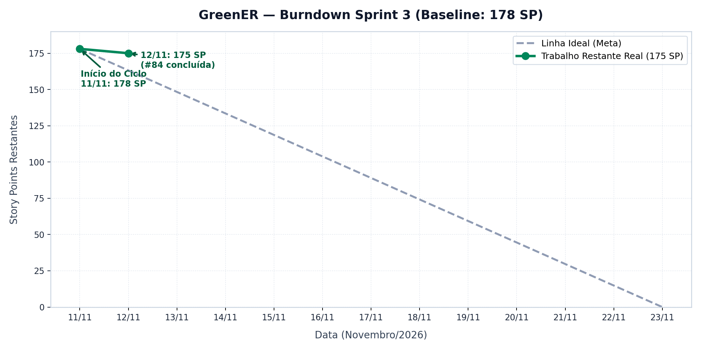

# Sprint 3 — Análises Avançadas, Usabilidade, Consolidação e Feira

**Período:** 11/11/2026 a 23/11/2026. **Tag planejada:** `sprint-3`. **Registro:** Rainan Reis (Product Owner) e Thales Cambraia (Scrum Master).

---

## 🎯 Objetivo e Capacidade

### Objetivo da Sprint
Consolidar a plataforma GreenER como uma solução completa, confiável e interativa de monitoramento e análise de impacto ambiental de software em nuvem, compreendendo:
1. **Período Compartilhado e Análises Temporais:** seletor global de período (24h, 7d, 30d, mês atual, mês anterior e personalizado) unificando dashboard, ranking, comparação e histórico;
2. **Ranking e Comparação Multi-Serviço:** ordenação por consumo (kWh) e emissão (gCO₂e) no período, e comparação lado a lado de até 5 serviços em granularidade alinhada;
3. **Visualização Geográfica e Mapa Animado:** mapa interativo Leaflet com marcadores proporcionais ao impacto, filtro por região e evolução temporal animada;
4. **Detalhe e Histórico do Serviço:** painel rápido e página individual com série histórica de consumo, emissões, componentes de potência e linha do tempo de disponibilidade;
5. **Administração Web dos Parâmetros:** interface administrativa protegida por JWT para consulta e atualização em tempo de execução dos intervalos de amostragem (`/configuracao`);
6. **Usabilidade, Acessibilidade e IHC:** execução de avaliação heurística formal (Nielsen) e testes de usabilidade com usuários reais (IHC05/IHC06), com implementação dos achados P01 a P08 e tour guiado;
7. **Qualidade Rigorosa e Pipeline CI Completo:** cobertura mínima de 80% em todos os services e repositories, testes de integração de API com banco PostgreSQL real e testes de componentes no frontend;
8. **Diferenciais de Decisão e Feira de Tecnologia:** simulador de região, equivalências de CO₂e no dia a dia, oportunidades automatizadas de redução, selo de eficiência A a F, modo TV e demonstração offline completa (`?demo=1`) para a feira (24 e 25/11).

### Capacidade Considerada
A equipe se propôs a entregar **51 itens comprometidos totalizando 178 Story Points (SP)**. O dimensionamento considerou:
- **Equipe Plena e Alinhada:** 6 integrantes com ritmo validado na Sprint 2 (100% de aproveitamento), agora atuando com responsabilidades modulares e bem delimitadas;
- **Base Técnica Amadurecida:** arquitetura em camadas estabilizada (NestJS/Prisma/PostgreSQL no backend e React/Tailwind/Vite no frontend) permitindo paralelismo em telas e endpoints;
- **Critério de Contagem e Não Duplicação:** as 8 PBIs guarda-chuva (#12, #13, #14, #83, #97, #121, #128, #137) representam agrupadores de entrega e não somam pontos diretamente ao burndown, evitando dupla contagem com suas tarefas filhas;
- **Backlog de Reserva (29 SP):** 10 itens com prioridade `could` mapeados como oportunidade de extensão caso a velocidade do time permita adiantamentos após o término dos itens obrigatórios.

---

## 📋 Itens Comprometidos (Sprint Backlog — 178 SP)

A tabela abaixo lista os 51 itens que compõem o escopo devedor da Sprint 3:

| Issue | Item | SP | Responsável | Epic | Situação |
| :---: | :--- | :---: | :--- | :--- | :---: |
| [#79](https://github.com/abpundefined/3DSM-ABP-UNDEFINED/issues/79) | [TASK] Repository para ServicosService | 5 | Pedro Gomes | #37 | Backlog |
| [#84](https://github.com/abpundefined/3DSM-ABP-UNDEFINED/issues/84) | [TASK] Periodização no backend (PeriodoDto) | 3 | Marcus Nascimento | #35 | Done |
| [#85](https://github.com/abpundefined/3DSM-ABP-UNDEFINED/issues/85) | [TASK] Navegação, rotas e biblioteca de gráficos | 2 | Nadla Ferreira | #35 | Backlog |
| [#86](https://github.com/abpundefined/3DSM-ABP-UNDEFINED/issues/86) | [TASK] Seletor de período compartilhado (frontend) | 5 | Nadla Ferreira | #35 | Backlog |
| [#88](https://github.com/abpundefined/3DSM-ABP-UNDEFINED/issues/88) | [TASK] Endpoint GET /ranking | 3 | Marcus Nascimento | #35 | Backlog |
| [#91](https://github.com/abpundefined/3DSM-ABP-UNDEFINED/issues/91) | [TASK] Página de ranking | 6 | Nadla Ferreira | #35 | Backlog |
| [#93](https://github.com/abpundefined/3DSM-ABP-UNDEFINED/issues/93) | [TASK] Endpoint GET /comparacao | 5 | Pedro Gomes | #35 | Backlog |
| [#94](https://github.com/abpundefined/3DSM-ABP-UNDEFINED/issues/94) | [TASK] Página de comparação | 6 | Thales Cambraia | #35 | Backlog |
| [#95](https://github.com/abpundefined/3DSM-ABP-UNDEFINED/issues/95) | [TASK] Endpoint GET /mapa | 5 | Israel Lemes | #35 | Backlog |
| [#96](https://github.com/abpundefined/3DSM-ABP-UNDEFINED/issues/96) | [TASK] Mapa animado no frontend | 9 | Israel Lemes | #35 | Backlog |
| [#98](https://github.com/abpundefined/3DSM-ABP-UNDEFINED/issues/98) | [TASK] Endpoint GET /servicos/:id/historico | 3 | Marcus Nascimento | #33 | Backlog |
| [#99](https://github.com/abpundefined/3DSM-ABP-UNDEFINED/issues/99) | [TASK] Página de detalhe do serviço | 7 | Rainan Reis | #33 | Backlog |
| [#80](https://github.com/abpundefined/3DSM-ABP-UNDEFINED/issues/80) | [TASK] Paginação do GET /coletas | 3 | Pedro Gomes | #33 | Backlog |
| [#78](https://github.com/abpundefined/3DSM-ABP-UNDEFINED/issues/78) | [PBI] Página de administração dos intervalos (frontend) | 5 | Nadla Ferreira | #36 | Backlog |
| [#81](https://github.com/abpundefined/3DSM-ABP-UNDEFINED/issues/81) | [PBI] Avaliação heurística e avaliação com usuários (IHC05/IHC06) | 8 | Thales Cambraia | #37 | Backlog |
| [#101](https://github.com/abpundefined/3DSM-ABP-UNDEFINED/issues/101) | [PBI-26] Melhorias de usabilidade (P01 a P08) | 8 | Thales Cambraia | #37 | Backlog |
| [#103](https://github.com/abpundefined/3DSM-ABP-UNDEFINED/issues/103) | [TASK] Cobertura de 80% em todos os services e repositories | 3 | Marcus Nascimento | #37 | Backlog |
| [#104](https://github.com/abpundefined/3DSM-ABP-UNDEFINED/issues/104) | [TASK] Testes E2E de API com PostgreSQL no CI | 5 | Israel Lemes | #37 | Backlog |
| [#105](https://github.com/abpundefined/3DSM-ABP-UNDEFINED/issues/105) | [TASK] Testes de componentes do frontend | 5 | Pedro Gomes | #37 | Backlog |
| [#106](https://github.com/abpundefined/3DSM-ABP-UNDEFINED/issues/106) | [TASK] CI completo | 5 | Marcus Nascimento | #32 | Backlog |
| [#21](https://github.com/abpundefined/3DSM-ABP-UNDEFINED/issues/21) | [PBI-21] Documentação técnica | 5 | Rainan Reis | #37 | Backlog |
| [#108](https://github.com/abpundefined/3DSM-ABP-UNDEFINED/issues/108) | [TASK] Planejamento e burndown da Sprint 3 | 2 | Rainan Reis | #37 | Backlog |
| [#109](https://github.com/abpundefined/3DSM-ABP-UNDEFINED/issues/109) | [TASK] Roteiro e vídeo da apresentação da Sprint 3 | 3 | Rainan Reis | #37 | Backlog |
| [#110](https://github.com/abpundefined/3DSM-ABP-UNDEFINED/issues/110) | [TASK] Endpoint GET /indicadores/serie | 2 | Marcus Nascimento | #34 | Backlog |
| [#111](https://github.com/abpundefined/3DSM-ABP-UNDEFINED/issues/111) | [TASK] Tendência no dashboard | 4 | Nadla Ferreira | #34 | Backlog |
| [#114](https://github.com/abpundefined/3DSM-ABP-UNDEFINED/issues/114) | [PBI-27] Variação em relação ao período anterior | 4 | Pedro Gomes | #35 | Backlog |
| [#115](https://github.com/abpundefined/3DSM-ABP-UNDEFINED/issues/115) | [PBI-28] Simulador "e se mudasse de região?" | 3 | Israel Lemes | #35 | Backlog |
| [#116](https://github.com/abpundefined/3DSM-ABP-UNDEFINED/issues/116) | [PBI-29] Equivalências do CO₂e | 1 | Rainan Reis | #34 | Backlog |
| [#117](https://github.com/abpundefined/3DSM-ABP-UNDEFINED/issues/117) | [PBI-30] Página "Como calculamos" | 2 | Rainan Reis | #37 | Backlog |
| [#118](https://github.com/abpundefined/3DSM-ABP-UNDEFINED/issues/118) | [PBI-31] Exportar relatório CSV do período | 2 | Marcus Nascimento | #35 | Backlog |
| [#119](https://github.com/abpundefined/3DSM-ABP-UNDEFINED/issues/119) | [PBI-33] Oportunidades de redução de emissão | 5 | Pedro Gomes | #35 | Backlog |
| [#120](https://github.com/abpundefined/3DSM-ABP-UNDEFINED/issues/120) | [PBI-34] Selo de eficiência A a F | 3 | Marcus Nascimento | #34 | Backlog |
| [#122](https://github.com/abpundefined/3DSM-ABP-UNDEFINED/issues/122) | [TASK] Endpoint GET /intensidade/horarios | 2 | Marcus Nascimento | #35 | Backlog |
| [#123](https://github.com/abpundefined/3DSM-ABP-UNDEFINED/issues/123) | [TASK] Mapa de calor do melhor horário | 3 | Israel Lemes | #35 | Backlog |
| [#124](https://github.com/abpundefined/3DSM-ABP-UNDEFINED/issues/124) | [PBI-36] Linha do tempo de estado e disponibilidade | 3 | Rainan Reis | #33 | Backlog |
| [#125](https://github.com/abpundefined/3DSM-ABP-UNDEFINED/issues/125) | [PBI-37] Corrida de barras do ranking | 3 | Nadla Ferreira | #35 | Backlog |
| [#126](https://github.com/abpundefined/3DSM-ABP-UNDEFINED/issues/126) | [PBI-38] Treemap de participação nas emissões | 2 | Nadla Ferreira | #35 | Backlog |
| [#127](https://github.com/abpundefined/3DSM-ABP-UNDEFINED/issues/127) | [PBI-39] Picos incomuns marcados nos gráficos | 3 | Thales Cambraia | #34 | Backlog |
| [#129](https://github.com/abpundefined/3DSM-ABP-UNDEFINED/issues/129) | [TASK] Meta de carbono no backend | 2 | Marcus Nascimento | #36 | Backlog |
| [#130](https://github.com/abpundefined/3DSM-ABP-UNDEFINED/issues/130) | [TASK] Projeção e meta no frontend | 3 | Pedro Gomes | #36 | Backlog |
| [#131](https://github.com/abpundefined/3DSM-ABP-UNDEFINED/issues/131) | [PBI-41] Contadores animados e transições de ordem | 1 | Thales Cambraia | #34 | Backlog |
| [#133](https://github.com/abpundefined/3DSM-ABP-UNDEFINED/issues/133) | [PBI-42] Relatório do período (imprimir ou salvar PDF) | 3 | Rainan Reis | #35 | Backlog |
| [#135](https://github.com/abpundefined/3DSM-ABP-UNDEFINED/issues/135) | [PBI-43] Saúde das integrações (administração) | 3 | Israel Lemes | #36 | Backlog |
| [#136](https://github.com/abpundefined/3DSM-ABP-UNDEFINED/issues/136) | [PBI-44] Modo TV para tela de monitoramento | 2 | Nadla Ferreira | #34 | Backlog |
| [#139](https://github.com/abpundefined/3DSM-ABP-UNDEFINED/issues/139) | [TASK] Composição da energia no backend | 1 | Marcus Nascimento | #34 | Backlog |
| [#140](https://github.com/abpundefined/3DSM-ABP-UNDEFINED/issues/140) | [TASK] Gráfico de composição da energia | 2 | Rainan Reis | #34 | Backlog |
| [#141](https://github.com/abpundefined/3DSM-ABP-UNDEFINED/issues/141) | [PBI-47] Tour guiado | 2 | Thales Cambraia | #37 | Backlog |
| [#142](https://github.com/abpundefined/3DSM-ABP-UNDEFINED/issues/142) | [TASK] Demonstração offline completa (?demo=1) | 2 | Israel Lemes | #37 | Backlog |
| [#143](https://github.com/abpundefined/3DSM-ABP-UNDEFINED/issues/143) | [PBI-50] Contador ao vivo de CO₂e | 1 | Nadla Ferreira | #34 | Backlog |
| [#145](https://github.com/abpundefined/3DSM-ABP-UNDEFINED/issues/145) | [TASK] Demonstração online e QR code | 2 | Rainan Reis | #32 | Backlog |
| [#146](https://github.com/abpundefined/3DSM-ABP-UNDEFINED/issues/146) | [PBI-51] Transições entre telas e carregamento com brilho | 1 | Thales Cambraia | #34 | Backlog |

- **Total de Itens Comprometidos:** 51 itens
- **Total de Story Points Comprometidos:** 178 SP
- **Story Points Restantes em 11/11:** 178 SP

---

## 🧩 PBIs Guarda-Chuva (Decompostas em Tarefas)

Estes itens definem os épicos e histórias do usuário principais e tiveram seus pontos decompostos em tarefas técnicas para execução e acompanhamento detalhado:

| Issue | PBI Guarda-Chuva | Responsável | Epic | Tarefas Filhas Vinculadas |
| :---: | :--- | :---: | :--- | :--- |
| [#83](https://github.com/abpundefined/3DSM-ABP-UNDEFINED/issues/83) | [PBI-24] Periodização das análises | — | #35 | Conferir descrição da issue |
| [#13](https://github.com/abpundefined/3DSM-ABP-UNDEFINED/issues/13) | [PBI-13] Ranking de impacto ambiental | — | #35 | Conferir descrição da issue |
| [#14](https://github.com/abpundefined/3DSM-ABP-UNDEFINED/issues/14) | [PBI-14] Comparação entre serviços | — | #35 | Conferir descrição da issue |
| [#12](https://github.com/abpundefined/3DSM-ABP-UNDEFINED/issues/12) | [PBI-12] Mapa interativo e animado | — | #35 | Conferir descrição da issue |
| [#97](https://github.com/abpundefined/3DSM-ABP-UNDEFINED/issues/97) | [PBI-25] Histórico e detalhe do serviço | — | #33 | Conferir descrição da issue |
| [#121](https://github.com/abpundefined/3DSM-ABP-UNDEFINED/issues/121) | [PBI-35] Melhor horário para rodar cargas pesadas | — | #35 | Conferir descrição da issue |
| [#128](https://github.com/abpundefined/3DSM-ABP-UNDEFINED/issues/128) | [PBI-40] Projeção e meta mensal de carbono | — | #36 | Conferir descrição da issue |
| [#137](https://github.com/abpundefined/3DSM-ABP-UNDEFINED/issues/137) | [PBI-46] Composição da energia por componente | — | #34 | Conferir descrição da issue |

---

## 📦 Backlog de Reserva e Opcionais (Fora do Burndown Inicial)

Itens com prioridade `could`, destinados a enriquecer o produto e a apresentação na feira, que só serão iniciados após a conclusão integral dos compromissos da sprint:

| Issue | Item de Reserva / Opcional | SP | Prioridade | Epic |
| :---: | :--- | :---: | :---: | :---: |
| [#107](https://github.com/abpundefined/3DSM-ABP-UNDEFINED/issues/107) | [TASK] Análise estática com SonarCloud | 2 | could (reserva) | #32 |
| [#147](https://github.com/abpundefined/3DSM-ABP-UNDEFINED/issues/147) | [PBI-45] Atualização em tempo real com SSE | 5 | could (reserva) | #34 |
| [#148](https://github.com/abpundefined/3DSM-ABP-UNDEFINED/issues/148) | [PBI-32] Alertas de limite de emissão por serviço | 5 | could (reserva) | #35 |
| [#149](https://github.com/abpundefined/3DSM-ABP-UNDEFINED/issues/149) | [TASK] Gráfico de intensidade de carbono por região | 2 | could (reserva) | #35 |
| [#150](https://github.com/abpundefined/3DSM-ABP-UNDEFINED/issues/150) | [TASK] Anel de CPU no card do serviço | 1 | could (reserva) | #34 |
| [#151](https://github.com/abpundefined/3DSM-ABP-UNDEFINED/issues/151) | [PBI-48] "Agrupar por" no ranking | 2 | could (reserva) | #35 |
| [#152](https://github.com/abpundefined/3DSM-ABP-UNDEFINED/issues/152) | [PBI-49] Enviar feedback dentro do app | 2 | could (reserva) | #37 |
| [#153](https://github.com/abpundefined/3DSM-ABP-UNDEFINED/issues/153) | [PBI-52] Planeta que reage à meta de carbono | 2 | could (reserva) | #34 |
| [#154](https://github.com/abpundefined/3DSM-ABP-UNDEFINED/issues/154) | [PBI-53] Arrastar o serviço para outra região no mapa | 3 | could (reserva) | #35 |
| [#155](https://github.com/abpundefined/3DSM-ABP-UNDEFINED/issues/155) | [PBI-54] Globo 3D no modo TV | 5 | could (reserva) | #35 |

- **Total de Itens de Reserva:** 10 itens (29 SP)

---

## 📉 Burndown da Sprint 3

O acompanhamento diário da queima de Story Points inicia-se em **11/11/2026** com **178 SP**.

### Regras de Processo e Fechamento
1. **Fluxo Contínuo de PRs:** submeter PRs pequenos e contínuos logo após a conclusão das tarefas, evitando acúmulo no final do ciclo;
2. **Critérios de Qualidade (DoD):** todo PR deve conter testes unitários/E2E com cobertura, passar nos jobs de lint/typecheck/build no GitHub Actions e receber aprovação de ao menos um revisor;
3. **Baixa de Pontos:** exclusivamente após o merge na `develop` e o fechamento da issue correspondente no GitHub.
